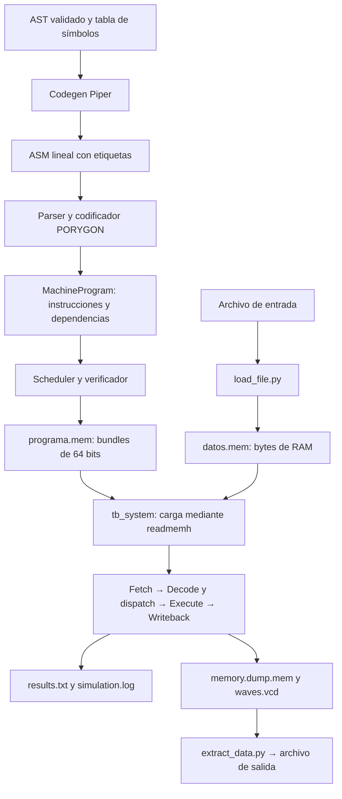

# Integración del compilador Piper con PORYGON

## 1. Objetivo y alcance

Este documento describe el contrato de interfaz entre el compilador
**PIPER-COMPILER (CE1108)** y el procesador **PORYGON (CE4301)**: qué entrega
el codegen, cómo se transforma en bundles VLIW y cómo se carga, ejecuta y
verifica en el procesador. El contrato corresponde a la implementación
disponible en ambos repositorios; la validación se realiza por simulación.

La [ISA](isa.md) detalla la codificación de instrucciones y la
[guía de simulación](simulation.md) describe el entorno de ejecución.
Aquí se fijan las condiciones que deben cumplir ambos equipos para integrarse.

## 2. Flujo de datos y responsabilidades



| Etapa / responsable | Entrada → salida | Garantía exigida |
| --- | --- | --- |
| Codegen / CE1108 | AST y símbolos → `.asm` lineal | Tipos y direcciones coherentes; convención de llamadas; expansión de intrínsecas y comprobaciones de ejecución. |
| Ensamblador / CE1108 | ASM → `MachineProgram` | Operandos y codificaciones válidos; identifica lecturas, escrituras, unidad funcional y efectos sobre memoria y bóveda. |
| Scheduler / CE1108 | `MachineProgram` → bundles | Respeta dependencias, latencias, recursos, inmediatos y espacios después de saltos; resuelve etiquetas al fijar el calendario. |
| Sistema / CE4301 | `.mem` de instrucciones y datos opcionales → ejecución | Interpreta el formato acordado, ejecuta las unidades y expone resultados y eventos de error. |
| Validación de integración | Resultados → comparación con valores esperados | Comprueba terminación, registros, memoria relevante y ausencia de errores inesperados. |

El ensamblador y scheduler usados en esta integración están en
`PIPER-COMPILER/porygon_assembler/` y `PIPER-COMPILER/scheduler/`.

## 3. Contrato de salida del compilador

### 3.1 Artefactos

| Artefacto | Contenido | Consumidor |
| --- | --- | --- |
| `.asm` | Una instrucción por línea, registros `r0`–`r7` y etiquetas simbólicas; todavía sin distribuir en slots. | Parser del ensamblador. |
| `.bundles` | Calendario legible con bundles, slots, literales y etiquetas. | Inspección y depuración. |
| `.mem` de instrucciones | Una palabra hexadecimal de 16 dígitos por bundle de 64 bits, sin cabecera binaria. | `$readmemh` de la memoria de instrucciones. |
| `.bin` | Contenedor versión 1: cabecera de 32 bytes y bundles serializados en little endian; actualmente sin datos inicializados embebidos. | Herramientas del compilador; el simulador no lo carga directamente. |
| `.mem` de datos, opcional | Bytes hexadecimales de 8 bits y directivas `@` relativas al inicio del arreglo de RAM. | `$readmemh` de la memoria de datos. |

La línea `n` del `.mem` de instrucciones, contando desde cero, corresponde
al PC `8n`. El empaquetado es:

```text
bits     [63:48]   [47:32]   [31:16]   [15:0]
         slot 3    slot 2    slot 1    slot 0
bundle = slot0 | (slot1 << 16) | (slot2 << 32) | (slot3 << 48)
```

### 3.2 Reglas de calendarización

- Cada bundle tiene **cuatro slots de 16 bits**. Los slots son flexibles:
  el opcode y, para MATH, el bit `pipe` seleccionan la unidad funcional.
- Puede emitirse como máximo una operación por unidad y bundle: ALU0,
  ALU1, LOST, BRUH y CRYPTO, siempre dentro de los cuatro slots disponibles.
- Una instrucción con inmediato consume **dos slots contiguos del mismo
  bundle**. El segundo contiene un literal de 16 bits y no se despacha como
  instrucción. CRYPTO no consume literal y mantiene su bit reservado en cero.
- El relleno usa exclusivamente `NOP = 0x0000`.
- El scheduler debe preservar dependencias RAW, WAR y WAW, el orden de los
  accesos a memoria y las operaciones sobre el estado criptográfico.
- Para una emisión en el ciclo `t`, los resultados rápidos llegan al banco
  en `t+2`; `mul`/`mulh`, en `t+4`. Un consumidor puede leerlos desde
  **`t+3` y `t+5`**, respectivamente. También deben evitarse colisiones
  con el canal de escritura compartido de ALU1.
- El hardware no resuelve estas dependencias mediante forwarding o stalls
  automáticos. El compilador inserta la separación necesaria y verifica
  el calendario antes de emitirlo.

### 3.3 Saltos y terminación

Los saltos relativos usan un desplazamiento con signo **en bundles**, medido
desde el bundle del salto:

```text
offset = bundle_destino - bundle_salto
PC_destino = PC_salto + 8 × offset
```

El scheduler resuelve las etiquetas después de distribuir las instrucciones.
Los saltos directos con etiqueta se representan internamente en forma larga,
con literal de 16 bits. `jr` recibe una dirección absoluta en bytes, alineada
a ocho. Después de cada salto se reservan **dos bundles NOP**, porque el
pipeline no hace flush de los bundles recientes.

No existe una instrucción `halt` en el procesador: el codegen emite un salto a su propia etiqueta. `tb_system` detecta ese salto tomado y termina la simulación, el halt es impementado por software.

## 4. Contratos del codegen

### 4.1 Entrada y convención de llamadas

El codegen recibe un AST aprobado por el análisis semántico y una tabla de
símbolos con tipos, dimensiones, direcciones y tamaños de frame.
El programa debe declarar una rutina global `main[]` sin parámetros.
Desde PC cero se inicializa `r7`, se ejecutan las sentencias globales que
correspondan y se transfiere el control a `main`.

| Registro | Convención de Piper |
| --- | --- |
| `r0` | Cero constante; el hardware ignora las escrituras. |
| `r1` | Primer argumento y valor de retorno. |
| `r2`–`r4` | Argumentos segundo a cuarto. |
| `r5`–`r6` | Temporales; `r6` también transporta el identificador de continuación al retornar. |
| `r7` | Base del frame actual; inicialmente `0x20000`, límite superior exclusivo de la pila. |

Las rutinas admiten hasta **32 argumentos**: los cuatro primeros viajan en
registros y los restantes en pila, en ranuras de cuatro bytes. Los arreglos
se pasan por dirección. El llamador conserva `r1`–`r6` y recupera el resultado
sin perder sus valores previos.

El registro de llamada ocupa 32 bytes: identificador de continuación en
`+0`, registros `r1`–`r6` en `+4`–`+24` y resultado temporal en `+28`.
Los argumentos adicionales empiezan en `+32`. El retorno se implementa con
un despachador de identificadores y saltos; no requiere una instrucción
hardware de llamada. El identificador cero representa el retorno de `main`.
Una terminación normal restaura `r7 = 0x20000` y deja el resultado en `r1`.

### 4.2 Memoria y representación de datos

| Región | Direcciones inclusivas | Uso |
| --- | --- | --- |
| Texto | `0x00000000`–`0x0000FFFF` | Hasta 8192 bundles; PC inicial cero. |
| Globales Piper | `0x00010000`–`0x0001EFFF` | Hasta 61 440 bytes compartidos con los archivos externos que se carguen. |
| Pila Piper | `0x0001F000`–`0x0001FFFF` | 4096 bytes; crece hacia direcciones menores. |

- Los GPR y las direcciones tienen 32 bits. La RAM usa **little endian**.
- `B8`/`uB8`, `B16`/`uB16` y `B32`/`uB32` ocupan 1, 2 y 4 bytes,
  respectivamente, con alineación natural. Las cargas con o sin signo
  seleccionan la extensión correspondiente; las palabras requieren alineación a cuatro bytes.
- Los arreglos son contiguos y las matrices se almacenan por filas:
  `dirección(f,c) = base + (f × columnas + c) × bytes_por_elemento`.
  Los índices empiezan en cero.
- El codegen comprueba índices y disponibilidad de pila. Operaciones como
  división, módulo y potencia se expanden en secuencias de instrucciones
  existentes; no suponen unidades hardware adicionales.
- Una imagen de datos externa debe respetar las direcciones de la tabla de
  símbolos y evitar solapamientos. El compilador no conoce el contenido del
  archivo cargado; las asignaciones del programa pueden sobrescribirlo.

### 4.3 Intrínsecas criptográficas

Son nombres reservados, validados por la semántica y expandidos directamente
por `src/codegen/codegen_crypto.c`. Todas tienen tipo **void**: se usan como
sentencias y no devuelven un indicador de éxito.

| Llamada Piper | Contrato de argumentos | ASM generado / efecto |
| --- | --- | --- |
| `crypto_auth[p0, p1, p2, p3].` | Cuatro expresiones enteras; palabras de credencial de menor a mayor significancia. | Evalúa cada palabra en `r1`, emite `lopw r1, 0` hasta `lopw r1, 3` y finalmente `auth`. |
| `crypto_write_key[dato, subllave, llave].` | Dato entero de 32 bits; ambos índices deben ser literales entre 0 y 3. | Evalúa el dato en `r1`; emite `write r1, subllave, llave`. Requiere sesión autenticada. |
| `crypto_feistel[bloque, ronda, llave].` | Identificador de un arreglo modificable exactamente `B32\|2\|`; índices literales entre 0 y 3. | Carga L y R desde el arreglo, ejecuta **una ronda** y escribe ambas mitades en el mismo arreglo. Requiere autenticación. |
| `crypto_revoke[].` | Sin argumentos. | Emite `rvk`; cierra la sesión. |

Para Feistel, `r3` contiene la dirección base; el bloque ocupa ocho bytes:
L en `base+0` y R en `base+4`. La expansión esencial es:

```asm
lowi r1, 0(r3)
lowi r2, 4(r3)
feistel r1, r2, ronda, llave
stwi r1, 0(r3)
stwi r2, 4(r3)
```

`ronda` y `llave` representan aquí los literales sustituidos por el codegen.
El scheduler debe registrar que `feistel` lee **y escribe dos registros**.
Una llamada no realiza el cifrado completo: el programa emite las rondas
0, 1, 2 y 3. Cada ronda implementa, con aritmética de 32 bits:

```text
F(R,k) = ((ROL32(R,5) + k) mod 2^32) XOR ROL32(R,13)
L' = R
R' = L XOR F(R,k)
```

La bóveda contiene cuatro llaves de cuatro subllaves cada una. `lopw` con
índice cero inicia una credencial nueva; `auth` exige las cuatro palabras y
limpia el buffer tras el intento. Las subllaves permanecen dentro de la bóveda.
El reset las pone en cero y restaura la contraseña de simulación
`0x146317BBDA48DB07A9A67018DFF0F76A`.

La sesión expira tras **32 ciclos** de inactividad en el RTL por defecto;
una operación protegida aceptada recarga el temporizador. El programa debe
autenticar de nuevo cuando la separación entre operaciones lo requiera,
considerando también los NOPs insertados. El scheduler conserva el orden del
estado criptográfico, pero no inserta reautenticación.

La instrucción `pwd` existe en la ISA y el RTL, pero **no tiene intrínseca
Piper** en esta versión. Un fallo de autenticación se observa mediante los
eventos del simulador; estas llamadas no producen un booleano en Piper.

## 5. Carga, ejecución y observación

1. `pipoc mem` genera la imagen de instrucciones calendarizada y verificada.
2. Opcionalmente, `load_file.py` convierte un archivo en una imagen de datos
   de ocho bits por posición. El índice cero de esa imagen corresponde a
   la dirección física `0x10000`: `@00000020` carga desde `0x10020`.
3. `sim.sh` construye el sistema y entrega las imágenes a `tb_system`.
   El testbench las carga con `$readmemh` y aplica el reset.
4. Fetch obtiene un bundle; decode separa instrucciones y literales y lee
   operandos; execute activa las unidades; writeback actualiza los GPR.
   LOST accede a RAM y BRUH actualiza el PC.
5. El salto a sí mismo termina la ejecución; si no ocurre, el watchdog
   detiene la simulación (100 000 ciclos por defecto).

| Evidencia generada | Qué permite verificar |
| --- | --- |
| `results.txt` | Ciclos, `halted`, `halt_pc`, `timeout`, estado de autenticación, eventos y GPR finales. |
| `simulation.log` | Resumen de ejecución y diagnósticos. |
| `memory.dump.mem` | Bytes finales de toda la RAM; no incluye GPR ni instrucciones. |
| `waves.vcd` | Evolución temporal de señales para depuración. |

Los resultados aritméticos se ven en GPR; para aparecer en el volcado deben
almacenarse en RAM. `extract_data.py` recupera un rango por dirección física
y longitud. Si el loader añadió relleno para completar bloques de ocho bytes,
se usa la longitud original al extraer el archivo.

## 6. Evidencia de validación: factorial

### 6.1 Objetivo de la prueba

La validación recorre el flujo completo con un único programa:
`factorial.rwt`. Su rutina `main[]` llama a `factorial[5]`, que calcula
`5!` mediante variables locales, un ciclo y multiplicaciones, y devuelve
**120**. Así se comprueban generación de código, ensamblado,
calendarización, carga del `.mem`, ejecución y retorno del resultado.

El fuente de referencia está en
`PIPER-COMPILER/tests/codegen/factorial.rwt`. Para seguir los comandos de
esta sección se copia a `PIPER-COMPILER/programas/factorial.rwt`.
Las rutas `/ruta/al/workspace/` se sustituyen por la ubicación local de
cada repositorio.

### 6.2 Compilación en Piper

Desde la raíz de PIPER-COMPILER:

```sh
cd /ruta/al/workspace/PIPER-COMPILER
make all
mkdir -p programas
cp tests/codegen/factorial.rwt programas/factorial.rwt

./bin/pipoc programas/factorial.rwt \
  --emit-mem programas/factorial.mem \
  -s -v -t -m -p
```

| Opción | Función en la validación |
| --- | --- |
| `--emit-mem programas/factorial.mem` | Guarda los bundles calendarizados en la imagen que cargará PORYGON. |
| `-s` | Conserva el ASM intermedio en `programas/factorial.asm`. |
| `-v` | Muestra las fases de compilación y sus diagnósticos. |
| `-t` | Imprime el AST para inspeccionar la estructura del programa. |
| `-m` | Imprime la tabla de símbolos y la distribución de memoria. |
| `-p` | Imprime los paquetes calendarizados en representación numérica y con mnemónicos. |

Esta invocación también genera el contenedor `programas/factorial.bin`.
El archivo que se entrega al simulador es **`factorial.mem`**.
El flujo realizado es:

```text
factorial.rwt → AST y símbolos → ASM lineal → MachineProgram
              → scheduler y verificador → factorial.mem
```

### 6.3 Ejecución en PORYGON

Desde la raíz del procesador:

```sh
cd /ruta/al/workspace/PORYGON
make sim \
  PROG=/ruta/al/workspace/PIPER-COMPILER/programas/factorial.mem \
  MAX_CYCLES=1000
```

`PROG` indica la imagen de instrucciones generada por Piper. `make sim`
construye el simulador, carga esa imagen mediante `$readmemh`, aplica el
reset y ejecuta el sistema completo hasta detectar el salto de terminación.
No se necesita una imagen `DATA`: el programa inicializa sus variables y
recibe el argumento 5 desde `main`.

La variable reconocida por el `Makefile` es **`MAX_CYCLES`**; `CYCLES=200`
no configura el watchdog. Se usa un límite de 1000 porque esta prueba
necesita **625 ciclos**. Un límite efectivo de 200 produciría un timeout
antes de obtener el resultado.

### 6.4 Resultados y archivos de evidencia

En la ejecución local se usó una
carpeta temporal para el fuente y las salidas del compilador; los comandos
anteriores usan `programas/` para reproducir el mismo flujo.

Revisiones de referencia de la implementación:

- PIPER-COMPILER: `fd956ad9bd47d19f817ea1a571ff0c22578bc454`.
- PORYGON: `4e1a1aee1ebd3eeee79c8f8856f4bd761043b2d4`.

El resumen de registros y eventos se conserva en
[factorial.results.txt](evidence/compiler-integration/factorial.results.txt).

| Indicador | Esperado | Observado |
| --- | --- | --- |
| Resultado en `r1` | `5! = 120` | `0x00000078` = 120 |
| Pila al finalizar, `r7` | `0x00020000` | `0x00020000` |
| Terminación, `halted` | 1 | 1 |
| Watchdog, `timeout` | 0 | 0 |
| Eventos de error, `errors` | 0 | 0 |
| Ciclos ejecutados | Menos de 1000 | 625 |
| PC de terminación, `halt_pc` | Final normal generado para esta imagen | `0x000006D8` |

La ejecución genera los siguientes archivos en
`PORYGON/sim_output/factorial/`:

| Archivo | Uso en esta prueba |
| --- | --- |
| `results.txt` | Comprobar `r1=120`, restauración de pila, terminación y contadores de error. |
| `simulation.log` | Consultar el resumen de ejecución y los diagnósticos del simulador. |
| `memory.dump.mem` | Inspeccionar la RAM final, incluidas las ranuras de pila utilizadas. |
| `waves.vcd` | Seguir instrucciones, operandos y escrituras durante la ejecución. |

El resultado de `main` queda en **`r1`**; no se espera un archivo de salida
ni una variable global en `0x10000`. Para esta prueba se verifica el valor
final del registro, junto con el estado de terminación y los errores.

### 6.5 Criterio de aceptación y alcance

La prueba pasa si `r1=120`, `r7=0x20000`, `halted=1`, `timeout=0` y
`errors=0`. Estos valores se comprobaron en el archivo de resultados.
`make sim` informa una ejecución completada sin errores, pero no compara
por sí mismo el factorial esperado; esa comparación se realiza contra
`results.txt`.

La evidencia valida el flujo integrado de factorial: llamada, paso de
parámetro, variables locales, ciclo, multiplicación y retorno. No demuestra
cobertura completa de la ISA, matrices, intrínsecas criptográficas ni carga
de archivos externos. Tampoco constituye un acta de aprobación formal de
los grupos.

Los caminos de error del codegen también usan saltos a sí mismos; por eso
`halted=1` por separado no demuestra éxito. Para esta imagen se verifican
el resultado esperado y el final normal en `halt_pc=0x000006D8`.
Cambios en el codegen o en el calendario pueden modificar esa dirección y
el número de ciclos, por lo que deben regenerarse las evidencias.
