# `cache_l2.md` — versión actualizada

Mantengo el formato, el tono y la estructura de secciones. Los cambios principales son: añadir `l2_admit_arb` como módulo, actualizar la tabla de requisitos (Fallo 1, 2, 3 y antigüedad de admisión), ajustar la sección del top (ya no tiene la lógica de antigüedad inline), añadir la cola de `get_done` en `l2_perf`, y actualizar los diagramas afectados.

```markdown
# Arquitectura de L2: módulos, conexiones y cómo resuelven P2-07 y P2-08

Guía de lectura del RTL de `rtl/memory/cache_l2`. Cada módulo se explica con cuatro cosas: qué hace, cómo contribuye a los issues, con quién se conecta y un diagrama de su estructura.

## 1. Visión general

L2 es exclusiva (una línea válida vive en L1 o en L2), de 16 KiB, con 4 vías, 128 conjuntos, líneas de 32 bytes, write-back y tree-PLRU. Puede tener en vuelo hasta `L2_MAX_INFLIGHT` operaciones (1 a 4). Entran dos tipos de solicitud: una demanda de L1 (`get`) y una instalación del write buffer (`install`). Salen cuatro canales (`fill` hacia L1, `wb_done` hacia el WB, `eb_push` hacia el eviction buffer y `mem_rd_req` hacia memoria) y L2 observa el retorno directo de memoria (`mem_rd_rsp`).

La idea central: el top cablea y decide la admisión; `l2_admit_arb` resuelve el desempate entre get e install respetando la antigüedad de espera. Cada operación aceptada ocupa una posición de la tabla `l2_op_table` y avanza por estados. Cada canal de salida tiene su propia unidad, que arbitra entre las operaciones que lo piden (gana la más antigua) y aplica los efectos en el flanco del handshake.

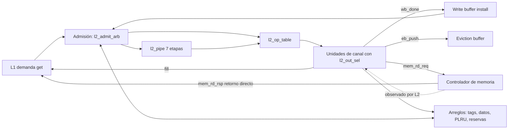

## 2. Qué pieza resuelve cada requisito

| Requisito | Dónde se resuelve |
| --- | --- |
| P2-07: usar vía inválida antes de desalojar | `l2_way_select` |
| P2-07: víctima tree-PLRU conservada mientras espera; uso actualizado una vez | `l2_plru` (touch solo al escribir, en `l2_install_unit`), `l2_way_resv` + `l2_way_select` (si la vía PLRU está reservada, la instalación espera), vía fijada en `l2_op_table` al aceptar |
| P2-07: WB conserva base, datos y dirty; confirmación solo tras instalar | `l2_op_table` guarda todo; `l2_done_unit` ofrece desde `ST_DONE`, estado posterior a `ST_WRITE` |
| P2-07: hit con L1 sin aceptar conserva línea, dirty y vía; invalida al aceptar | `l2_op_table` + `l2_way_resv` + `l2_fill_unit` |
| P2-07: víctima limpia sin escritura a EB | transición `PIPE` a `WRITE` en `l2_op_table`; métrica `clean_discard` |
| P2-07: víctima sucia retenida si EB no acepta; vía reutilizable al aceptar | `ST_EBOFF` + `l2_evict_unit` (oferta estable) |
| P2-07: miss entrega solo a L1, sin copia en L2 | `l2_mem_unit` solo observa la respuesta |
| P2-07: reset cancela líneas, reservas y resultados | reset asíncrono en todo el estado; salidas anuladas con `rst_ni` |
| P2-08: id y posición del límite compartido; WB sin aceptar no consume | `free_any` de `l2_op_table` y reglas de admisión del top |
| P2-08: límite `L2_MAX_INFLIGHT` entre 1 y 4 | parámetro `N` de la tabla y de todas las unidades |
| P2-08: posición ocupada hasta el handshake | estados de la tabla y eventos `ev_*` |
| P2-08: A espera memoria y B avanza | un estado por operación; `skip_q` en `l2_mem_unit` |
| P2-08: misma línea o vía, la segunda espera | `conflict_a/b` de la tabla y reservas de vía |
| P2-08: la más antigua que pueda avanzar; drenado en empate | matriz `older` + `l2_out_sel`; `l2_admit_arb` para la cola de admisión |
| P2-08: resultado detenido conserva datos, efectos una vez | datos en la tabla; lock de `l2_out_sel`; `first_sel` en `l2_install_unit` |
| P2-08: ocho ciclos adicionales; id libre al ver el handshake de retorno | `l2_pipe` y `ev_rsp` de `l2_mem_unit` |
| Fallo 1: antigüedad de espera en la admisión | `l2_admit_arb` (get/install pendientes + `get_first_q`) |
| Fallo 2: lookup solo para demandas; installs aparte | `l2_perf` filtra `lookup` con `!lookup_is_write_i`; expone `install_lookup_o`/`install_lookup_hit_o` |
| Fallo 3: get_done en hit y miss | `l2_perf` une `fill_hs_i` y `rsp_done_i` con una cola `gd_q` |

## 3. Módulos

### 3.1 cache\_l2 (top)

**Qué hace.** Instancia todos los módulos, decodifica la dirección (5 bits de offset, 7 de conjunto, el resto es tag) y decide la admisión. Hace el lookup de la demanda sobre la fila A de los arreglos y el de la instalación sobre la fila B. Delega el desempate entre get e install en `l2_admit_arb`.

Al aceptar: el id es la posición libre (`alloc_idx`), se reserva la vía (siempre para install; para get solo si hay hit), se escribe la operación en la tabla y se lanza el pipeline. Para un install se calcula también la víctima (línea válida de la vía elegida, con su base reconstruida desde el tag) y el dirty final (`wb_dirty` o el dirty previo si había hit).

**Con quién se conecta.** Las lecturas de datos se reparten así: `rd0` la fija `l2_fill_unit` y `rd1` la fija `l2_evict_unit`. La escritura (tag y dato) la genera `l2_install_unit`; la invalidación, `l2_fill_unit`; el touch de PLRU, `l2_install_unit`. Las reservas se liberan por `l2_fill_unit` (clr0) y `l2_install_unit` (clr1). Los eventos `ev_*` de las cinco unidades vuelven a la tabla, y la tabla entrega `req_*` y `older` a las unidades. `l2_perf` recibe las señales de aceptación, handshakes, lookup, ocupación y esperas.

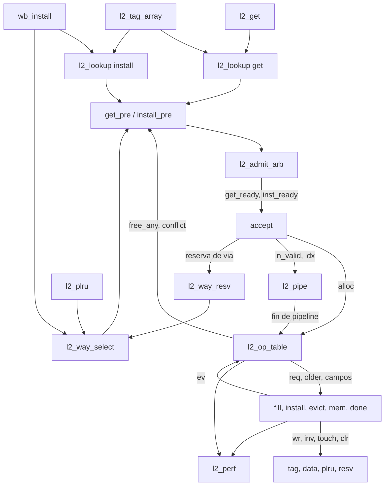

### 3.2 l2\_tag\_array

**Qué hace.** Guarda tag, valid y dirty por cada pareja (conjunto, vía). Tiene dos puertos de lectura combinacionales que devuelven la fila completa del conjunto (las 4 vías en paralelo), un puerto de escritura de instalación (valid=1) y uno de invalidación (valid=0, dirty=0). El reset asíncrono deja todo inválido.

**Aporte a los issues.** La invalidación es lo que hace exclusiva a L2: se activa al aceptar L1 un fill. El reset deja sin líneas válidas.

**Conexiones.** Puerto A lo consulta el lookup de la demanda y puerto B el de la instalación y el selector de vía. Escribe `l2_install_unit`; invalida `l2_fill_unit`.

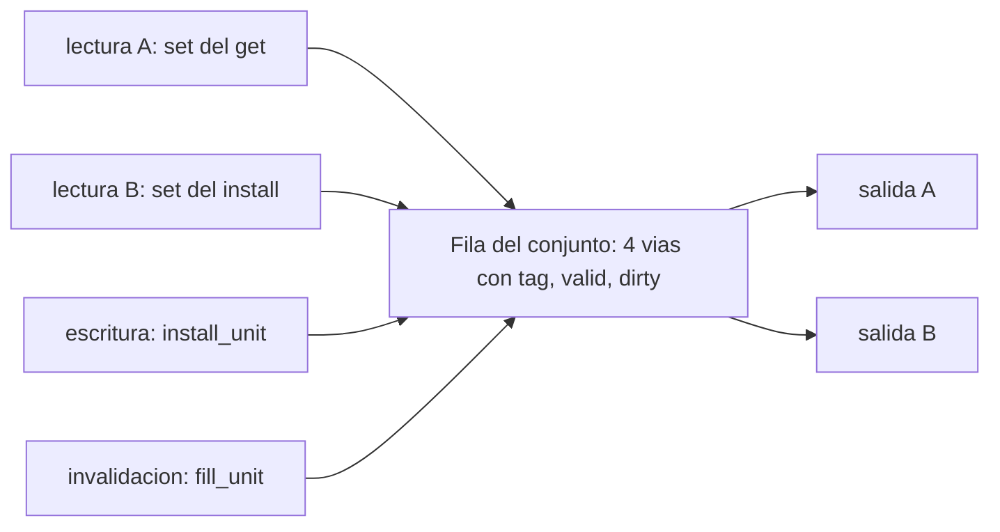

### 3.3 l2\_data\_array

**Qué hace.** Una línea de 256 bits por (conjunto, vía), con el mismo direccionamiento que el arreglo de tags. Dos lecturas combinacionales (`rd0` para fill, `rd1` para la víctima que va a EB) y una escritura síncrona. No tiene reset: la validez la gobierna el arreglo de tags.

**Aporte a los issues.** Dado que la línea sigue en el arreglo hasta que se sobrescribe, tanto el fill retenido como la víctima sucia pendiente de EB conservan sus datos sin copias adicionales.

**Conexiones.** `rd0` depende de `l2_fill_unit`, `rd1` de `l2_evict_unit`, y la escritura comparte `wr_*` con el arreglo de tags (viene de `l2_install_unit`).

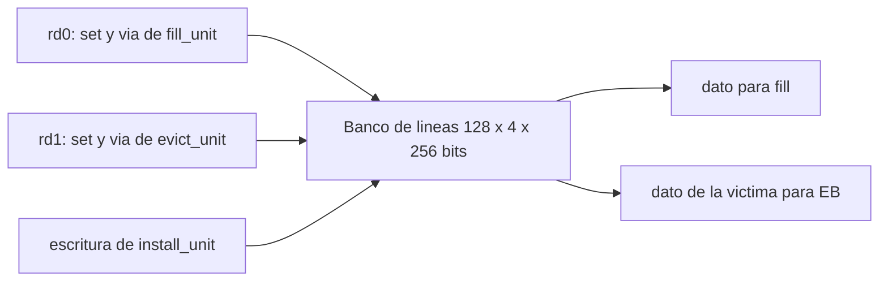

### 3.4 l2\_plru

**Qué hace.** Tree-PLRU de 4 vías: 3 bits por conjunto (384 bits en total). El bit 0 elige entre el par {0,1} y {2,3}; el bit 1 elige dentro de {0,1} y el bit 2 dentro de {2,3}. La víctima se calcula combinacionalmente a partir del conjunto consultado. El estado cambia solo con `touch_valid_i`, que activa `l2_install_unit` una vez por instalación efectiva.

**Aporte a los issues.** Cumple tree-PLRU con el uso actualizado una sola vez al hacerse efectivo. Los hits de demanda no lo tocan porque la línea se invalida al promoverla.

**Conexiones.** Consulta con `inst_set` del top; entrega la vía candidata a `l2_way_select`; recibe el touch de `l2_install_unit`.

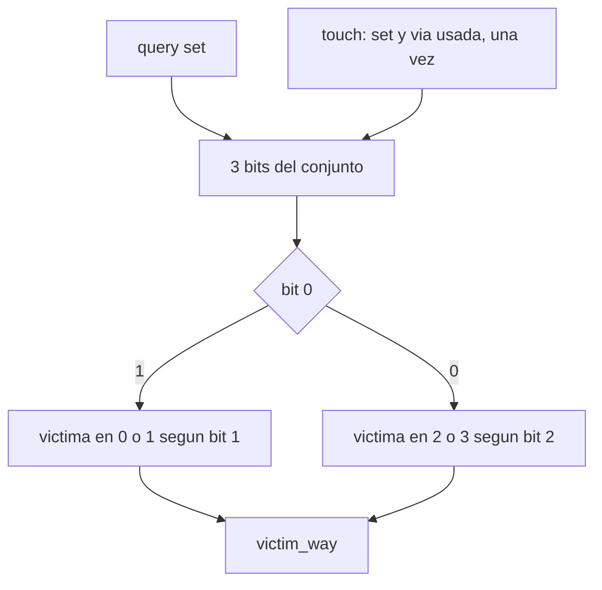

### 3.5 l2\_way\_resv

**Qué hace.** Un bit de reserva por (conjunto, vía). Dos lecturas de fila (conjunto de la demanda y conjunto de la instalación), un puerto para reservar y dos para liberar: `clr0` cuando termina un fill y `clr1` cuando termina la escritura de un install. Si en el mismo ciclo se libera y se reserva la misma vía, prevalece la reserva.

**Aporte a los issues.** Es lo que impide que dos operaciones se apropien de la misma vía sin serializar por conjunto: un hit con L1 sin aceptar mantiene su vía, y una instalación en curso mantiene la vía destino.

**Conexiones.** El top reserva al aceptar; libera `l2_fill_unit` (clr0) y `l2_install_unit` (clr1); la fila B alimenta a `l2_way_select` y la fila A al chequeo de hit bloqueado del top.

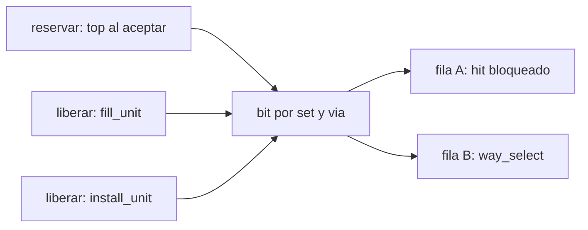

### 3.6 l2\_lookup

**Qué hace.** Comparador combinacional sin estado: recibe tags y valid de una fila y el tag buscado; devuelve `hit` y la vía. Si hubiera coincidencias múltiples (no esperado) gana la de menor índice. El top tiene dos instancias: una para la demanda y otra para la instalación.

**Aporte a los issues.** Decide en la admisión si la demanda es hit o miss y si la instalación cae sobre una línea ya presente.

**Conexiones.** Entrada desde `l2_tag_array`; salida hacia las reglas de admisión del top.

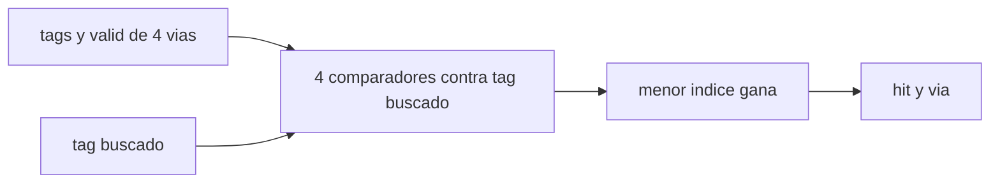

### 3.7 l2\_way\_select

**Qué hace.** Elige la vía destino de una instalación con tres prioridades: primera vía inválida no reservada; si no hay, la vía que indica PLRU si no está reservada; si la vía PLRU está reservada, `ok_o=0` y la instalación espera. No cambia a otra vía válida: la elección PLRU se conserva.

**Aporte a los issues.** Implementa literalmente «vía inválida antes de desalojar» y «se conserva la elección PLRU mientras espera». La víctima queda fijada porque el top guarda la vía elegida en la tabla al aceptar.

**Conexiones.** Entradas: `valid` y `resv` de la fila B, y la víctima de `l2_plru`. Salida: vía y `ok` hacia el top.

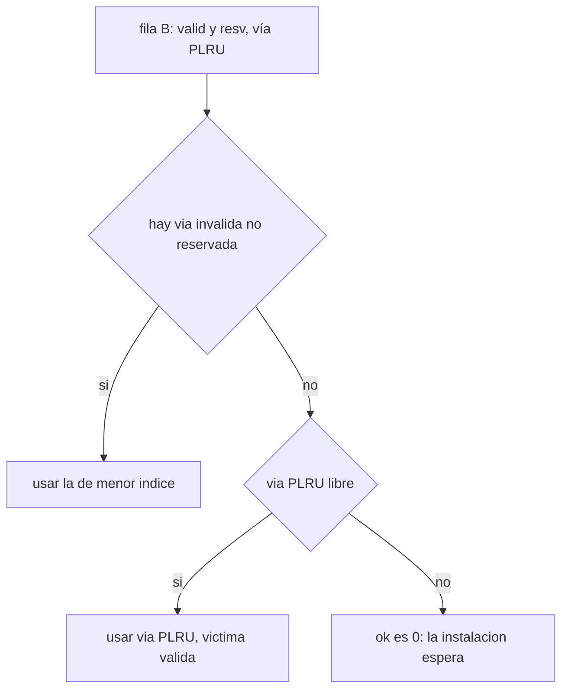

### 3.8 l2\_op\_table

**Qué hace.** Es el corazón del control non-blocking. Tiene `N` posiciones; cada una guarda estado, tipo (demanda o instalación), base, vía, datos, dirty, información de la víctima y la matriz de antigüedad `older`. Ofrece `free_any` (hay posición libre) y `alloc_idx` (la de menor índice). También responde si una base coincide con alguna operación activa (`conflict_a/b`) y publica qué operaciones piden cada canal (`req_fill`, `req_mem`, `req_eb`, `req_wr`, `req_done`). Los eventos `ev_*` (uno por canal, one-hot) hacen avanzar el estado.

**Aporte a los issues.** Una posición y su id permanecen ocupados hasta el handshake final; una operación bloqueada conserva datos y antigüedad sin impedir que otras avancen; los datos viven aquí, no en el pipeline, así que un resultado detenido no se pierde. `older[j*N+i]=1` significa que j es más antigua que i y se fija al asignar.

**Conexiones.** Recibe `alloc` del top, `fin de pipeline` de `l2_pipe` y los eventos de las cinco unidades. Entrega `req_*`, `older` y los campos de cada operación a esas mismas unidades.

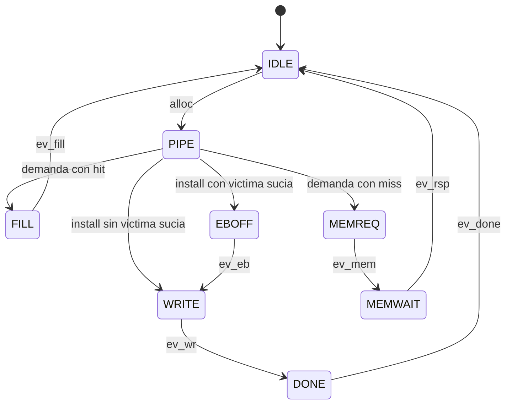

### 3.9 l2\_pipe

**Qué hace.** Línea de retardo de 7 etapas que solo transporta el índice de la operación. Sumada al ciclo de aceptación da los 8 ciclos de L2 sin contención. No se detiene nunca: las esperas (memoria, EB, canal de salida) son estados de la tabla, no bloqueos del pipeline.

**Aporte a los issues.** Garantiza la latencia de ocho ciclos adicionales y, como los datos no viajan por las etapas, un resultado detenido conserva datos y metadatos y las demás operaciones siguen avanzando.

**Conexiones.** Entra `alloc_idx` cuando el top acepta; sale `end_valid/end_idx` hacia `l2_op_table`, que pasa de `PIPE` al estado siguiente. La etapa 3 se usa para la métrica de lookup.

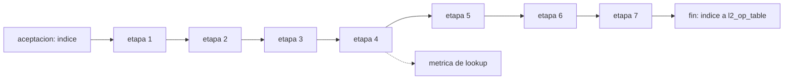

### 3.10 l2\_out\_sel

**Qué hace.** Árbitro reutilizable de un canal. Gana la solicitante que no tiene otra solicitante más antigua (según `older`); entre iguales, el menor índice. Tiene un lock: si el canal ofreció y el receptor no aceptó, la elección se registra y se mantiene hasta el handshake, aunque aparezca una operación más antigua. Entrega `sel_valid`, `sel_idx` y `sel_onehot`.

**Aporte a los issues.** Implementa «se atiende la más antigua que pueda avanzar» y la estabilidad de `valid` y datos hasta el handshake. Precondición: la operación bloqueada debe seguir pidiendo el canal.

**Conexiones.** Hay una instancia dentro de cada unidad de canal (fill, install, evict, mem y done). Recibe `req_*` y `older` de la tabla y el handshake externo de su canal.

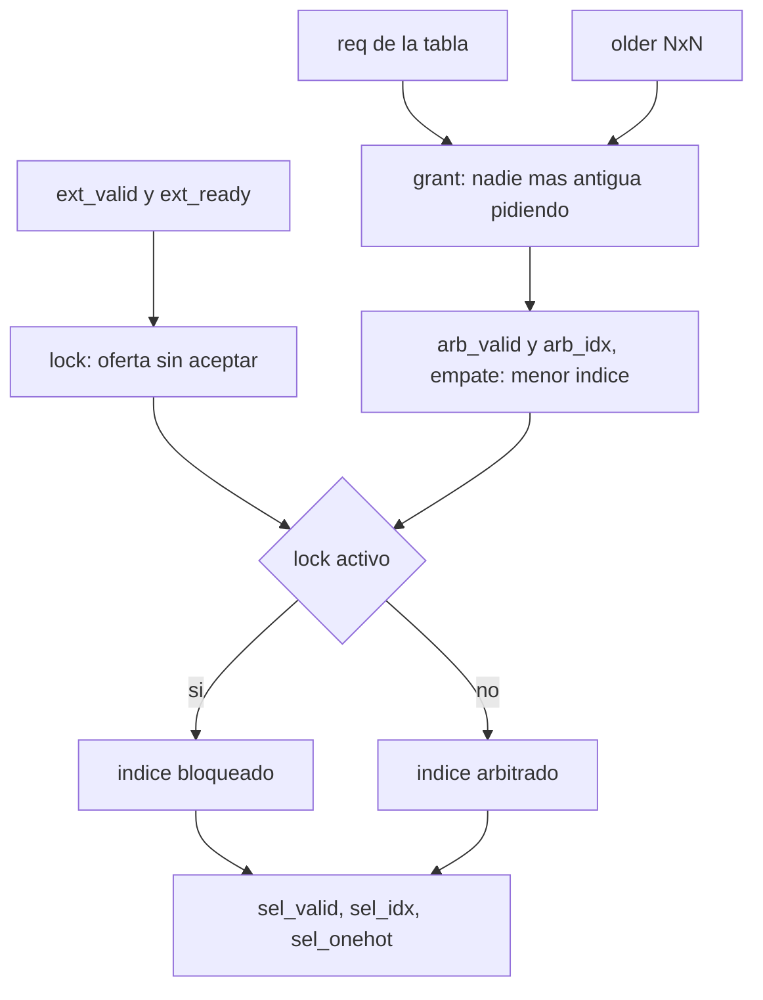

### 3.11 l2\_admit\_arb

**Qué hace.** Árbitro de la cola de admisión. Decide quién gana la única aceptación por ciclo cuando una demanda y un install compiten por entrar. Mantiene tres bits: `get_pend_q`/`inst_pend_q` (qué tipo está esperando) y `get_first_q` (cuál llegó primero cuando ambas esperaban). `get_older` traduce ese estado a "la demanda es la más antigua". Las reglas de `ready` ceden el paso a la otra solicitud solo si la otra es la más antigua **y puede avanzar** (`pre`): una solicitud bloqueada no frena a la otra.

**Aporte a los issues.** Resuelve Fallo 1: la antigüedad de espera se respeta antes de aceptar, no solo después. El drenado de WB gana solo en empate (ambas llegan en el mismo ciclo, ninguna esperaba).

**Conexiones.** Entradas: `get_valid_i`/`get_pre_i` y `inst_valid_i`/`inst_pre_i` desde el top. Salidas: `get_ready_o`/`inst_ready_o`. No calcula `pre` (eso depende de tablas, reservas y `way_select`); solo decide quién avanza.

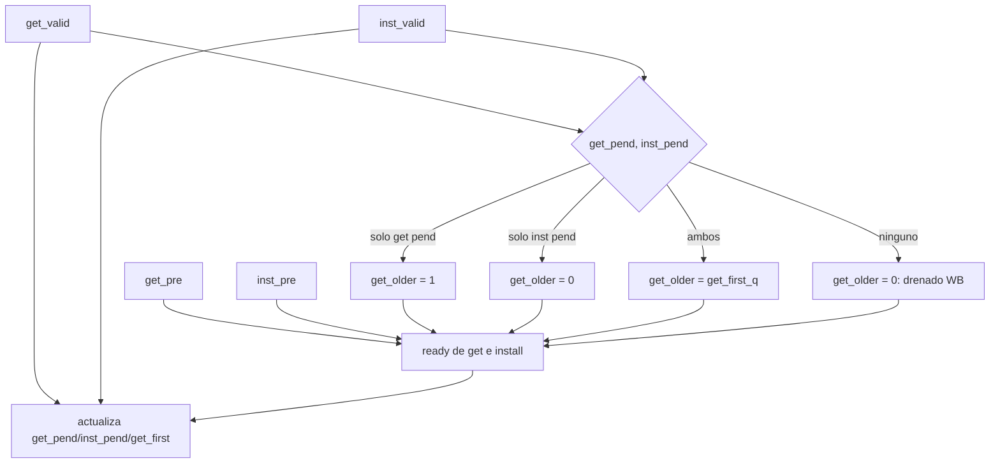

### 3.12 l2\_fill\_unit

**Qué hace.** Canal de entrega de un hit hacia L1. Arbitra entre las operaciones en `ST_FILL`, ofrece id, base, línea y dirty. Al handshake (`valid && ready`) ocurren tres efectos en el mismo flanco: invalida la vía en el arreglo de tags, libera la reserva y emite `ev_fill` para que la tabla libere posición e id.

**Aporte a los issues.** Es la exclusividad: la línea sale de L2 solo cuando L1 la acepta; mientras L1 no acepta, línea, dirty y vía siguen reservados y la oferta no cambia.

**Conexiones.** Entradas: `req_fill`, `older`, base, vía y dirty de la tabla, y dato de `rd0`. Expone `sel_set/sel_way` para que el top los cablee a `rd0`. Salidas: `inv` al arreglo de tags, `clr0` a las reservas, `ev_fill` a la tabla.

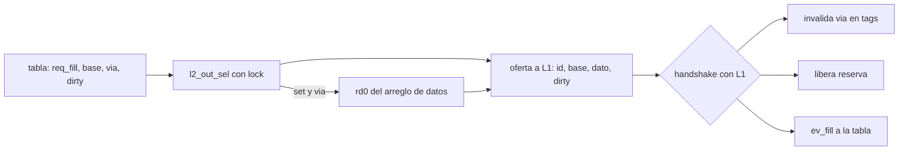

### 3.13 l2\_install\_unit

**Qué hace.** Canal de escritura de una instalación. Arbitra entre las operaciones en `ST_WRITE` y escribe tag, dirty y línea. La escritura de arreglos es un nivel idempotente; los efectos que no se pueden repetir (`ev_wr`, touch de PLRU y liberación de reserva) salen como un solo pulso en la primera selección (`first_sel`).

**Aporte a los issues.** Garantiza «uso actualizado una sola vez» y «efectos una vez» aunque la operación tarde más de un ciclo en cambiar de estado. Como la operación pasa a `ST_DONE` después de escribir, `wb_done` nunca aparece antes de instalar.

**Conexiones.** Entradas: `req_wr`, `older` y campos de la tabla. Salidas: escritura a los arreglos de tags y datos, touch a `l2_plru`, `clr1` a `l2_way_resv` y `ev_wr` a la tabla. También expone el índice de la operación para la métrica `clean_discard`.

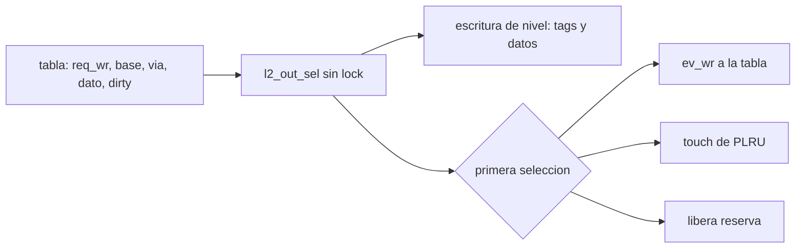

### 3.14 l2\_evict\_unit

**Qué hace.** Canal que entrega la víctima sucia al eviction buffer. Arbitra entre las operaciones en `ST_EBOFF`; ofrece la base de la víctima (`vbase`, no la base de la línea entrante), la línea leída por `rd1` y dirty=1. Al handshake emite `ev_eb` y la operación pasa a `ST_WRITE`.

**Aporte a los issues.** Si EB no acepta, la víctima y su vía se conservan y la oferta es estable; cuando EB acepta la línea completa, la vía puede reutilizarse sin esperar a que la escritura llegue a memoria. Una víctima limpia nunca pasa por aquí.

**Conexiones.** Entradas: `req_eb`, `older`, `vbase` y vía de la tabla, dato de `rd1`. Expone `sel_set/sel_way` para cablear `rd1`. Salida: `eb_push_*` hacia EB y `ev_eb` hacia la tabla.

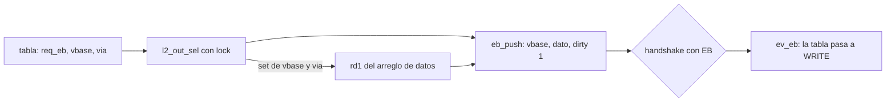

### 3.15 l2\_mem\_unit

**Qué hace.** Maneja el miss. Arbitra entre las operaciones en `ST_MEMREQ`, sondea el eviction buffer con la base elegida (`eb_probe`) y solo emite `mem_rd_req` si EB no tiene una escritura pendiente de esa línea. Para que una operación bloqueada por EB no frene a las demás, mantiene una máscara `skip_q`: la candidata bloqueada se marca y se prueba la siguiente; un handshake limpia la máscara. Además observa `mem_rd_rsp`: cuando hay handshake y coinciden id y base con la operación que espera, emite `ev_rsp` y la tabla libera la posición sin instalar copia.

**Aporte a los issues.** Resuelve el retorno directo (L2 no conserva copia), el conflicto lectura contra eviction buffer, el progreso de operaciones independientes y la liberación del id en el mismo flanco del handshake de retorno. Ignora respuestas ajenas, por ejemplo residuales tras un reset.

**Conexiones.** Entradas: `req_mem`, `older` y base de la tabla; `eb_probe_hit` de EB; `mem_rd_rsp_*` del controlador. Salidas: `eb_probe_*`, `mem_rd_req_*`, `ev_mem` y `ev_rsp` hacia la tabla.

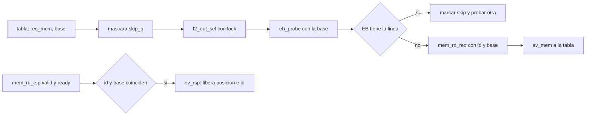

### 3.16 l2\_done\_unit

**Qué hace.** Canal de confirmación de instalación hacia el write buffer. Arbitra entre las operaciones en `ST_DONE` y ofrece su id; al handshake emite `ev_done` y la tabla libera posición e id. No lee arreglos ni libera reservas (eso ya ocurrió al escribir).

**Aporte a los issues.** `wb_done` solo se ofrece después de instalar, y la posición y el id siguen ocupados hasta que el WB consume la confirmación. Su `valid` y su id son estables mientras no haya handshake.

**Conexiones.** Entradas: `req_done` y `older` de la tabla; `wb_done_ready` del WB. Salidas: `wb_done_valid/id` hacia el WB, `ev_done` hacia la tabla y el escalar de handshake hacia las métricas.

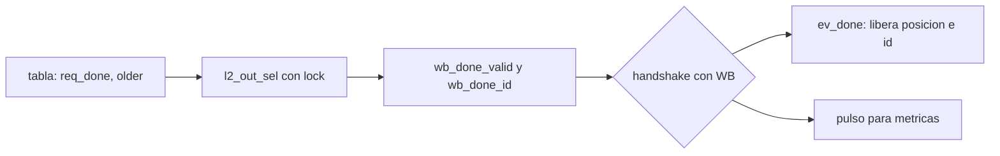

### 3.17 l2\_perf

**Qué hace.** Convierte señales internas en los eventos de métricas de `pkg_metrics::l2_events_t`: `get_accept`, `get_done`, `lookup`, `promotion`, `clean_discard`, `dirty_eviction`, ocupación, capacidad y espera. Los conceptos sin campo en el paquete salen como puertos auxiliares (`install_lookup_o`, `install_lookup_hit_o`, `install_accept_o`, `install_done_o`, waits, `gd_overflow_o`).

**Aporte a los issues.** Resuelve el Fallo 2 (`lookup` solo para demandas; installs en `install_lookup_o`/`install_lookup_hit_o`) y el Fallo 3 (`get_done` une `fill_hs_i` y `rsp_done_i` con una cola `gd_q` que retiene finalizaciones coincidentes). La cola protege contra overflow (`gd_overflow_o`) y limpia con reset.

**Conexiones.** Solo recibe señales del top (aceptaciones, handshakes de fill, `eb_push` y `wb_done`, `rsp_done` de `l2_mem_unit`, ocupación de la tabla). No influye en el control.

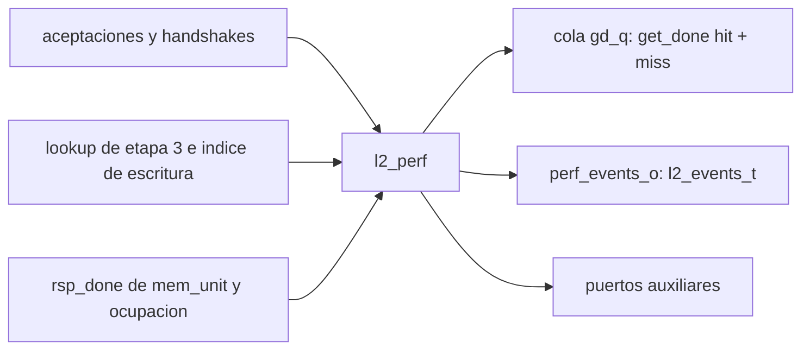

## 4. Recorrido de una operación

### 4.1 Demanda con hit

El lookup acierta, se reserva la vía y la operación recorre el pipeline. Si L1 no acepta, la línea queda retenida y la oferta no cambia. Al aceptar, se invalida en L2 y se libera la reserva.

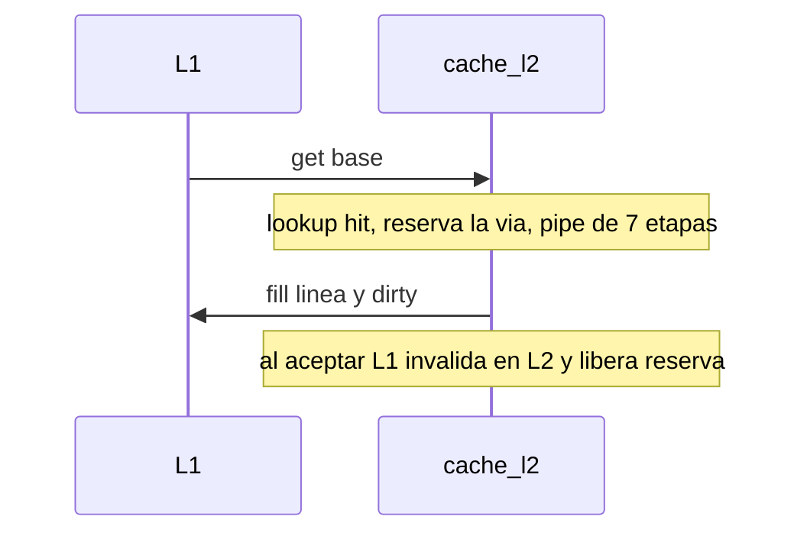

### 4.2 Demanda con miss

No se reserva ninguna vía. Tras el pipeline, L2 sondea el eviction buffer; si la línea no está pendiente de escritura, emite la lectura. La línea llega a L1 directamente y L2 solo observa el handshake para liberar el id. `l2_perf` emite `get_done` con el id de la demanda (Fallo 3).

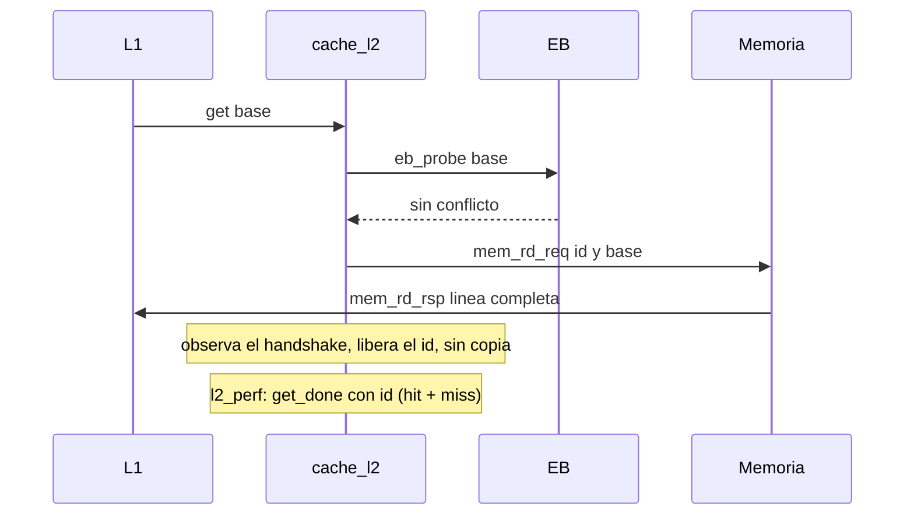

### 4.3 Instalación con víctima sucia

El write buffer entrega una línea; si la vía elegida tiene una línea sucia, esta se envía al eviction buffer antes de escribir. La confirmación solo sale después de instalar. Si get e install compiten en el mismo ciclo, `l2_admit_arb` decide: gana la solicitud más antigua que pueda avanzar; el drenado de WB gana solo en empate.

```mermaid
sequenceDiagram
  participant WB
  participant L2 as cache_l2
  participant EB
  WB->>L2: install base, dato, dirty
  Note over L2: elige via, reserva, pipe de 7 etapas
  L2->>EB: eb_push victima completa
  EB-->>L2: acepta
  Note over L2: escribe tag, dato y dirty, touch de PLRU, libera reserva
  L2->>WB: wb_done id
  WB-->>L2: consume wb_done
```

### 4.4 Admisión con competencia (Fallo 1)

Cuando get e install llegan al mismo tiempo o uno de ellos lleva esperando, `l2_admit_arb` decide con `get_pend_q`/`inst_pend_q`/`get_first_q`. Si solo uno esperaba, ese gana. Si ambos esperaban, gana el que llegó primero. Si ambos llegan en el mismo ciclo, gana el install (drenado). Una solicitud bloqueada (`pre=0`) no frena a la otra.

```mermaid
sequenceDiagram
  participant L1
  participant WB
  participant ARB as l2_admit_arb
  participant L2 as cache_l2
  L1->>ARB: get_valid + get_pre
  WB->>ARB: inst_valid + inst_pre
  Note over ARB: get_pend/inst_pend/get_first deciden
  ARB-->>L2: get_ready o inst_ready
  Note over L2: accept en el mismo ciclo, pipe en T
```
