# Interfaces internas de la jerarquía

```mermaid
%%{init: {"flowchart": {"nodeSpacing": 45, "rankSpacing": 55, "curve": "linear"}}}%%
flowchart TB
    subgraph DEMANDA["Acceso de CPU y retorno de la línea"]
        CPU(["Solicitud CPU / LSU"]) --> L1{"¿Hit en L1?"}
        L1 -->|Sí| RESP(["Completar acceso y responder a CPU"])
        L1 -->|No| RES["Reservar entrada de L1<br/>Consultar write buffer"]
        RES --> WB{"¿Estado de la línea en WB?"}
        WB -->|Disponible| FWD["Forwarding de línea completa<br/>Conservar dirty"]
        WB -->|En servicio| WAIT_WB["Esperar consumo de confirmación<br/>de instalación en L2"]
        WB -->|Ausente| GET["Solicitar línea a L2"]
        WAIT_WB --> GET
        GET --> L2{"¿Hit en L2?"}
        L2 -->|Sí| HIT["Ofrecer línea completa<br/>Conservar dirty"]
        L2 -->|No| EB{"¿Conflicto en eviction buffer?"}
        EB -->|Sí| WAIT_EB["Esperar consumo de confirmación<br/>de escritura sin error de esa línea"]
        EB -->|No| READ["Controlador: iniciar lectura<br/>y cruce al reloj de memoria"]
        WAIT_EB --> READ
        READ --> BURST["Memoria: completar burst<br/>de ocho palabras"]
        BURST --> MEM_FILL["Ofrecer línea completa limpia"]
        FWD --> RET["Seleccionar retorno autorizado"]
        HIT --> RET
        MEM_FILL --> RET
        RET --> ACCEPT["L1 acepta en vía o entrada reservada<br/>El origen completa su entrega"]
        ACCEPT --> INSTALL["Desalojar víctima si hace falta<br/>Instalar línea y completar load/store"]
        INSTALL --> DONE(["Responder a CPU"])
    end

    subgraph DESALOJOS["Desalojos y drenado de buffers"]
        V1["Víctima de L1<br/>Limpia o sucia"] --> PUSH_WB["Write buffer acepta la línea<br/>L1 libera su vía"]
        PUSH_WB --> DRAIN_WB["Drenado FIFO hacia L2"]
        DRAIN_WB --> INST_L2["L2 instala y confirma<br/>WB consume confirmación y libera entrada"]
        V2["Víctima de L2"] --> DIRTY{"¿Está sucia?"}
        DIRTY -->|No| DISCARD(["Invalidar y liberar vía de L2"])
        DIRTY -->|Sí| PUSH_EB["Eviction buffer acepta la línea<br/>L2 libera su vía"]
        PUSH_EB --> WRITE["Drenado FIFO al controlador<br/>Burst de escritura a memoria"]
        WRITE --> ACK(["Memoria confirma las ocho palabras<br/>EB consume confirmación sin error y libera entrada"])
    end
```

Los dos recorridos usan los mismos módulos. Al aceptar el retorno de un hit L2,
L2 invalida su línea; si proviene de memoria, L2 observa esa finalización sin
instalar una copia. Las confirmaciones cierran el traslado indicado en cada paso.

## 1. Convenciones

Estas interfaces concretan el [movimiento de líneas](line-transfers.md) y las
[políticas de la jerarquía](hierarchy.md). CPU ↔ L1 conserva el
[contrato CPU–memoria](cpu-memory-contract.md). Los nombres son lógicos,
sin sufijos de puerto; las tablas indican origen y destino.

Los [skeletons RTL](skeletons.md) concretan estos canales en puertos con sufijos
desde cada módulo y tipos compartidos.

Todos los canales definidos aquí usan `clk_i` de CPU, a 100 MHz, y `rst_ni`
activo bajo. El controlador contiene el cruce al dominio de memoria, a 50 MHz
por defecto. Cachés, buffers y controlador avanzan durante el stall del núcleo.

| Campo | Bits | Significado |
| --- | --- | --- |
| `valid`, `ready` | 1 cada uno | Oferta del emisor y capacidad del receptor. |
| `base` | 32 | Dirección física de línea; bits `[4:0]=0`, dentro de `0x00010000–0x0001FFFF`. |
| `data` | 256 | Línea completa: byte de `base+k` en `[8*k +: 8]`; palabra inicial en `[31:0]`. |
| `dirty` | 1 | La línea contiene modificaciones pendientes de escribir a memoria. |
| `id` | Según canal | Identificador conservado hasta consumir la respuesta. |
| `error` | 1 | Finalización fallida; datos sin uso y sin instalación. |

La notación `p_{valid,base}` representa las señales `p_valid` y `p_base`.
En cada canal, `valid` y sus campos viajan del emisor al receptor; `ready`
viaja en sentido inverso. Se aplican estas reglas a todas las interfaces:

- **Aceptación:** ocurre en el flanco positivo con `valid && ready`.
  El emisor genera `valid` sin esperar `ready`; el receptor solo acepta si
  puede conservar los campos o completar su efecto en ese flanco.
- **Espera:** con `valid && !ready`, se conservan `valid` y todos sus campos.
  Tras aceptar una solicitud, no se repite mientras se espera su respuesta.
  Las respuestas también se conservan hasta su consumo.
- **Finalización:** en un traslado sin respuesta separada, el handshake entrega
  la responsabilidad de la línea. En una solicitud con respuesta, aceptar
  solo inicia la operación; su respuesta se entrega exactamente una vez.
- **Reset:** no hay handshakes; se cancelan solicitudes, reservas e
  identificadores pendientes. El controlador descarta también retornos del
  dominio de memoria anteriores al reset.

L2 asigna un `id` libre al aceptar cada demanda o instalación. Su ancho es
`L2_ID_W = max(1, ceil(log2(L2_MAX_INFLIGHT)))`, dos bits por defecto;
solo se usan valores de `0` a `L2_MAX_INFLIGHT-1`. Se devuelve mediante
`*_accept_id`, válido únicamente en el flanco de aceptación. No se reutiliza
hasta consumir la finalización, aunque esta ya esté disponible.

Las operaciones pueden terminar fuera de orden. El drenado FIFO de un buffer
fija el orden de presentación de sus entradas: puede presentar la siguiente
después de que el destino acepte la anterior. Cada respuesta se asocia con su
entrada por `id`; retirar una entrada no altera el orden de las restantes.

## 2. L1 ↔ write buffer

| Señales | Dirección | Significado |
| --- | --- | --- |
| `wb_push_{valid,base,data,dirty}` | L1 → WB | Víctima de L1, limpia o sucia. |
| `wb_push_ready` | WB → L1 | Hay una entrada para conservar la víctima. |
| `wb_probe_{valid,base}` | L1 → WB | Consulta combinacional de la línea solicitada por un miss L1. |
| `wb_probe_hit` | WB → L1 | Hay coincidencia, incluidas entradas en servicio. |
| `wb_probe_busy` | WB → L1 | La coincidencia está en servicio hacia L2; cero si no hay hit. |
| `wb_fwd_{valid,base,data,dirty}` | WB → retorno L1 | Línea coincidente disponible para forwarding. |
| `wb_fwd_ready` | Retorno L1 → WB | L1 puede aceptar la línea reenviada. |

**Aceptación y finalización.** `wb_push_valid && wb_push_ready` entrega la
víctima al buffer: L1 invalida su vía en ese flanco. No hay confirmación posterior
hacia L1. El buffer conserva la entrada hasta consumir `wb_done` de L2 o hasta
`wb_fwd_valid && wb_fwd_ready`. La capacidad por defecto es `WRITE_BUFFER_DEPTH=4`.

La consulta no tiene handshake ni encola una operación. Con `wb_probe_valid=1`,
`hit/busy` describen el estado actual para esa base. L1 mantiene la consulta
mientras espera una coincidencia ocupada o su forwarding. Si no hay hit,
puede solicitar la línea a L2. Si hay hit libre, el buffer presenta `wb_fwd_valid`;
si está ocupado, L1 espera el consumo de la confirmación de instalación por WB
y vuelve a consultar.

**Espera e identificación.** La entrada elegida para forwarding queda reservada
hasta `wb_fwd_valid && wb_fwd_ready`; entonces se retira conservando dirty.
No necesita `id`: corresponde a la única demanda pendiente de L1 y se identifica
por `base`. El espacio de entrada se reserva antes de pedir el forwarding.

Una entrada está en servicio desde que se presenta con `wb_install_valid`,
incluso con `wb_install_ready=0`, hasta consumir su confirmación. Si forwarding
y drenado quieren iniciar sobre la misma entrada libre en un ciclo, gana el
forwarding y no se presenta su instalación. Una entrada en servicio no genera
`wb_fwd_valid`. Con el buffer lleno, L1 conserva víctima y vía hasta aceptarse
`wb_push`; el forwarding puede liberar espacio sin esperar su drenado.

## 3. L1 ↔ L2

| Señales | Dirección | Significado |
| --- | --- | --- |
| `l2_get_{valid,base}` | L1 → L2 | Obtener una línea para un load o store pendiente. |
| `l2_get_ready` | L2 → L1 | L2 puede registrar la demanda. |
| `l2_get_accept_id` | L2 → L1 | Identificador L2 asignado al aceptar. |
| `l2_fill_{valid,id,base,data,dirty,error}` | L2 → retorno L1 | Resultado de un hit L2, con el `id` asignado. |
| `l2_fill_ready` | Retorno L1 → L2 | L1 puede consumir ese resultado. |

**Aceptación y finalización.** Antes de presentar `l2_get_valid`, L1 comprueba
el write buffer y reserva su espacio de entrada. La solicitud obtiene siempre
la línea completa; el store y su máscara permanecen en L1. Cada demanda acepta
una sola respuesta: `l2_fill` si acierta en L2, o `mem_rd_rsp` si necesita memoria,
ambas por el retorno de la sección 8.

En un hit, L2 conserva línea, dirty y vía reservada hasta
`l2_fill_valid && l2_fill_ready`. En ese flanco L1 recibe la responsabilidad,
L2 invalida la línea y libera el `id`. En un miss, L2 coordina la lectura y
libera el `id` cuando L1 consume `mem_rd_rsp`; no instala una copia válida.

**Espera e identificación.** L1 conserva solicitud y base hasta aceptarse;
después conserva el `id` junto con su demanda. L2 mantiene cada resultado
estable hasta su consumo. La aceptación del retorno en L1 puede ocurrir antes
de instalar la línea en su vía y antes de responder a la CPU.

## 4. Write buffer ↔ L2

| Señales | Dirección | Significado |
| --- | --- | --- |
| `wb_install_{valid,base,data,dirty}` | WB → L2 | Siguiente línea del drenado FIFO para instalar en L2. |
| `wb_install_ready` | L2 → WB | L2 puede conservar la solicitud de instalación. |
| `wb_install_accept_id` | L2 → WB | Identificador L2 asignado al aceptar. |
| `wb_done_{valid,id}` | L2 → WB | La línea quedó instalada, con datos y dirty conservados. |
| `wb_done_ready` | WB → L2 | El buffer puede consumir la confirmación. |

**Aceptación y finalización.** Aceptar `wb_install` ocupa una posición de L2;
no libera la entrada del write buffer. L2 instala la línea cuando dispone de
vía y resuelve el desalojo necesario. Después presenta `wb_done_valid`.
Solo `wb_done_valid && wb_done_ready` retira la entrada del buffer y libera el
`id` de L2. La instalación ya terminada conserva ambos ocupados mientras su
confirmación no se consuma.

**Espera e identificación.** Hasta aceptar la instalación, el buffer conserva
su oferta completa. Después conserva la entrada en servicio y asocia el `id`
recibido con ella; puede presentar la siguiente entrada en orden FIFO. L2
conserva cada confirmación hasta consumirla. Si varias instalaciones terminan
fuera de orden, el `id` permite retirar la entrada correcta; una línea ya
instalada no se instala de nuevo durante la espera de confirmación.

`l2_get` y `wb_install` comparten el límite `L2_MAX_INFLIGHT=4` por defecto.
Cada aceptación consume una posición distinta. Con el límite ocupado no se
aceptan solicitudes nuevas; las pendientes, sus respuestas y el drenado del
eviction buffer siguen avanzando. La aceptación requiere también recursos y
ausencia de conflictos de línea o vía, según el arbitraje de `hierarchy.md`.

## 5. L2 ↔ eviction buffer

| Señales | Dirección | Significado |
| --- | --- | --- |
| `eb_push_{valid,base,data,dirty}` | L2 → EB | Víctima sucia completa; `dirty=1`. |
| `eb_push_ready` | EB → L2 | Hay una entrada para conservar la víctima. |
| `eb_probe_{valid,base}` | L2 → EB | Consulta combinacional de conflicto antes de leer memoria. |
| `eb_probe_hit` | EB → L2 y controlador | Existe una escritura pendiente para esa línea. |

**Aceptación y finalización.** `eb_push_valid && eb_push_ready` transfiere la
responsabilidad al buffer y permite invalidar y reutilizar la vía de L2.
No hay respuesta posterior hacia L2 por ese desalojo. Una víctima limpia se
descarta sin usar este canal. La capacidad por defecto es
`EVICTION_BUFFER_DEPTH=8`.

**Espera e identificación.** Con el buffer lleno, L2 conserva oferta, víctima y
vía. La entrega se identifica por `base` y no requiere `id` de retorno a L2.
El buffer conserva la línea hasta confirmar su escritura completa en memoria.

La consulta no tiene handshake: mientras `eb_probe_valid=1`, `eb_probe_hit`
incluye entradas encoladas y en servicio, hasta consumir su confirmación de
escritura. También bloquea una lectura si se acepta `eb_push` para la misma
base en ese flanco. Con hit, no se acepta la lectura de memoria; se espera
solo a esa línea. Las consultas y reservas de L2 no impiden drenar el buffer.

## 6. L2 ↔ controlador de memoria

| Señales | Dirección | Significado |
| --- | --- | --- |
| `mem_rd_req_{valid,id,base}` | L2 → controlador | Lectura de línea por miss; mismo `id` de la demanda L1. |
| `mem_rd_req_ready` | Controlador → L2 | Puede iniciar el burst de lectura, sin conflicto en EB. |
| `mem_rd_rsp_{valid,id,base,data,error}` | Controlador → retorno L1; control observado por L2 | Línea completa o error, asociados a la solicitud. |
| `mem_rd_rsp_ready` | Retorno L1 → controlador; observado por L2 | L1 puede consumir el resultado. |

**Aceptación y finalización.** L2 presenta `eb_probe_valid=mem_rd_req_valid`
y `eb_probe_base=mem_rd_req_base` durante toda la oferta de lectura. El
controlador arbitra esta lectura frente a escrituras del buffer;
`mem_rd_req_ready` solo permite aceptarla si puede iniciar el servicio y
`eb_probe_hit=0`. La espera de arbitraje queda antes de la aceptación.
Aceptar inicia el tiempo de transferencia y su timeout.

El controlador reúne las ocho palabras y presenta una única respuesta completa;
no entrega palabras parciales a L1. L2 observa `valid`, `ready`, `id`, `base`
y `error` del mismo canal. Su handshake finaliza la demanda de L2 y entrega
el resultado a L1 en el mismo flanco, sin una segunda confirmación ni un
segundo traslado de datos por L2.

**Espera e identificación.** Se mantienen solicitud y respuesta según las
reglas comunes. El controlador devuelve `id/base` sin modificarlos; el espacio
de L1 y la posición L2 permanecen reservados hasta consumir el retorno.
La línea llega limpia; el retorno fija `dirty=0` cuando no hay error.

## 7. Eviction buffer ↔ controlador de memoria

| Señales | Dirección | Significado |
| --- | --- | --- |
| `mem_wr_req_{valid,id,base,data}` | EB → controlador | Escritura completa de la entrada más antigua pendiente de envío. |
| `mem_wr_req_ready` | Controlador → EB | Puede iniciar su burst de escritura. |
| `mem_wr_rsp_{valid,id,base,error}` | Controlador → EB | Confirmación de escritura completa o error. |
| `mem_wr_rsp_ready` | EB → controlador | El buffer puede consumir la confirmación. |

**Aceptación y finalización.** El buffer conserva la entrada después de aceptar
`mem_wr_req`. Solo `mem_wr_rsp_valid && mem_wr_rsp_ready && !mem_wr_rsp_error`
permite liberarla. La confirmación significa que las ocho palabras quedaron
almacenadas; aceptar la solicitud o escribir la primera palabra no basta.

**Espera e identificación.** El buffer asigna un identificador de ancho
`EB_ID_W = max(1, ceil(log2(EVICTION_BUFFER_DEPTH)))`, tres bits por defecto,
único entre sus escrituras pendientes. Conserva su asociación con la entrada
hasta consumir la confirmación; el controlador devuelve el mismo `id/base`.
Los identificadores de lectura y escritura pertenecen a espacios separados,
identificados por sus canales de solicitud y respuesta.
La oferta de escritura y su confirmación permanecen estables durante esperas.
Una entrada en servicio sigue participando en `eb_probe`.

El controlador elige la solicitud más antigua que pueda avanzar; en empate,
prioriza el drenado. Un burst iniciado termina antes de iniciar otro. Con los
parámetros acordados, lectura y escritura duran 39 ciclos de CPU desde su
aceptación, con primeras palabras a los 25 ciclos y siete intervalos de dos.
Las latencias iniciales de lectura y escritura son parámetros independientes.

El timeout de 128 ciclos por defecto termina cuando está disponible la respuesta
completa, aunque su receptor aún no la consuma. Un timeout informa el error y
detiene la simulación según `hierarchy.md`; una escritura fallida conserva su
entrada en EB.

## 8. Retorno al espacio de entrada de L1

| Señales | Dirección | Significado |
| --- | --- | --- |
| `fill_{valid,base,data,dirty,error}` | Selección de retorno → L1 | Resultado completo seleccionado. |
| `fill_source` | Selección de retorno → L1 | Dos bits: `0` WB, `1` L2, `2` memoria; `3` reservado. |
| `fill_id` | Selección de retorno → L1 | `L2_ID_W` bits para L2/memoria; cero y sin uso para WB. |
| `fill_ready` | L1 → selección de retorno | Puede conservar el resultado en la vía o en su entrada reservada. |

**Aceptación y finalización.** La selección une `wb_fwd`, `l2_fill` y
`mem_rd_rsp`. Para WB fija `fill_error=0` y `fill_id=0`; para memoria fija
`fill_dirty=0`. Los demás campos se copian del origen. Solo el seleccionado
recibe `ready`, y únicamente cuando L1 puede consumir su resultado; ese
handshake es el de `fill`. El selector no añade un ciclo obligatorio ni
confirma una línea antes de recibirla L1.

Para la única demanda de L1 hay un solo origen autorizado: WB si procede el
forwarding; L2 si hay hit; memoria si L2 determina miss. La selección se conserva
mientras `fill_valid && !fill_ready`. Antes de aceptar, L1 comprueba la base y,
para L2/memoria, el `id` guardado al aceptar `l2_get`. Una respuesta ajena a esa
reserva es un error de protocolo y no se instala.

**Espera e instalación.** L1 recibe en su vía si está libre o en su espacio de
entrada reservado si todavía conserva una víctima. En ambos casos libera al
origen en ese flanco. Después desaloja la víctima si hace falta e instala la
línea entrante conservando dirty. Completa el load o aplica una sola vez la
máscara del store y marca dirty antes de responder a la CPU. Un resultado con
error no instala datos; sigue el contrato de error CPU–memoria.

## 9. Avance y casos de referencia

El diseño incorpora pipeline interno de caché: sus etapas conservan datos,
identificador y reservas durante esperas y permiten avanzar a operaciones
independientes cuando hay recursos. Mantiene el hit L1 de un ciclo y los ocho
ciclos adicionales de L2 sin contención; los handshakes auxiliares no imponen
ciclos extra. El número de etapas y su organización interna quedan a cargo del
diseño de cada caché.

Non-blocking determina cuántas operaciones conserva L2 mientras otras esperan;
el pipeline interno determina cómo avanzan por etapas. `L2_MAX_INFLIGHT` cuenta
las demandas e instalaciones aceptadas hasta consumir su finalización. No fija
cuatro búsquedas simultáneas ni el número de bancos o puertos físicos.

| Caso | Comportamiento esperado |
| --- | --- |
| WB contiene `[A, B, C]`; L1 pide B libre | `wb_fwd` entrega B y su dirty; quedan `[A, C]`. No se acepta `l2_get` para B. |
| B se ofrece a L2 y `wb_install_ready=0`; L1 pide B | B ya está en servicio; espera aceptación y consumo de `wb_done`, después se pide a L2. |
| Un hit L2 vuelve con la vía destino de L1 ocupada | L1 acepta en su entrada; L2 invalida y libera el `id`; la víctima de L1 puede seguir esperando WB. |
| EB contiene A en servicio; L2 necesita leer A | No se acepta `mem_rd_req` hasta consumir la confirmación de escritura de A. Otras líneas no exigen vaciar EB. |
| EB lleno y L2 necesita desalojar una víctima sucia | `eb_push` permanece estable; EB y controlador continúan drenando. Operaciones independientes pueden avanzar. |
| Cuatro operaciones aceptadas en L2, con el valor por defecto | No se acepta una quinta. Una respuesta consumida permite reutilizar su posición. |
| Memoria terminó el burst, pero L1 aún no consume la línea | El controlador conserva `mem_rd_rsp`; el timeout terminó y el `id` L2 sigue ocupado. |
| Miss sin contención, con parámetros por defecto | Se conservan `E9` para hit L2 y `E48` para miss L2 del contrato CPU–memoria. |

Los handshakes distinguen accesos aceptados, entregas y confirmaciones; mantener
`valid` durante una espera no genera accesos nuevos. Las esperas se contabilizan
por ciclo, separando arbitraje previo, transferencia de memoria y respuesta
disponible sin consumir.
