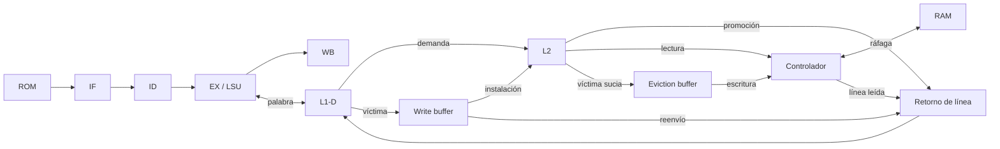

# Jerarquía de memoria de PORYGON

## 1. Conexión con el procesador

IF lee un bundle de la ROM síncrona por ciclo de avance. En EX, la LSU solicita una palabra a L1-D. Una transferencia se acepta en el flanco en que coinciden `valid` y `ready`. Mientras la demanda espera respuesta, el núcleo conserva el PC y el bundle completo. La jerarquía sigue avanzando y puede drenar una víctima durante esa espera.

## 2. Escritura y reemplazo

| Decisión | L1-D | L2 |
|---|---|---|
| Organización | 4 KiB, 64 conjuntos de 2 vías | 16 KiB, 128 conjuntos de 4 vías |
| Línea | 32 bytes (8 palabras) | 32 bytes (8 palabras) |
| Hit sin contención | 1 ciclo de CPU | 8 ciclos adicionales tras un miss en L1 |
| Escritura | Write-back y write-allocate | Write-back hacia RAM |
| Reemplazo | LRU exacto, 1 bit por conjunto | Tree-PLRU, 3 bits por conjunto |

**L1-D.** Un store que acierta modifica los bytes seleccionados y marca la línea como sucia. Si falla, L1 trae la línea antes de aplicar la máscara. Así conserva los demás bytes y puede reunir varias escrituras en una sola línea antes de desalojarla. El costo de *write-allocate* aparece cuando se escribe una línea una sola vez y se paga igualmente su lectura. Con dos vías basta un bit para recordar cuál se usó menos recientemente.

**L2.** Si al instalar una línea hay una vía libre, L2 la aprovecha. Si el conjunto está lleno, tres bits organizados en árbol permiten elegir una víctima aproximando LRU, con menos estado que mantener el orden exacto de cuatro vías. Una víctima limpia se descarta. Una sucia pasa al eviction buffer. Esta política de escritura reserva las ráfagas hacia RAM para datos que realmente cambiaron.

Las guías de [L1-D](modulos/microarquitectura-l1.md) y [L2](modulos/cache_l2.md) describen los canales y el control interno.

## 3. Exclusividad entre L1 y L2

Una línea válida reside en uno de los dos niveles. Cuando L2 acierta, entrega la línea a L1 con su bit de suciedad e invalida su vía al aceptarse la entrega. En sentido contrario, una víctima válida de L1 pasa a L2 incluso si está limpia.

En un procesador de un solo núcleo, la exclusividad permite dedicar las vías de L2 a datos distintos de los que ya están en L1. La contrapartida es el tráfico de migración y la necesidad de reservar las líneas en tránsito. En el benchmark secuencial, por ejemplo, L1 desaloja líneas aunque el programa solo lea. Los resultados y las condiciones de medición se detallan en la [evaluación de rendimiento](performance.md).

## 4. Buffers y lecturas tras una escritura

| FIFO y profundidad predeterminada | Qué conserva y cuándo libera la entrada | Si la LSU vuelve a leer esa línea |
|---|---|---|
| **Write buffer**, 4 líneas de L1 hacia L2 | Conserva dirección base, datos y suciedad. Libera la entrada cuando L1 acepta el reenvío o L2 confirma la instalación. | Si la línea sigue en cola, la reenvía a L1. Si ya está en servicio, la demanda espera la confirmación y recupera la línea desde L2. |
| **Eviction buffer**, 8 líneas de L2 hacia RAM | Conserva la versión modificada hasta que el controlador confirma la escritura completa. | La lectura espera la confirmación de esa dirección. Las entradas correspondientes a otras líneas pueden seguir pendientes. |

Las cuatro entradas del primer buffer permiten acumular víctimas mientras L2 atiende otras operaciones. El segundo dispone de ocho para absorber desalojos durante las escrituras más largas a RAM. Aumentar la profundidad consume almacenamiento y amplía la búsqueda por dirección. Cuando un buffer se llena, el emisor conserva la víctima hasta que se libera espacio.

Las guías de [write buffer](modulos/microarquitectura-write-buffer.md) y [eviction buffer](modulos/microarquitectura-eviction-buffer.md) describen los canales y el control interno.

## 5. Tiempo de acceso a memoria

La RAM de 64 KiB funciona a 50 MHz mediante un divisor de dos respecto a la CPU de 100 MHz. El controlador arbitra las lecturas de L2 y las escrituras del eviction buffer. Desde que acepta una ráfaga, la primera palabra tarda 25 ciclos de CPU y las otras siete, dos ciclos cada una. La línea completa tarda **25 + 7 × 2 = 39 ciclos de CPU**. El controlador detecta timeout si una transferencia aceptada sigue incompleta al alcanzar 128 ciclos.

Para una lectura sin contención, la LSU recibe la palabra en **1 ciclo** si acierta L1, **9** si acierta L2 y **48** si debe llegar a RAM. Una reserva en conflicto o un buffer lleno añade espera. La [microarquitectura](microarchitecture.md) muestra dónde se retiene la solicitud y qué señales permiten reanudar el pipeline. La guía del [controlador de memoria](modulos/microarquitectura-memory-controller.md) detalla el cruce de relojes.
