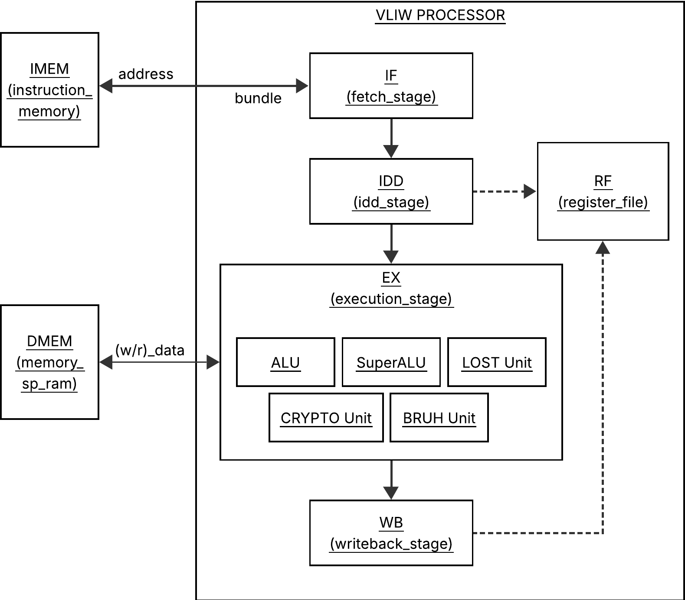
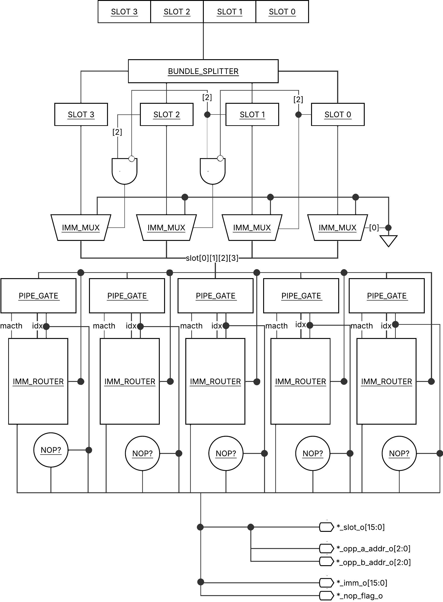
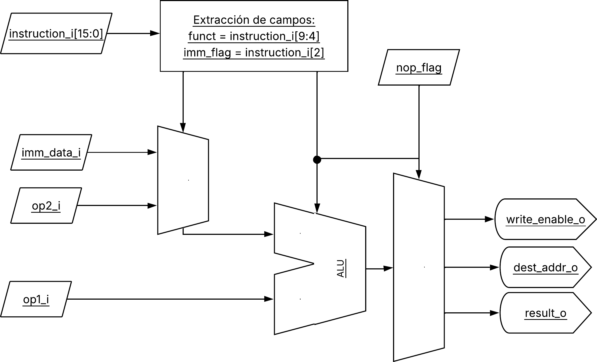
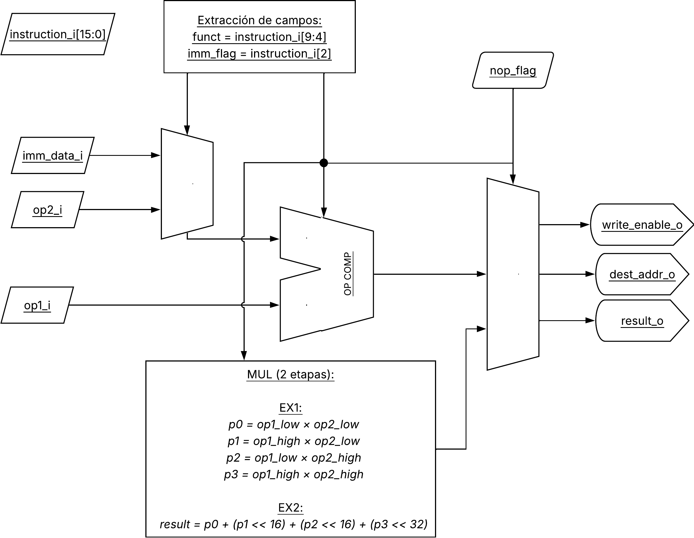
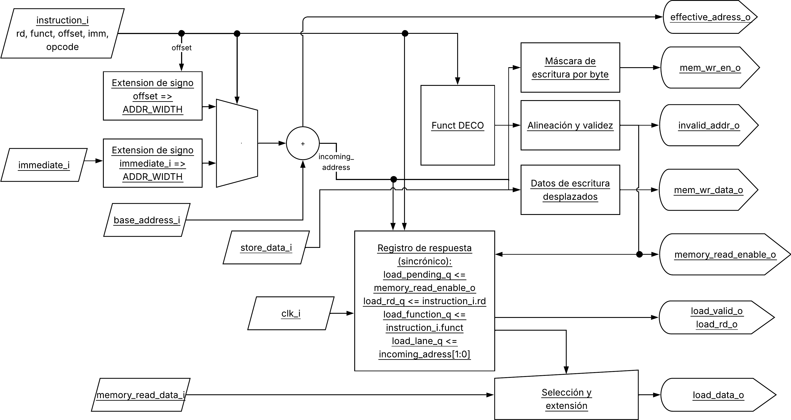
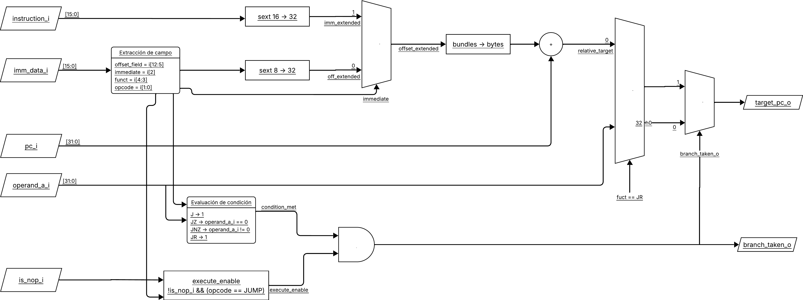
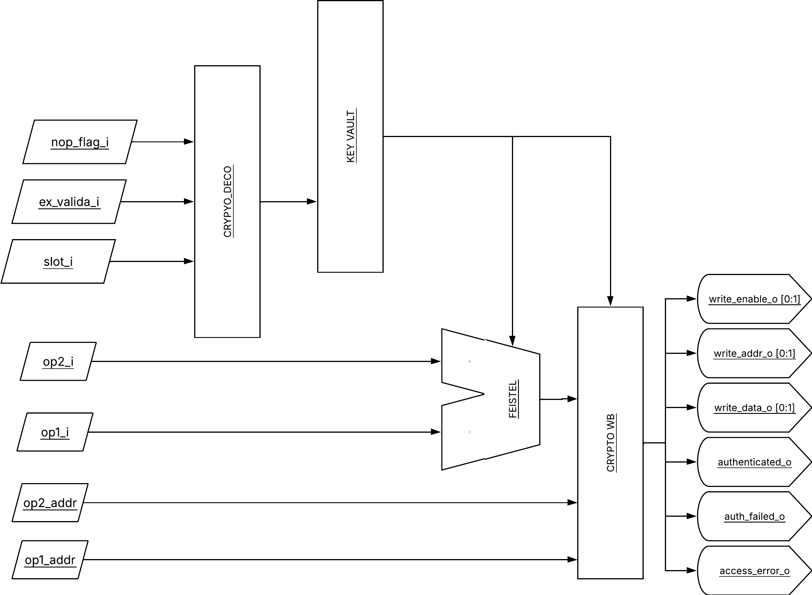

# Microarquitectura del Procesador PORYGON

## Overview

PORYGON es un procesador VLIW (*Very Long Instruction Word*) de propósito general con una unidad funcional dedicada a la aceleración del cifrado por bloques Feistel4.
Su ISA propia se organiza en bundles de 64 bits compuestos por cuatro slots de 16 bits que se ejecutan en paralelo.

> [!NOTE]
>
> El paralelismo a nivel de instrucción se resuelve de forma estática por software.

El procesador se implementa como un pipeline de cuatro etapas (IF, ID, EX, WB) y se modela completamente en SystemVerilog para simulación con Icarus Verilog.

## Diagrama de Bloques del Sistema



**Figura 1.** Diagrama de bloques del sistema PORYGON.

## Pipeline

El pipeline de PORYGON se organiza en cuatro etapas principales.
Cada bundle avanza una etapa por ciclo de reloj, de modo que hasta cuatro bundles pueden encontrarse simultáneamente en distintas etapas.

### Fetch (IF)

**Módulo:** `fetch_stage.sv`

Mantiene el Program Counter (`pc_q`) y captura el bundle correspondiente.
La interfaz con la memoria de instrucciones es **combinacional**: la memoria debe entregar el bundle en el mismo ciclo en que se presenta la dirección.
En cada flanco de reloj, el PC avanza ocho bytes (`BUNDLE_BYTES`) o toma el destino calculado por la BRU si `branch_taken_i` está activo.

| Señal | Dirección | Descripción |
|-------|-----------|-------------|
| `instruction_address_o` | Salida | Dirección del bundle solicitado (PC actual) |
| `instruction_read_enable_o` | Salida | Habilitador de lectura (activo si `rst_ni`) |
| `instruction_bundle_i` | Entrada | Bundle correspondiente a la dirección presentada |
| `branch_taken_i` | Entrada | Decisión de salto de la BRU |
| `branch_target_i` | Entrada | Dirección destino del salto |
| `bundle_o` | Salida | Bundle capturado hacia la frontera IF/ID |
| `bundle_pc_o` | Salida | PC del bundle capturado |
| `bundle_valid_o` | Salida | Validez del bundle en IF/ID |

> [!IMPORTANT]
>
> **Consideración sobre saltos:**
> 
> Un salto no invalida IF/ID. Los bundles jóvenes que ya entraron al pipeline deben ser NOPs insertados por el software. 
> El ISA no define un mecanismo de flush por hardware.

> [!TIP]
>
> **Memoria de instrucciones (`instruction_memory.sv`):**
>
> Es un arreglo combinacional de bundles. Cada posición contiene 64 bits y la posición cero corresponde a `TEXT_BASE_ADDRESS` (`0x00000000`).
> Las posiciones no cargadas se inicializan con el bundle NOP completo (`64'h0`).
> Una solicitud desalineada o fuera del segmento devuelve NOP y activa `out_of_range_o`, que se expone como diagnóstico en el sistema.

### Decode/Dispatch (ID)

**Módulo:** `idd_stage.sv` (con submódulos en `hardware/src/idd/`)

Separa el bundle de 64 bits en cuatro slots de 16 bits, decodifica cada slot, detecta NOPs, gestiona los inmediatos y genera las direcciones de lectura del banco de registros.
La asignación de slots a unidades funcionales es **flexible**: cualquier slot puede contener cualquier tipo de instrucción, y el dispatcher redirige cada operación a la unidad correspondiente según su opcode.



**Figura 3.** Diagrama de bloques de `idd_stage`.

| Submódulo | Responsabilidad |
|-----------|-----------------|
| `bundle_splitter.sv` | Divide el bundle en cuatro slots de 16 bits |
| `imm_mux.sv` | Reemplaza slots que son inmediatos por NOP |
| `pipe_gate.sv` | Enruta slots a la unidad funcional correspondiente |
| `imm_router.sv` | Calcula el inmediato asociado a cada pipe |
| `nop_detector.sv` | Identifica slots NOP (`16'h0000`) |
| `rf_addr_gen.sv` | Genera las direcciones de lectura del banco de registros |

**Mecanismo de inmediato:** El bit `imm` de un slot indica que el slot inmediatamente siguiente contiene un inmediato de 16 bits y no debe decodificarse como instrucción.
La convención es que el inmediato siempre va después del opcode.

**Figura 2.** Distribucion de bundles con inmediatos.
```
┌───────────┬───────────┬───────────┬───────────────┐
│  Slot 3   │  Slot 2   │  Slot 1   │  Slot 0       │
│ instrucc. │ instrucc. │ INMEDIATO │ instr (imm=1) │
└───────────┴───────────┴───────────┴───────────────┘
                              ▲             │
                              └─────────────┘
                    Slot 1 es el inmediato de Slot 0
```

> [!NOTE]
> 
> **Salidas hacia ID/EX:**
> 
> El dispatcher produce, para cada unidad, un `issued_op_t` que contiene la instrucción, el inmediato, los operandos leídos del banco de registros y el PC del bundle.
> Estos datos se capturan en registros de frontera ID/EX.

### Execute (EX)

**Módulo:** `execution_stage.sv` (integra las unidades funcionales)

Contiene cinco unidades funcionales que se ejecutan en paralelo.
Cada unidad recibe su `issued_op_t` desde la frontera ID/EX y produce un `wb_channel_t` hacia writeback.

**Figura 4.** Modulos presentes en `execution_stage`.

| Unidad | Módulo | Latencia | Descripción |
|--------|--------|----------|-------------|
| ALU0 | `alu_unit.sv` | 1 ciclo | Operaciones aritméticas, lógicas, comparaciones |
| SuperALU | `super_alu_unit.sv` | 1 ciclo (2 para `mul`/`mulh`) | Desplazamientos, multiplicaciones |
| LSU | `lost_unit.sv` | 2 ciclos (solicitud + respuesta) | Cargas y almacenamientos |
| BRUH | `bruh_unit.sv` | Combinacional | Saltos condicionales e incondicionales |
| Crypto | `crypto/crypto_unit.sv` | 2 ciclos | Ronda Feistel4 y operaciones de bóveda |

### Writeback (WB)

**Módulo:** `writeback_stage.sv`

Conecta los cinco resultados (ALU0, SuperALU, LSU, Crypto L, Crypto R) a los cinco puertos físicos de escritura del banco de registros.
Es cableado combinacional; no agrega registros después de `crypto_wb` ni resuelve colisiones de destino.
El scheduler garantiza que no haya conflictos de escritura.

> [!TIP]
>
> **Banco de registros (`register_file.sv`):**
>
> Ocho registros de 32 bits (`r0`–`r7`), con diez puertos de lectura asíncrona y cinco puertos de escritura síncrona.
> `r0` está conectado a cero y no puede sobrescribirse. Las escrituras ocurren en el flanco positivo del reloj.

## Unidades Funcionales

### ALU General (ALU0)

**Módulo:** `alu_unit.sv`



**Figura 4.** Diagrama de bloques de `alu_unit` (ALU0).

| Operación | Instrucción | Descripción |
|-----------|-------------|-------------|
| `mov` | `MATH_MOV` | `rs1 ← rs2` |
| `sum` / `sumi` | `MATH_SUM` | `rs1 ← rs1 + rs2/imm` |
| `diff` / `diffi` | `MATH_DIFF` | `rs1 ← rs1 − rs2/imm` |
| `and` / `andi` | `MATH_AND` | `rs1 ← rs1 & rs2/imm` |
| `or` / `ori` | `MATH_OR` | `rs1 ← rs1 \| rs2/imm` |
| `xor` / `xori` | `MATH_XOR` | `rs1 ← rs1 ^ rs2/imm` |
| `not` | `MATH_NOT` | `rs1 ← ~rs1` |
| `gtn` | `MATH_GTN` | `rs1 ← (rs1 > rs2) ? 1 : 0` |
| `ltn` | `MATH_LTN` | `rs1 ← (rs1 < rs2) ? 1 : 0` |
| `eor` | `MATH_EOR` | `rs1 ← (rs1 == rs2) ? 1 : 0` |
| `nez` | `MATH_NEZ` | `rs1 ← (rs1 != 0) ? 1 : 0` |

### ALU Especializada (SuperALU)

**Módulo:** `super_alu_unit.sv`



**Figura 5.** Diagrama de bloques de `super_alu_unit` (SuperALU).

| Operación | Instrucción | Descripción |
|-----------|-------------|-------------|
| `shl` / `shli` | `MATH_SHL` | `rs1 ← rs1 << rs2/imm` (lógico) |
| `shr` / `shri` | `MATH_SHR` | `rs1 ← rs1 >> rs2/imm` (lógico) |
| `sar` / `sari` | `MATH_SAR` | `rs1 ← rs1 >>> rs2/imm` (aritmético) |
| `mul` / `muli` | `MATH_MUL` | `rs1 ← rs1 × rs2/imm` (parte baja) |
| `mulh` / `mulhi` | `MATH_MULH` | `rs1 ← rs1 × rs2/imm` (parte alta) |

### LSU (Load/Store Unit)

**Módulo:** `lost_unit.sv`



**Figura 6.** Diagrama de bloques de `lost_unit` (LSU).

| Operación | Instrucción | Descripción |
|-----------|-------------|-------------|
| `low` / `lowi` | `LOST_LOW` | Carga palabra de 32 bits |
| `lob` / `lobi` | `LOST_LOB` | Carga byte con extensión de signo |
| `lobu` / `lobui` | `LOST_LOBU` | Carga byte con extensión de ceros |
| `loh` / `lohi` | `LOST_LOH` | Carga media palabra con signo |
| `lohu` / `lohui` | `LOST_LOHU` | Carga media palabra con ceros |
| `stw` / `stwi` | `LOST_STW` | Almacena palabra |
| `stb` / `stbi` | `LOST_STB` | Almacena byte |
| `sth` / `sthi` | `LOST_STH` | Almacena media palabra |

> [!NOTE]
>
> **Memoria de datos (`memory_sp_ram.sv`):**
>
> Arreglo de bytes de 64 KiB, con base en `DATA_BASE_ADDRESS` (`0x00010000`).
> Las lecturas son sincrónicas (capturan una palabra little endian en el flanco positivo) y las escrituras aplican una máscara por byte.
> Un acceso fuera del segmento no indexa el arreglo y activa `out_of_range_o`.

### BRUH (Branch Unit)

**Módulo:** `bruh_unit.sv`



**Figura 7.** Diagrama de bloques de `bruh_unit` (BRUH).

| Operación | Instrucción | Descripción |
|-----------|-------------|-------------|
| `j` / `ji` | `JUMP_J` | Salto incondicional relativo |
| `jz` / `jzi` | `JUMP_JZ` | Salto condicional si `rd == 0` |
| `jnz` / `jnzi` | `JUMP_JNZ` | Salto condicional si `rd != 0` |
| `jr` | `JUMP_JR` | Salto indirecto (`PC ← Reg[rd]`) |

### Crypto Unit

**Módulo:** `crypto/crypto_unit.sv`



**Figura 7.** Diagrama de bloques de `crypto_unit`.

| Operación | Instrucción | Descripción |
|-----------|-------------|-------------|
| `auth` | `CRYPTO_AUTH` | Compara la credencial de 128 bits construida en `rsa` contra `rsp` |
| `write` | `CRYPTO_WRITE` | Almacena una subllave de 32 bits en la bóveda |
| `feistel` | `CRYPTO_FEISTEL` | Ejecuta una ronda Feistel4 |
| `pwd` | `CRYPTO_PWD` | Copia la credencial de `rsa` a `rsp` |
| `rvk` | `CRYPTO_RVK` | Revoca la autenticación (`AUTH ← 0`) |
| `LOPW` | `CRYPTO_LOPW` | Escribe una palabra de la credencial en `rsa` |

**Función de ronda Feistel4:**

```
F(x, k) = (ROL32(x, 5) + k) XOR ROL32(x, 13)

Nuevo L = R
Nuevo R = L XOR F(R, k)
```

> [!IMPORTANT]
> 
> **Bóveda de llaves (`crypto/key_vault.sv`):**
>
> Almacena cuatro llaves de 128 bits (16 subllaves de 32 bits).
> Mantiene los registros internos `rsp` (contraseña de 128 bits), `rsa` (credencial candidata de 128 bits, write-only), `rsa_valid` (4 bits), `state` (FSM de autenticación) y `auth_timer`.
> Las llaves nunca se exponen a registros de propósito general ni a memoria general; solo la instrucción `feistel` las lee y `write` las escribe.

## Banco de Registros

**Módulo:** `register_file.sv`

| Registro | Nombre | Uso | ¿Escribible? |
|----------|--------|-----|--------------|
| `r0` | zero | Siempre 0 | No |
| `r1`–`r7` | — | Propósito general | Sí |

> [!NOTE]
>
> **Puertos de lectura:**
>
> 10 puertos asíncronos de 3 bits de dirección y 32 bits de datos. 

Cada unidad despachada consume dos puertos (operando A y operando B). La asignación es:

| Unidad | Puerto A | Puerto B |
|--------|----------|----------|
| ALU0 | 0 | 1 |
| SuperALU | 2 | 3 |
| LSU | 4 | 5 |
| BRUH | 6 | 7 |
| Crypto | 8 | 9 |

**Puertos de escritura:** 5 puertos síncronos de 3 bits de dirección y 32 bits de datos. La asignación es:

| Puerto | Fuente |
|--------|--------|
| 0 | ALU0 |
| 1 | SuperALU |
| 2 | LSU |
| 3 | Crypto L |
| 4 | Crypto R |

> [!WARNING]
>
> El banco de registros no resuelve colisiones de escritura. El scheduler debe garantizar que no haya colisiones.

## Memoria

### Mapa de Memoria

| Segmento | Rango | Uso |
|----------|-------|-----|
| Instrucciones (texto) | `0x00000000` – `0x0000FFFF` | Bundles de instrucciones |
| Datos | `0x00010000` – `0x0001FFFF` | Datos generales, archivos cargados |
| Pila | `0x0001F000` – `0x0001FFFF` | Pila del programa (crece hacia abajo) |
| Reservado | resto | Reservado para expansión |

**Memoria de Instrucciones** (`instruction_memory.sv`)

**Memoria de Datos** (`memory_sp_ram.sv`)

## Flujo de Datos

### Ejemplo de Bundle Mixto

```
Bundle[63:0] = [ Slot 3: CRYPTO | Slot 2: JUMP | Slot 1: LOST | Slot 0: MATH ]
```

| Slot | Formato | Instrucción | Unidad |
|------|---------|-------------|--------|
| 0 | MATH | `sum r1, r2` | ALU0 |
| 1 | LOST | `low r3, 0(r4)` | LSU |
| 2 | JUMP | `jz r1, 8` | BRUH |
| 3 | CRYPTO | `feistel r5, r6, 0, 0` | Crypto |

En un mismo ciclo:

1. **ALU0** calcula `r1 + r2` y escribe el resultado en `r1`.
2. **LSU** calcula la dirección `r4 + 0` y solicita la lectura a la RAM.
3. **BRUH** evalúa si `r1 == 0` y, si es así, actualiza el PC.
4. **Crypto** ejecuta una ronda Feistel4 sobre `r5` (L) y `r6` (R) usando la subllave 0 de la llave 0, y escribe los nuevos L y R en `r5` y `r6`.

### Dependencias de Datos

El hardware **no** resuelve dependencias de datos. El scheduler debe garantizar que:

- Una instrucción que lee un registro no se emita hasta que la instrucción que lo escribió haya alcanzado writeback.
- Las operaciones con latencia > 1 (LSU, SuperALU `mul`, Crypto) requieren separación adicional.
- Las operaciones independientes se agrupen en el mismo bundle para explotar el paralelismo.

**Ejemplo de dependencia RAW (Read After Write):**

```asm
; Bundle 0: escribe r1
{ sum r1, r2 | nop | nop | nop }

; Bundle 1: lee r1 (debe esperar a que WB escriba r1)
{ sum r3, r1 | nop | nop | nop }
```

Si el scheduler coloca ambas instrucciones en bundles consecutivos, la segunda leerá el valor antiguo de `r1` porque WB escribe en el flanco y ID lee combinacionalmente. El scheduler debe insertar un NOP de separación:

```asm
; Bundle 0: escribe r1
{ sum r1, r2 | nop | nop | nop }

; Bundle 1: NOP de separación
{ nop | nop | nop | nop }

; Bundle 2: lee r1 (ya actualizado)
{ sum r3, r1 | nop | nop | nop }
```

### Dependencias de Control

El hardware **no** resuelve dependencias de control. El scheduler debe garantizar que:

- Después de un salto, se inserten dos bundles NOP antes de la instrucción destino.
- La BRU evalúa el salto en el ciclo de EX y fetch aplica la decisión en el siguiente flanco.
- Los bundles jóvenes que ya entraron al pipeline no se invalidan; deben ser NOPs.

**Ejemplo de salto:**

```asm
; Bundle 0: salto condicional
{ jz r1, 8 | nop | nop | nop }

; Bundle 1: NOP (branch delay slot)
{ nop | nop | nop | nop }

; Bundle 2: NOP (branch delay slot)
{ nop | nop | nop | nop }

; Bundle 3: destino del salto (si r1 == 0)
{ sum r2, r3 | nop | nop | nop }
```

## Integración con el Pipeline

### Fronteras de Pipeline

| Frontera | Registro | Contenido |
|----------|----------|-----------|
| IF/ID | `fetch_stage.sv` | Bundle, PC, validez |
| ID/EX | `vliw_processor.sv` (genvar) | `issued_op_t` para cada unidad |
| EX/WB | `execution_stage.sv` | `wb_channel_t` para cada fuente |
| WB/RF | `writeback_stage.sv` | Puertos de escritura del RF |

### Señales de Control

| Señal | Origen | Destino | Descripción |
|-------|--------|---------|-------------|
| `branch_taken_o` | BRUH | Fetch | Decisión de salto |
| `branch_target_o` | BRUH | Fetch | Dirección destino |
| `memory_read_enable_o` | LSU | RAM | Habilitador de lectura |
| `memory_write_enable_o` | LSU | RAM | Máscara de escritura por byte |
| `memory_address_o` | LSU | RAM | Dirección efectiva |
| `authenticated_o` | Crypto | Sistema | Estado de autenticación |
| `auth_failed_o` | Crypto | Sistema | Evento de autenticación fallida |
| `access_error_o` | Crypto | Sistema | Evento de acceso no autorizado |
| `invalid_address_o` | LSU | Sistema | Evento de dirección inválida |

### Eventos y Diagnósticos

| Evento | Señal | Descripción |
|--------|-------|-------------|
| Autenticación exitosa | `authenticated_o` | La FSM de la bóveda está en `AUTHENTICATED` |
| Autenticación fallida | `auth_failed_o` | La credencial no coincide con `rsp` |
| Acceso no autorizado | `access_error_o` | Se intentó una operación privilegiada sin autenticación |
| Dirección inválida (LSU) | `invalid_address_o` | Acceso desalineado o fuera del segmento de datos |
| Dirección inválida (IF) | `instruction_access_error_o` | Acceso desalineado o fuera del segmento de texto |
| Error de datos | `data_access_error_o` | Acceso fuera del segmento de datos |

## Referencias

- [ISA de PORYGON](isa.md): formatos, instrucciones y codificación.
- [Enunciado del proyecto](project-description.md): requisitos oficiales.
- [Integración con CE1108](compiler-integration.md): contrato con el compilador.
- [Simulación](simulation.md): modelo de simulación.

## Apéndice: Correspondencia entre Módulos y Responsabilidades

| Módulo | Responsabilidad | Archivo |
|--------|-----------------|---------|
| `porygon_system` | Sistema completo (procesador + memorias) | `hardware/src/porygon_system.sv` |
| `vliw_processor` | Núcleo VLIW (IF/ID/EX/WB) | `hardware/src/vliw_processor.sv` |
| `fetch_stage` | PC y frontera IF/ID | `hardware/src/fetch_stage.sv` |
| `idd_stage` | Decodificación y despacho | `hardware/src/idd/idd_stage.sv` |
| `bundle_splitter` | División del bundle en slots | `hardware/src/idd/bundle_splitter.sv` |
| `nop_detector` | Detección de NOPs | `hardware/src/idd/nop_detector.sv` |
| `imm_mux` | Reemplazo de inmediatos por NOP | `hardware/src/idd/imm_mux.sv` |
| `imm_router` | Cálculo del inmediato por pipe | `hardware/src/idd/imm_router.sv` |
| `pipe_gate` | Enrutamiento a unidad funcional | `hardware/src/idd/pipe_gate.sv` |
| `rf_addr_gen` | Direcciones de lectura del RF | `hardware/src/idd/rf_addr_gen.sv` |
| `register_file` | Banco de registros | `hardware/src/register_file.sv` |
| `execution_stage` | Integración de unidades | `hardware/src/execution_stage.sv` |
| `alu_unit` | ALU general | `hardware/src/alu_unit.sv` |
| `super_alu_unit` | ALU especializada | `hardware/src/super_alu_unit.sv` |
| `lost_unit` | Load/Store Unit | `hardware/src/lost_unit.sv` |
| `bruh_unit` | Branch Unit | `hardware/src/bruh_unit.sv` |
| `crypto_unit` | Unidad criptográfica | `hardware/src/crypto/crypto_unit.sv` |
| `key_vault` | Bóveda de llaves | `hardware/src/crypto/key_vault.sv` |
| `feistel_round_logic` | Ronda Feistel4 | `hardware/src/crypto/feistel_round_logic.sv` |
| `crypto_decode` | Decodificación CRYPTO | `hardware/src/crypto/crypto_decode.sv` |
| `crypto_wb` | Frontera EX/WB de Crypto | `hardware/src/crypto/crypto_wb.sv` |
| `writeback_stage` | Arbitraje de escritura | `hardware/src/writeback_stage.sv` |
| `instruction_memory` | Memoria de instrucciones | `hardware/src/instruction_memory.sv` |
| `memory_sp_ram` | Memoria de datos | `hardware/src/memory_sp_ram.sv` |
| `pkg_vliw` | Tipos y constantes | `hardware/src/pkg_vliw.sv` |
