# Microarquitectura del Procesador PORYGON

## Overview

PORYGON es un procesador VLIW (*Very Long Instruction Word*) de propósito general con una unidad funcional dedicada a la aceleración del cifrado por bloques Feistel4.
Su ISA propia se organiza en bundles de 64 bits compuestos por cuatro slots de 16 bits que se ejecutan en paralelo.

> [!NOTE]
>
> El paralelismo a nivel de instrucción se resuelve de forma estática por software.

El procesador se implementa como un pipeline de cuatro etapas (IF, ID, EX, WB) y se modela completamente en SystemVerilog para simulación con Icarus Verilog.

## Diagrama de Bloques del Sistema

<a href="imgs/sys.png">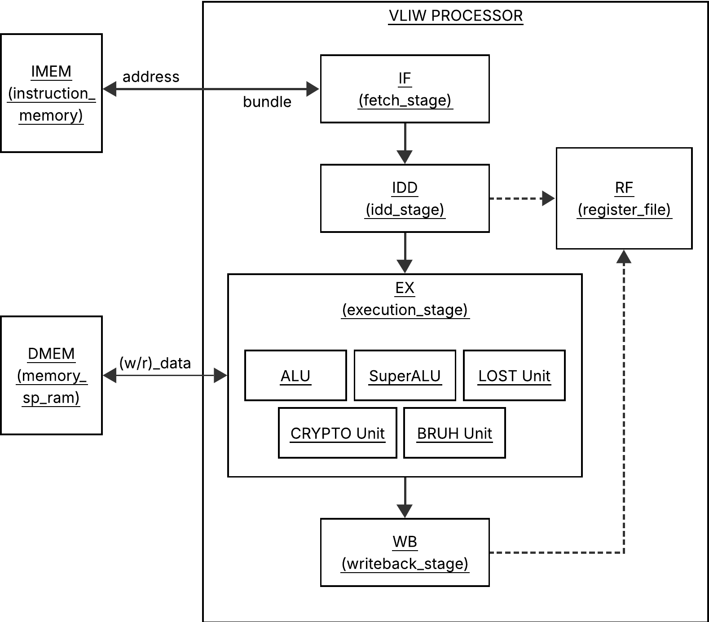</a>

**Figura 1.** Organización del núcleo VLIW. El siguiente diagrama amplía la conexión de la LSU con la jerarquía de datos del Proyecto II.

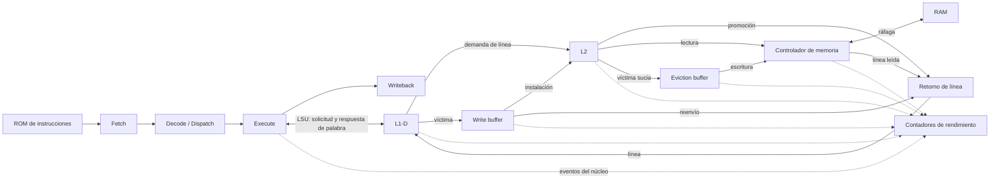

La ROM suministra un bundle completo a IF. En EX, la LSU emite una solicitud de palabra y espera la respuesta de L1-D. Mientras espera, el núcleo retiene el PC y los registros del pipeline. Los contadores siguen recibiendo eventos en cada ciclo de CPU, de modo que una sola lectura puede generar varios ciclos de espera. La conexión entre núcleo, ROM y jerarquía está en [porygon_system.sv](../rtl/porygon_system.sv).

## Pipeline

El pipeline de PORYGON se organiza en cuatro etapas principales.
Cuando el núcleo está habilitado, cada bundle avanza una etapa por ciclo de reloj, de modo que hasta cuatro bundles pueden encontrarse simultáneamente en distintas etapas.

### Fetch (IF)

**Módulo:** `fetch_stage.sv`

Mantiene el Program Counter (`pc_q`) y registra el PC y la validez de IF/ID.
La interfaz con la memoria de instrucciones es **síncrona de un ciclo**: la ROM registra el bundle en el flanco que termina IF. Esa salida constituye la frontera de datos IF/ID; fetch la conecta directamente a decode, sin volver a registrarla. En paralelo, fetch captura el PC de esa lectura, de modo que bundle y PC corresponden a la misma solicitud.
En cada flanco con `advance_i=1` y sin parada, el PC avanza ocho bytes (`BUNDLE_BYTES`) o toma el destino calculado por la BRU si `branch_taken_i` está activo. Con `advance_i=0`, conserva PC y metadatos IF/ID y deshabilita la lectura ROM para conservar también el bundle. `stop_i` invalida IF/ID y conserva sus PC; la prioridad es reset, parada, avance.

| Señal | Dirección | Descripción |
|-------|-----------|-------------|
| `instruction_address_o` | Salida | Dirección del bundle solicitado (PC actual) |
| `advance_i` | Entrada | Permiso común generado por el control de memoria y parada del núcleo |
| `stop_i` | Entrada | Cancela IF/ID e inhibe fetch al reconocer la terminación |
| `instruction_read_enable_o` | Salida | Habilitador de lectura (`rst_ni && advance_i && !stop_i`) |
| `instruction_bundle_i` | Entrada | Respuesta registrada de la lectura IF anterior |
| `branch_taken_i` | Entrada | Decisión de salto de la BRU |
| `branch_target_i` | Entrada | Dirección destino del salto |
| `bundle_o` | Salida | Salida registrada de ROM, calificada por validez IF/ID |
| `bundle_pc_o` | Salida | PC del bundle capturado |
| `bundle_valid_o` | Salida | Validez del bundle en IF/ID |

> [!IMPORTANT]
>
> **Consideración sobre saltos:**
>
> Un salto no invalida IF/ID. Los bundles jóvenes que ya entraron al pipeline deben ser NOPs insertados por el software.
> El ISA no define un mecanismo de flush por hardware.

> [!TIP]
>
> **Memoria de instrucciones (`instruction_memory.sv`):**
>
> Es una ROM de bundles con salida registrada. Cada posición contiene 64 bits y la posición cero corresponde a `TEXT_BASE_ADDRESS` (`0x00000000`).
> Las posiciones no cargadas se inicializan con el bundle NOP completo (`64'h0`).
> Una lectura desalineada o fuera del segmento registra NOP y activa `out_of_range_o` para esa lectura. El wrapper registra el PC correspondiente en el mismo flanco. Sin habilitación de lectura se conserva el bundle y se desactiva el diagnóstico. Reset limpia las salidas, sin modificar la imagen de instrucciones. No se añade una etapa al pipeline ni se cambian los dos bundles de retardo.

### Decode/Dispatch (ID)

**Módulo:** `idd_stage.sv` (con submódulos en `rtl/core/decode/`)

Separa el bundle de 64 bits en cuatro slots de 16 bits, decodifica cada slot, detecta NOPs, gestiona los inmediatos y genera las direcciones de lectura del banco de registros.
La asignación de slots a unidades funcionales es **flexible**: cualquier slot puede contener cualquier tipo de instrucción, y el dispatcher redirige cada operación a la unidad correspondiente según su opcode.

<a href="imgs/idd.png">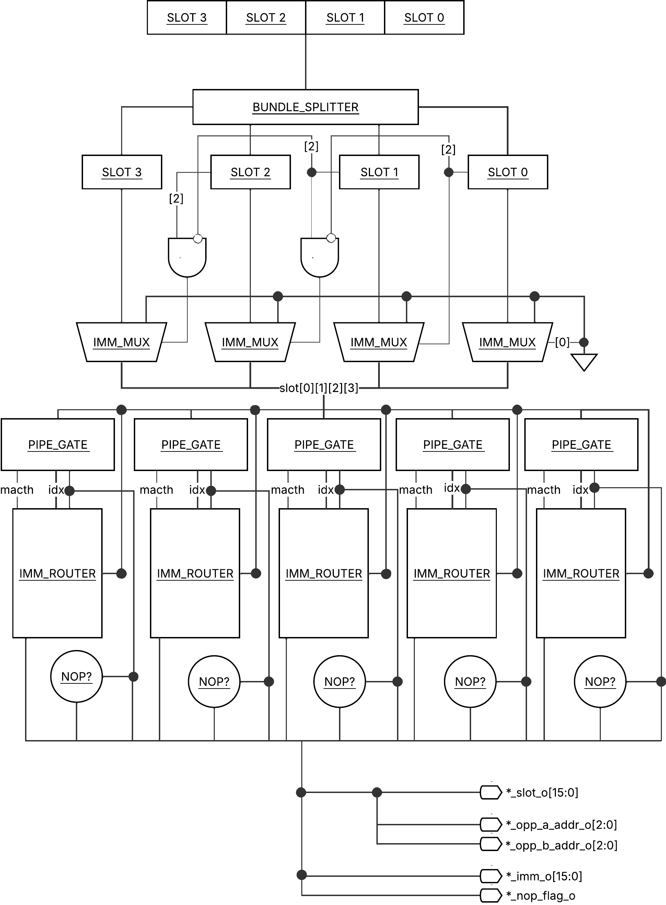</a>

**Figura 3.** Diagrama de bloques de `idd_stage`.

| Submódulo | Responsabilidad |
|-----------|-----------------|
| `bundle_splitter.sv` | Divide el bundle en cuatro slots de 16 bits |
| `imm_mux.sv` | Reemplaza slots que son inmediatos por NOP |
| `pipe_gate.sv` | Enruta slots a la unidad funcional correspondiente |
| `imm_router.sv` | Calcula el inmediato asociado a cada pipe |
| `nop_detector.sv` | Identifica slots NOP (`16'h0000`) |
| `rf_addr_gen.sv` | Genera las direcciones de lectura del banco de registros |

**Mecanismo de inmediato:** El bit `imm` de un slot indica que el slot inmediatamente siguiente contiene un inmediato de 16 bits y no debe decodificarse como instrucción.
La convención es que el inmediato siempre va después del opcode.

**Figura 2.** Distribucion de bundles con inmediatos.
```
┌───────────┬───────────┬───────────┬───────────────┐
│  Slot 3   │  Slot 2   │  Slot 1   │  Slot 0       │
│ instrucc. │ instrucc. │ INMEDIATO │ instr (imm=1) │
└───────────┴───────────┴───────────┴───────────────┘
                              ▲             │
                              └─────────────┘
                    Slot 1 es el inmediato de Slot 0
```

> [!NOTE]
>
> **Salidas hacia ID/EX:**
>
> El dispatcher produce, para cada unidad, un `issued_op_t` que contiene la instrucción, el inmediato, los operandos leídos del banco de registros y el PC del bundle.
> Estos datos se capturan en registros de frontera ID/EX.

### Execute (EX)

**Módulo:** `execution_stage.sv` (integra las unidades funcionales)

Contiene cinco unidades funcionales que se ejecutan en paralelo.
Cada unidad recibe su operación desde ID/EX. La ALU, la LSU y CRYPTO envían resultados al banco de registros por los canales de WB. BRUH entrega al control de fetch la decisión y el destino del salto.

**Figura 4.** Modulos presentes en `execution_stage`.

| Unidad | Módulo | Latencia | Descripción |
|--------|--------|----------|-------------|
| ALU0 | `alu_unit.sv` | 1 ciclo | Operaciones aritméticas, lógicas, comparaciones |
| SuperALU | `super_alu_unit.sv` | 1 ciclo (2 para `mul`/`mulh`) | Desplazamientos, multiplicaciones |
| LSU | `lost_unit.sv` | Variable según el nivel que responde | Cargas y almacenamientos |
| BRUH | `bruh_unit.sv` | Combinacional | Saltos condicionales e incondicionales |
| Crypto | `crypto/crypto_unit.sv` | 2 ciclos | Ronda Feistel4 y operaciones de bóveda |

### Writeback (WB)

**Módulo:** `writeback_stage.sv`

Conecta los cinco resultados (ALU0, SuperALU, LSU, Crypto L, Crypto R) a los cinco puertos físicos de escritura del banco de registros.
Es cableado combinacional; no agrega registros después de `crypto_wb` ni resuelve colisiones de destino.
El scheduler garantiza que no haya conflictos de escritura.

`advance_i=0` inhibe los cinco habilitadores de escritura sin modificar dato ni
destino. Los productores deben conservar sus canales pendientes durante esa
espera. El habilitador se genera en `vliw_processor` y se conecta a fetch, ID/EX,
las etapas MUL y sus tags, WB de ALU0/SuperALU/load/CRYPTO y los cinco puertos RF.
CRYPTO acepta instrucciones y actualiza WB/tags solo al avanzar; sus diagnósticos
se emiten una vez. La bóveda conserva su reloj; el temporizador mantiene su cuenta
durante la espera y descuenta solo al avanzar el núcleo, incluidos NOPs.
El mismo puerto de la LSU sirve a las dos configuraciones de simulación. En el modo de referencia, un adaptador traduce los accesos de palabra a transferencias de línea con el controlador de memoria.

El salto tomado al propio PC cierra fetch y admisión al avanzar EX; los bundles
posteriores se invalidan. Ejecución y WB completan lo pendiente. La previsión
combinacional `work_after_advance_o` permite emitir `stop_done_o` en el último
flanco, incluyendo su escritura o diagnóstico. `halted_o` registra entonces la
parada completa y deshabilita avances hasta reset. Los saltos ordinarios
conservan los dos bundles de retardo por software.

La observación `perf_events_o` usa los tipos de `pkg_metrics`. El núcleo
conserva el bundle y su validez para distinguir NOPs de burbujas; el observador
programa las finalizaciones según las latencias ya existentes y se pausa con
el mismo avance. No participa en dependencias ni control de emisión. Los
errores ROM se retienen hasta admitir ID, y los de alineación se informan con
la dirección efectiva. Al cerrar, los eventos del último flanco coinciden con
`stop_done_o`; después de `halted_o` no se emiten nuevos eventos.

> [!TIP]
>
> **Banco de registros (`register_file.sv`):**
>
> Ocho registros de 32 bits (`r0`–`r7`), con diez puertos de lectura asíncrona y cinco puertos de escritura síncrona.
> `r0` está conectado a cero y no puede sobrescribirse. Las escrituras ocurren en el flanco positivo del reloj.

## Unidades Funcionales

### ALU General (ALU0)

**Módulo:** `alu_unit.sv`

<a href="imgs/alu0.png">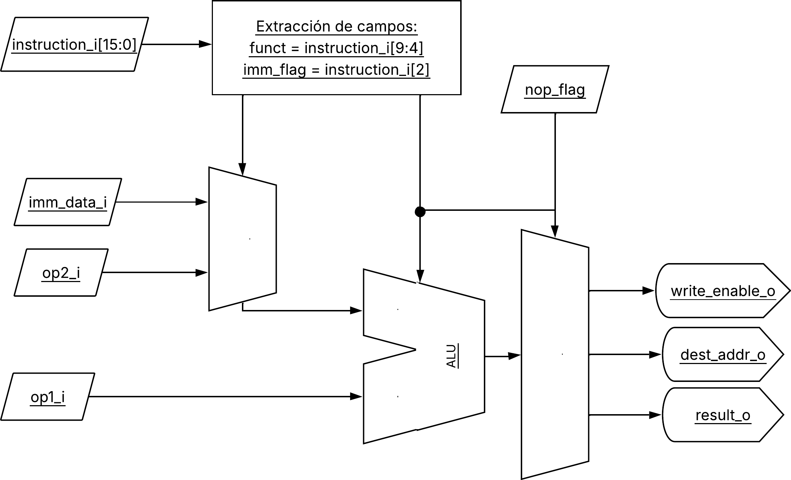</a>

**Figura 4.** Diagrama de bloques de `alu_unit` (ALU0).

| Operación | Instrucción | Descripción |
|-----------|-------------|-------------|
| `mov` | `MATH_MOV` | `rs1 ← rs2` |
| `sum` / `sumi` | `MATH_SUM` | `rs1 ← rs1 + rs2/imm` |
| `diff` / `diffi` | `MATH_DIFF` | `rs1 ← rs1 − rs2/imm` |
| `and` / `andi` | `MATH_AND` | `rs1 ← rs1 & rs2/imm` |
| `or` / `ori` | `MATH_OR` | `rs1 ← rs1 \| rs2/imm` |
| `xor` / `xori` | `MATH_XOR` | `rs1 ← rs1 ^ rs2/imm` |
| `not` | `MATH_NOT` | `rs1 ← ~rs1` |
| `gtn` | `MATH_GTN` | `rs1 ← (rs1 > rs2) ? 1 : 0` |
| `ltn` | `MATH_LTN` | `rs1 ← (rs1 < rs2) ? 1 : 0` |
| `eor` | `MATH_EOR` | `rs1 ← (rs1 == rs2) ? 1 : 0` |
| `nez` | `MATH_NEZ` | `rs1 ← (rs1 != 0) ? 1 : 0` |

### ALU Especializada (SuperALU)

**Módulo:** `super_alu_unit.sv`

<a href="imgs/super_alu.png">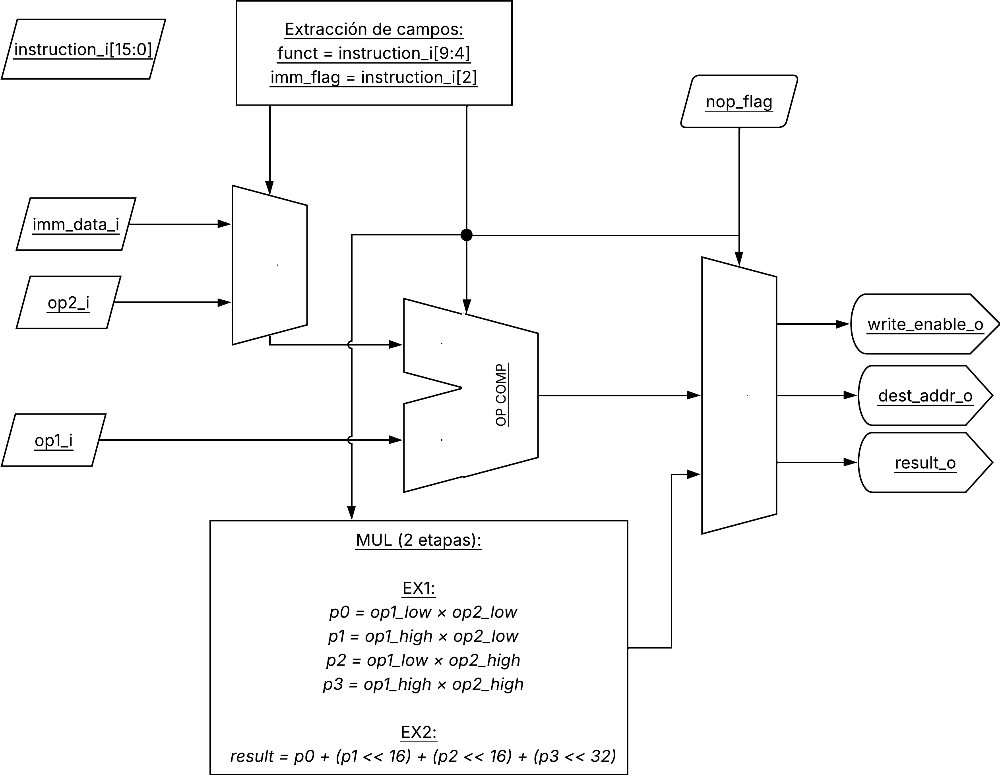</a>

**Figura 5.** Diagrama de bloques de `super_alu_unit` (SuperALU).

| Operación | Instrucción | Descripción |
|-----------|-------------|-------------|
| `shl` / `shli` | `MATH_SHL` | `rs1 ← rs1 << rs2/imm` (lógico) |
| `shr` / `shri` | `MATH_SHR` | `rs1 ← rs1 >> rs2/imm` (lógico) |
| `sar` / `sari` | `MATH_SAR` | `rs1 ← rs1 >>> rs2/imm` (aritmético) |
| `mul` / `muli` | `MATH_MUL` | `rs1 ← rs1 × rs2/imm` (parte baja) |
| `mulh` / `mulhi` | `MATH_MULH` | `rs1 ← rs1 × rs2/imm` (parte alta) |

### LSU (Load/Store Unit)

**Módulo:** `lost_unit.sv`

<a href="imgs/lost.png">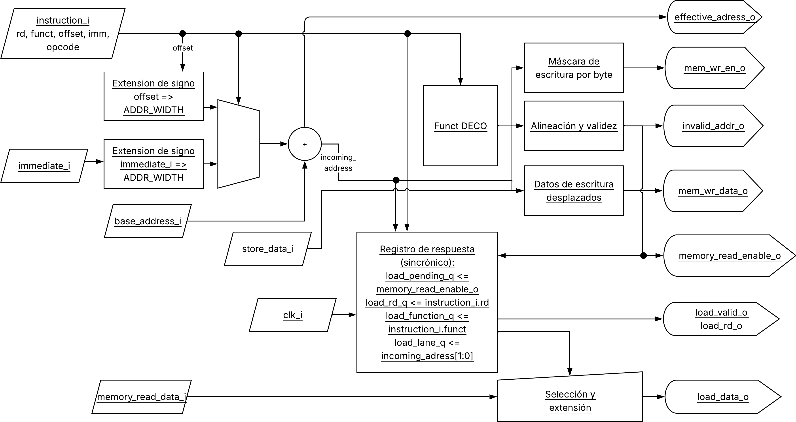</a>

**Figura 6.** Diagrama de bloques de `lost_unit` (LSU).

| Operación | Instrucción | Descripción |
|-----------|-------------|-------------|
| `low` / `lowi` | `LOST_LOW` | Carga palabra de 32 bits |
| `lob` / `lobi` | `LOST_LOB` | Carga byte con extensión de signo |
| `lobu` / `lobui` | `LOST_LOBU` | Carga byte con extensión de ceros |
| `loh` / `lohi` | `LOST_LOH` | Carga media palabra con signo |
| `lohu` / `lohui` | `LOST_LOHU` | Carga media palabra con ceros |
| `stw` / `stwi` | `LOST_STW` | Almacena palabra |
| `stb` / `stbi` | `LOST_STB` | Almacena byte |
| `sth` / `sthi` | `LOST_STH` | Almacena media palabra |

> [!NOTE]
>
> **Memoria de datos (`memory_sp_ram.sv`):**
>
> Arreglo de bytes de 64 KiB, con base en `DATA_BASE_ADDRESS` (`0x00010000`).
> Las lecturas son sincrónicas (capturan una palabra little endian en el flanco positivo) y las escrituras aplican una máscara por byte.
> Un acceso fuera del segmento no indexa el arreglo y activa `out_of_range_o`.

### BRUH (Branch Unit)

**Módulo:** `bruh_unit.sv`

<a href="imgs/bruh.png">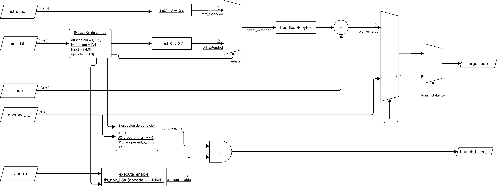</a>

**Figura 7.** Diagrama de bloques de `bruh_unit` (BRUH).

| Operación | Instrucción | Descripción |
|-----------|-------------|-------------|
| `j` / `ji` | `JUMP_J` | Salto incondicional relativo |
| `jz` / `jzi` | `JUMP_JZ` | Salto condicional si `rd == 0` |
| `jnz` / `jnzi` | `JUMP_JNZ` | Salto condicional si `rd != 0` |
| `jr` | `JUMP_JR` | Salto indirecto (`PC ← Reg[rd]`) |

### Crypto Unit

**Módulo:** `crypto/crypto_unit.sv`

<a href="imgs/crypto.png">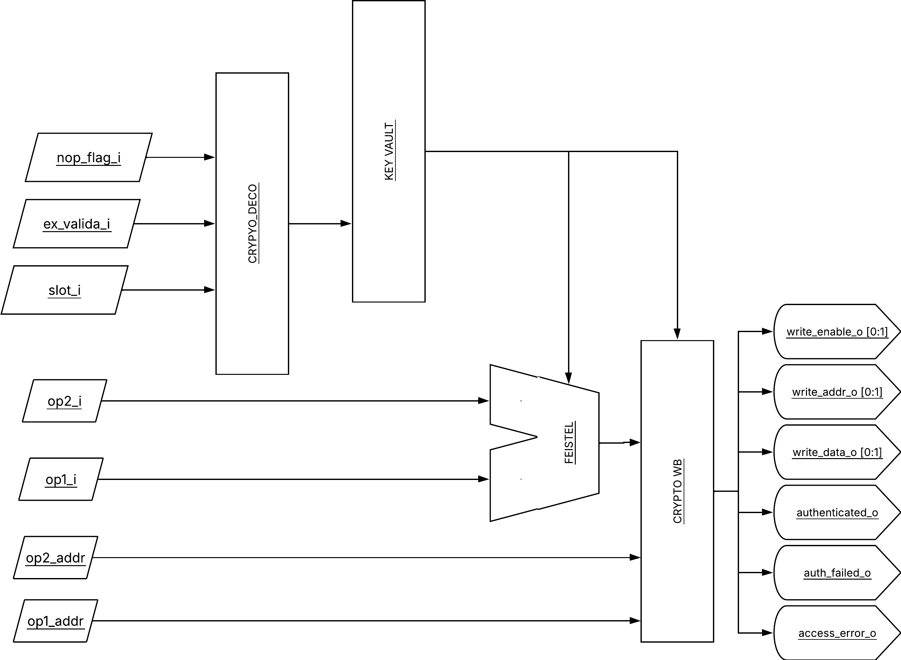</a>

**Figura 7.** Diagrama de bloques de `crypto_unit`.

| Operación | Instrucción | Descripción |
|-----------|-------------|-------------|
| `auth` | `CRYPTO_AUTH` | Compara la credencial de 128 bits construida en `rsa` contra `rsp` |
| `write` | `CRYPTO_WRITE` | Almacena una subllave de 32 bits en la bóveda |
| `feistel` | `CRYPTO_FEISTEL` | Ejecuta una ronda Feistel4 |
| `pwd` | `CRYPTO_PWD` | Copia la credencial de `rsa` a `rsp` |
| `rvk` | `CRYPTO_RVK` | Revoca la autenticación (`AUTH ← 0`) |
| `LOPW` | `CRYPTO_LOPW` | Escribe una palabra de la credencial en `rsa` |

**Función de ronda Feistel4:**

```
F(x, k) = (ROL32(x, 5) + k) XOR ROL32(x, 13)

Nuevo L = R
Nuevo R = L XOR F(R, k)
```

> [!IMPORTANT]
>
> **Bóveda de llaves (`rtl/core/crypto/key_vault.sv`):**
>
> Almacena cuatro llaves de 128 bits (16 subllaves de 32 bits).
> Mantiene los registros internos `rsp` (contraseña de 128 bits), `rsa` (credencial candidata de 128 bits, write-only), `rsa_valid` (4 bits), `state` (FSM de autenticación) y `auth_timer`.
> Las llaves nunca se exponen a registros de propósito general ni a memoria general; solo la instrucción `feistel` las lee y `write` las escribe.

## Banco de Registros

**Módulo:** `register_file.sv`

| Registro | Nombre | Uso | ¿Escribible? |
|----------|--------|-----|--------------|
| `r0` | zero | Siempre 0 | No |
| `r1`–`r7` | — | Propósito general | Sí |

> [!NOTE]
>
> **Puertos de lectura:**
>
> 10 puertos asíncronos de 3 bits de dirección y 32 bits de datos.

Cada unidad despachada consume dos puertos (operando A y operando B). La asignación es:

| Unidad | Puerto A | Puerto B |
|--------|----------|----------|
| ALU0 | 0 | 1 |
| SuperALU | 2 | 3 |
| LSU | 4 | 5 |
| BRUH | 6 | 7 |
| Crypto | 8 | 9 |

**Puertos de escritura:** 5 puertos síncronos de 3 bits de dirección y 32 bits de datos. La asignación es:

| Puerto | Fuente |
|--------|--------|
| 0 | ALU0 |
| 1 | SuperALU |
| 2 | LSU |
| 3 | Crypto L |
| 4 | Crypto R |

> [!WARNING]
>
> El banco de registros no resuelve colisiones de escritura. El scheduler debe garantizar que no haya colisiones.

## Memoria

### Mapa de Memoria

| Segmento | Rango | Uso |
|----------|-------|-----|
| Instrucciones (texto) | `0x00000000` – `0x0000FFFF` | Bundles de instrucciones |
| Datos | `0x00010000` – `0x0001FFFF` | Datos generales, archivos cargados |
| Pila | `0x0001F000` – `0x0001FFFF` | Pila del programa (crece hacia abajo) |
| Reservado | resto | Reservado para expansión |

### Recorrido de un acceso de datos

En la configuración predeterminada, un load sin contención puede completarse en **1 ciclo** si acierta en L1, **9 ciclos** si la línea viene de L2 y **48 ciclos** si requiere RAM. Para seguir esos tres caminos, los diagramas siguientes muestran dónde se busca la línea, quién la conserva durante la espera y qué evento permite continuar. Las instancias y los canales se pueden seguir en [data_memory_hierarchy.sv](../rtl/memory/data_memory_hierarchy.sv).

#### L1-D: de la palabra a la línea

<a href="imgs/l1-d.png">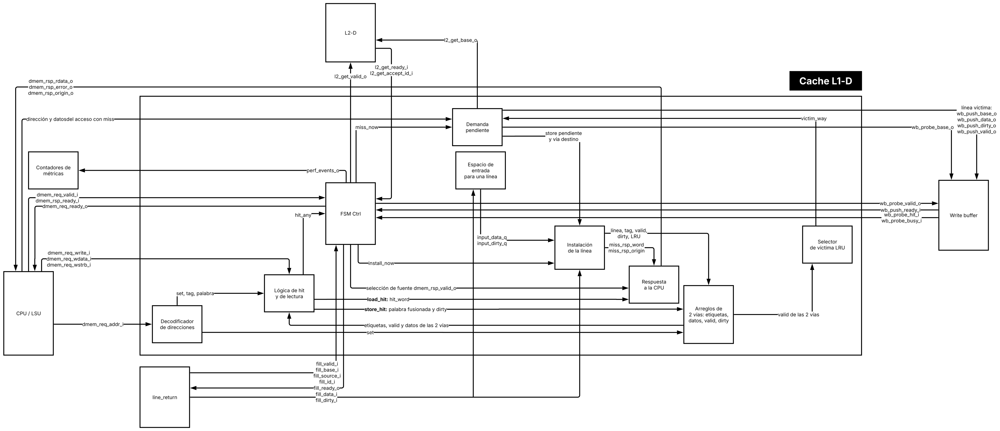</a>

La dirección selecciona el conjunto y la palabra dentro de la línea de 32 bytes. En un hit, L1 entrega la palabra o aplica la máscara del store y marca la línea como modificada (*dirty*). En un miss, guarda la demanda y la vía destino. El bloque `line_return` reúne los retornos del write buffer, L2 y memoria. Al instalar la línea, L1 puede completar la demanda pendiente y actualizar el estado de reemplazo. Detalle del módulo: [L1-D](modulos/microarquitectura-l1.md).

#### Write buffer: qué ocurre con la víctima de L1

<a href="imgs/write-buffer.png">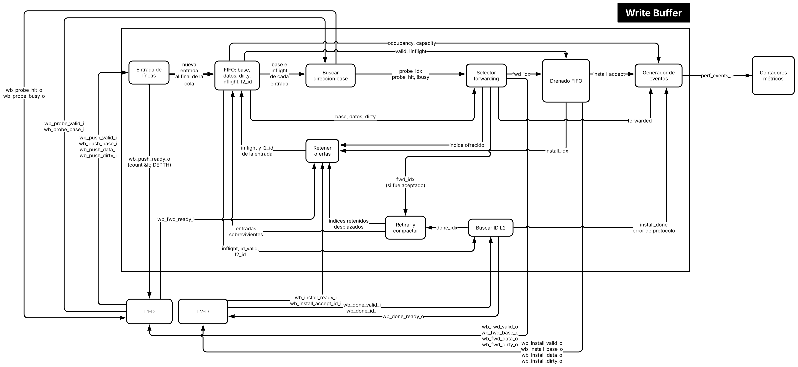</a>

En esta jerarquía exclusiva, las víctimas válidas de L1, limpias o sucias, pasan por un FIFO de cuatro entradas hacia L2. Si L1 vuelve a pedir una línea que sigue en la cola, el buffer puede reenviarla con su bit *dirty*. Si L2 ya aceptó su instalación, la entrada conserva el identificador hasta la confirmación. Así, la siguiente lectura espera a que la línea esté disponible en L2. Detalle del módulo: [write buffer](modulos/microarquitectura-write-buffer.md).

#### L2: admisión, reservas y promoción

<a href="imgs/l2.png">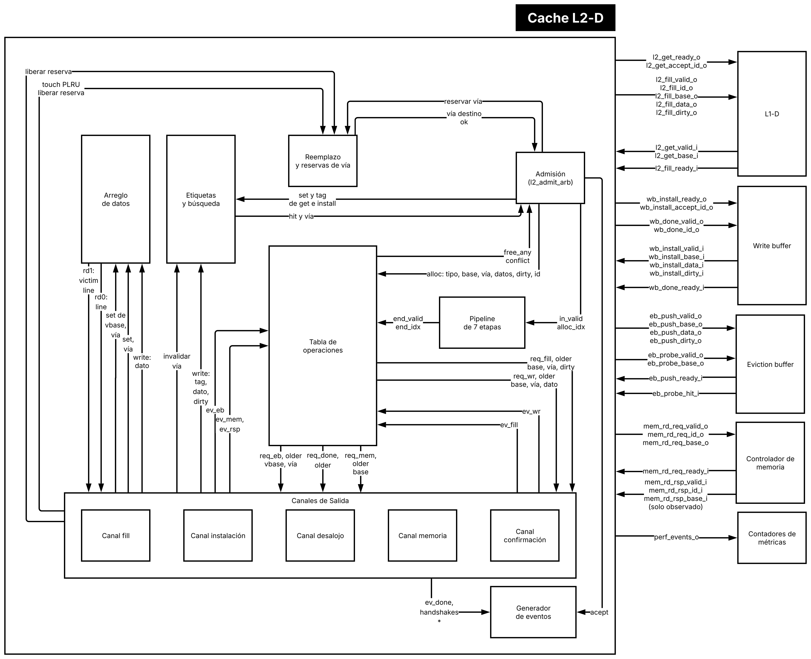</a>

L2 arbitra entre demandas de L1 e instalaciones del write buffer. Al admitir una operación le asigna una entrada de la tabla y, cuando corresponde, reserva su vía. El bloque «Pipeline de 7 etapas» desplaza el **índice** de la operación. Sus datos y metadatos permanecen en la tabla. Esto permite seguir hasta cuatro operaciones en vuelo y conservar una respuesta mientras otra operación independiente avanza. En un hit de demanda, la línea se mueve a L1 y L2 invalida la copia al aceptarse el retorno. En un miss, L2 solicita la lectura al controlador. Detalle del módulo: [L2](modulos/cache_l2.md).

#### Eviction buffer: desalojo de una línea sucia

<a href="imgs/eviction-buffer.png">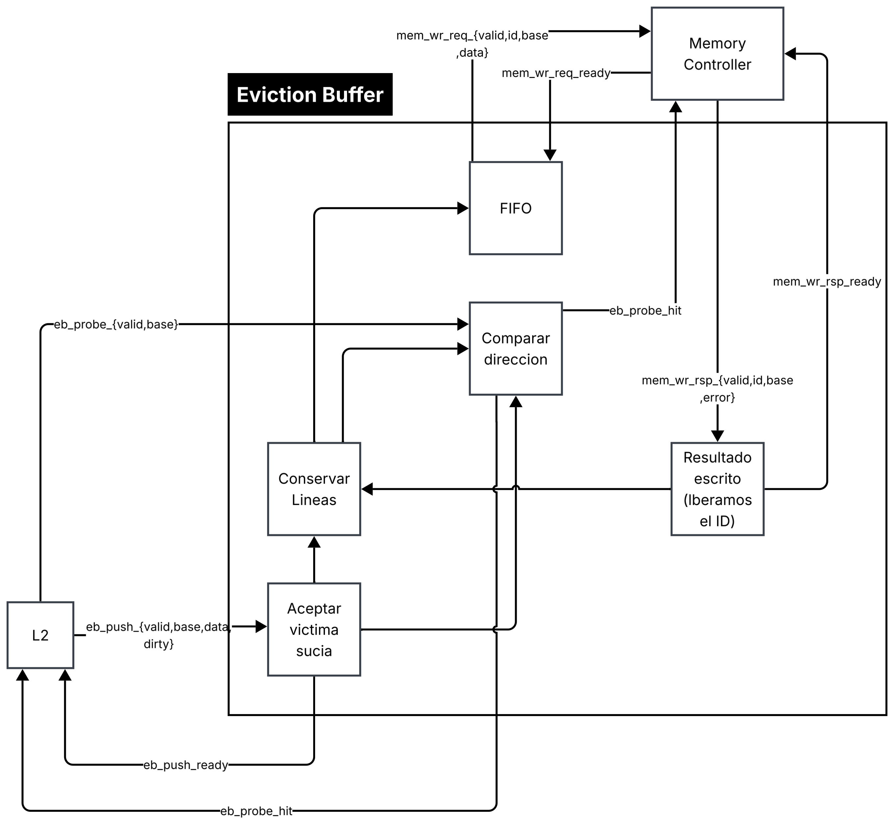</a>

Cuando una instalación desplaza una línea sucia de L2, el eviction buffer conserva su dirección y sus datos en un FIFO de ocho entradas. La entrada permanece ocupada hasta que el controlador confirma la escritura. Si llega una lectura de esa dirección, la comparación por dirección base detecta el conflicto y la lectura espera esa confirmación. Las demás entradas pueden seguir pendientes. Detalle del módulo: [eviction buffer](modulos/microarquitectura-eviction-buffer.md).

#### Controlador: transferencia y retorno desde RAM

<a href="imgs/controlador-memoria.png">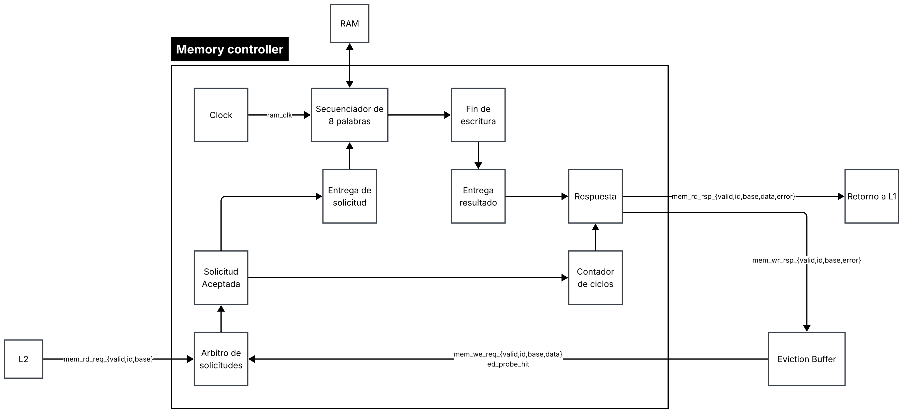</a>

El controlador arbitra las lecturas solicitadas por L2 y las escrituras provenientes del eviction buffer. La RAM opera a 50 MHz con la CPU a 100 MHz. En la configuración predeterminada, la primera palabra tarda 25 ciclos de CPU y las siete restantes llegan a razón de una cada dos ciclos. La línea completa tarda **25 + 7 × 2 = 39 ciclos de CPU**. Sumados al ciclo de L1 y a los ocho de L2, se obtienen los 48 ciclos del load sin contención. Las lecturas regresan a L1 por `line_return`. La confirmación de escritura libera la entrada correspondiente del eviction buffer. Detalle del módulo: [controlador de memoria](modulos/microarquitectura-memory-controller.md).

Los contadores registran los hits y misses de cada nivel, la ocupación de los buffers, las palabras transferidas y los stalls del núcleo. Los tiempos anteriores sirven como referencia para interpretar mediciones con contención. La [guía de simulación](simulation.md) describe cómo obtener la instantánea de contadores al terminar un programa.

## Flujo de Datos

### Ejemplo de Bundle Mixto

```
Bundle[63:0] = [ Slot 3: CRYPTO | Slot 2: JUMP | Slot 1: LOST | Slot 0: MATH ]
```

| Slot | Formato | Instrucción | Unidad |
|------|---------|-------------|--------|
| 0 | MATH | `sum r1, r2` | ALU0 |
| 1 | LOST | `low r3, 0(r4)` | LSU |
| 2 | JUMP | `jz r1, 8` | BRUH |
| 3 | CRYPTO | `feistel r5, r6, 0, 0` | Crypto |

ID captura los operandos antes de que el bundle entre en EX. ALU0 calcula la suma y BRUH evalúa el valor de `r1` leído en ID. Al mismo tiempo, la LSU solicita la palabra en la dirección de `r4` y CRYPTO calcula la ronda con los operandos capturados, si la sesión está autorizada.

Si la lectura queda pendiente, el núcleo retiene el bundle completo e inhibe las escrituras en registros. Cuando consume la respuesta, el pipeline vuelve a avanzar y aplica la decisión de salto. Los canales de WB entregan la suma a `r1`, la palabra leída a `r3` y las dos mitades de la ronda a `r5` y `r6` en el flanco de escritura correspondiente.

### Dependencias de Datos

El hardware **no** resuelve dependencias de datos. El scheduler debe garantizar que:

- Una instrucción que lee un registro no se emita hasta que la instrucción que lo escribió haya alcanzado writeback.
- Las operaciones con latencia > 1 (LSU, SuperALU `mul`, Crypto) requieren separación adicional.
- Las operaciones independientes se agrupen en el mismo bundle para explotar el paralelismo.

**Ejemplo de dependencia RAW (Read After Write):**

```asm
; Bundle 0: escribe r1
{ sum r1, r2 | nop | nop | nop }

; Bundle 1: lee r1 (debe esperar a que WB escriba r1)
{ sum r3, r1 | nop | nop | nop }
```

Si el scheduler coloca ambas instrucciones en bundles consecutivos, la segunda leerá el valor antiguo de `r1` porque WB escribe en el flanco y ID lee combinacionalmente. Para este resultado rápido, WB escribe en el flanco de emisión + 2. La lectura del consumidor debe ocurrir después de ese flanco:

```asm
; Bundle 0: escribe r1
{ sum r1, r2 | nop | nop | nop }

; Bundle 1: NOP de separación
{ nop | nop | nop | nop }

; Bundle 2: WB del productor
{ nop | nop | nop | nop }

; Bundle 3: lee r1 actualizado
{ sum r3, r1 | nop | nop | nop }
```

### Dependencias de Control

El hardware **no** resuelve dependencias de control. El scheduler debe garantizar que:

- Después de un salto, se inserten dos bundles NOP antes de la instrucción destino.
- La BRU evalúa el salto en el ciclo de EX y fetch aplica la decisión en el siguiente flanco.
- Los bundles jóvenes que ya entraron al pipeline no se invalidan; deben ser NOPs.

**Ejemplo de salto:**

```asm
; Bundle 0: salto condicional
{ jz r1, 3 | nop | nop | nop }

; Bundle 1: NOP (branch delay slot)
{ nop | nop | nop | nop }

; Bundle 2: NOP (branch delay slot)
{ nop | nop | nop | nop }

; Bundle 3: destino del salto (si r1 == 0)
{ sum r2, r3 | nop | nop | nop }
```

## Integración con el Pipeline

### Fronteras de Pipeline

| Frontera | Registro | Contenido |
|----------|----------|-----------|
| IF/ID | `instruction_memory.sv` y `fetch_stage.sv` | Bundle registrado en ROM; PC y validez registrados en fetch |
| ID/EX | `vliw_processor.sv` (genvar) | `issued_op_t` para cada unidad |
| EX/WB | `execution_stage.sv` | `wb_channel_t` para cada fuente |
| WB/RF | `writeback_stage.sv` | Puertos de escritura del RF |

### Señales de Control

| Señal | Origen | Destino | Descripción |
|-------|--------|---------|-------------|
| `branch_taken_o` | BRUH | Fetch | Decisión de salto |
| `branch_target_o` | BRUH | Fetch | Dirección destino |
| `dmem_req_valid_o`, `dmem_req_ready_i` | Núcleo / jerarquía | Jerarquía / núcleo | La solicitud se acepta cuando ambas señales están activas |
| `dmem_req_addr_o`, `dmem_req_write_o`, `dmem_req_wstrb_o`, `dmem_req_wdata_o` | Núcleo | Jerarquía | Dirección alineada, tipo de acceso, máscara y dato del store |
| `dmem_rsp_valid_i`, `dmem_rsp_ready_o` | Jerarquía / núcleo | Núcleo / jerarquía | La respuesta se consume cuando ambas señales están activas |
| `authenticated_o` | Crypto | Sistema | Estado de autenticación |
| `auth_failed_o` | Crypto | Sistema | Evento de autenticación fallida |
| `access_error_o` | Crypto | Sistema | Evento de acceso no autorizado |
| `invalid_address_o` | LSU | Sistema | Evento de dirección inválida |

### Eventos y Diagnósticos

| Evento | Señal | Descripción |
|--------|-------|-------------|
| Autenticación exitosa | `authenticated_o` | La FSM de la bóveda está en `AUTHENTICATED` |
| Autenticación fallida | `auth_failed_o` | La credencial no coincide con `rsp` |
| Acceso no autorizado | `access_error_o` | Se intentó una operación privilegiada sin autenticación |
| Dirección inválida (LSU) | `invalid_address_o` | Acceso desalineado o fuera del segmento de datos |
| Dirección inválida (IF) | `instruction_access_error_o` | Acceso desalineado o fuera del segmento de texto |
| Error de datos | `data_access_error_o` | Acceso fuera del segmento de datos |

Aparte de estos errores, la jerarquía está instrumentada: cada bloque emite un bus de eventos que el módulo `performance_counters` acumula durante una ventana de medición y publica como una instantánea. Es un observador puro, sin `ready` hacia ningún bloque, de modo que instrumentar no altera los tiempos que se miden. Detalle del módulo: [contadores de métricas](modulos/microarquitectura-contadores.md).

## Referencias

- [ISA de PORYGON](isa.md): formatos, instrucciones y codificación.
- [Jerarquía de memoria](memory-hierarchy.md) explica las políticas de las cachés y sus buffers.
- [Integración con CE1108](compiler-integration.md): contrato con el compilador.
- [Simulación](simulation.md): modelo de simulación.

## Apéndice: Correspondencia entre Módulos y Responsabilidades

| Módulo | Responsabilidad | Archivo |
|--------|-----------------|---------|
| `porygon_system` | Sistema completo (procesador + memorias) | `rtl/porygon_system.sv` |
| `vliw_processor` | Núcleo VLIW (IF/ID/EX/WB) | `rtl/core/vliw_processor.sv` |
| `fetch_stage` | PC y frontera IF/ID | `rtl/core/fetch_stage.sv` |
| `idd_stage` | Decodificación y despacho | `rtl/core/decode/idd_stage.sv` |
| `bundle_splitter` | División del bundle en slots | `rtl/core/decode/bundle_splitter.sv` |
| `nop_detector` | Detección de NOPs | `rtl/core/decode/nop_detector.sv` |
| `imm_mux` | Reemplazo de inmediatos por NOP | `rtl/core/decode/imm_mux.sv` |
| `imm_router` | Cálculo del inmediato por pipe | `rtl/core/decode/imm_router.sv` |
| `pipe_gate` | Enrutamiento a unidad funcional | `rtl/core/decode/pipe_gate.sv` |
| `rf_addr_gen` | Direcciones de lectura del RF | `rtl/core/decode/rf_addr_gen.sv` |
| `register_file` | Banco de registros | `rtl/core/register_file.sv` |
| `execution_stage` | Integración de unidades | `rtl/core/execution_stage.sv` |
| `alu_unit` | ALU general | `rtl/core/alu_unit.sv` |
| `super_alu_unit` | ALU especializada | `rtl/core/super_alu_unit.sv` |
| `lost_unit` | Load/Store Unit | `rtl/core/lost_unit.sv` |
| `bruh_unit` | Branch Unit | `rtl/core/bruh_unit.sv` |
| `crypto_unit` | Unidad criptográfica | `rtl/core/crypto/crypto_unit.sv` |
| `key_vault` | Bóveda de llaves | `rtl/core/crypto/key_vault.sv` |
| `feistel_round_logic` | Ronda Feistel4 | `rtl/core/crypto/feistel_round_logic.sv` |
| `crypto_decode` | Decodificación CRYPTO | `rtl/core/crypto/crypto_decode.sv` |
| `crypto_wb` | Frontera EX/WB de Crypto | `rtl/core/crypto/crypto_wb.sv` |
| `writeback_stage` | Conexión de los canales de resultado con los puertos de escritura del banco de registros | `rtl/core/writeback_stage.sv` |
| `instruction_memory` | Memoria de instrucciones | `rtl/memory/instruction_memory.sv` |
| `data_memory_hierarchy` | Integra los niveles, los buffers, el retorno y los contadores | [data_memory_hierarchy.sv](../rtl/memory/data_memory_hierarchy.sv) |
| `cache_l1` | Atiende demandas de palabra de la LSU | [cache_l1.sv](../rtl/memory/cache_l1.sv) |
| `write_buffer` | Conserva víctimas de L1 para reenvío o instalación en L2 | [write_buffer.sv](../rtl/memory/write_buffer.sv) |
| `cache_l2` | Admite demandas e instalaciones y reserva vías | [cache_l2.sv](../rtl/memory/cache_l2/cache_l2.sv) |
| `eviction_buffer` | Retiene líneas sucias hasta la confirmación de RAM | [eviction_buffer.sv](../rtl/memory/eviction_buffer.sv) |
| `line_return` | Entrega a L1 la línea devuelta por el buffer, L2 o memoria | [line_return.sv](../rtl/memory/line_return.sv) |
| `memory_controller` | Arbitra lecturas y escrituras y secuencia las ráfagas | [memory_controller.sv](../rtl/memory/memory_controller.sv) |
| `main_memory` | Conecta el almacenamiento con el reloj de memoria | [main_memory.sv](../rtl/memory/main_memory.sv) |
| `performance_counters` | Acumula eventos y captura la medición final | [performance_counters.sv](../rtl/metrics/performance_counters.sv) |
| `memory_sp_ram` | Memoria de datos | `rtl/memory/memory_sp_ram.sv` |
| `pkg_vliw` | Tipos y constantes | `rtl/pkg_vliw.sv` |
