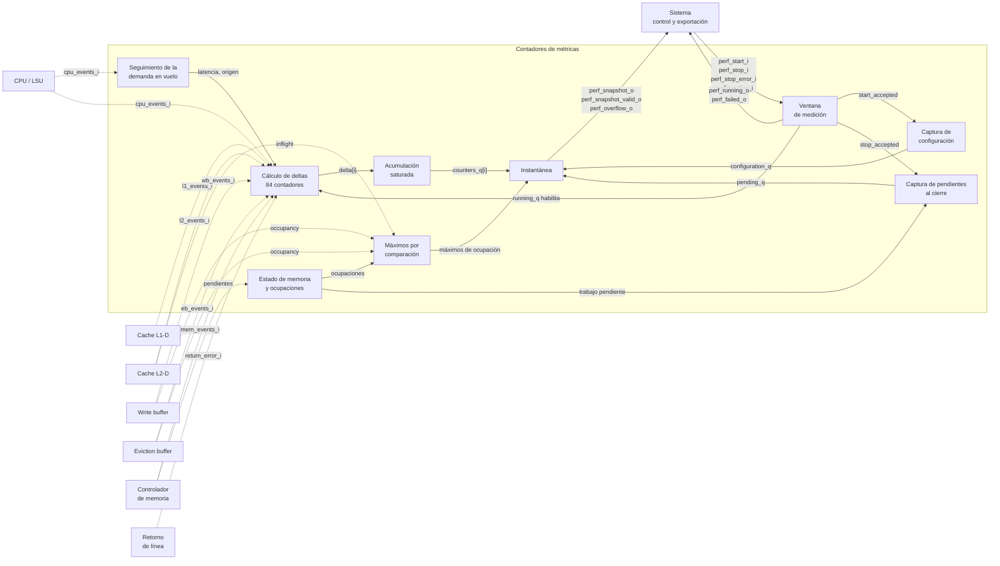
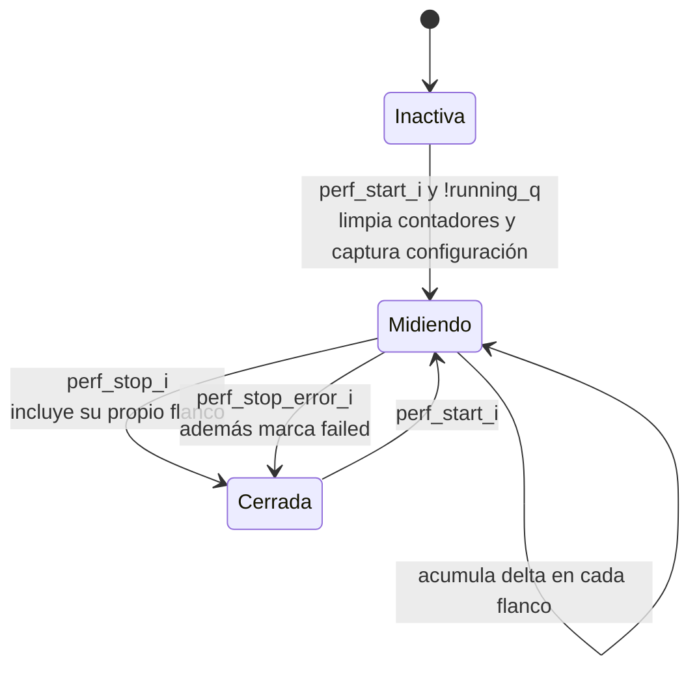

# Organización / Microarquitectura — Contadores de métricas

**Módulo:** `rtl/metrics/performance_counters.sv` · **Issue:** P2-10

## 1. Resumen de la organización

| Propiedad | Valor |
| --- | --- |
| Función | Observador de la jerarquía: acumula eventos durante una ventana de medición y publica una instantánea |
| Posición | Instanciado en `data_memory_hierarchy.sv` como `u_performance_counters` |
| Entradas de observación | Seis buses de eventos (CPU, L1-D, L2, write buffer, eviction buffer, controlador) más los errores del retorno de línea |
| Contadores acumulados | 84, de 64 bits, en siete grupos |
| Máximos | 3, por comparación en lugar de suma: ocupación de WB y EB e inflight de L2 |
| Saturación | Suma de 65 bits por contador; el acarreo fija `perf_overflow_o` hasta reset o nuevo inicio |
| Backpressure | Ninguno: no tiene `ready` hacia ningún bloque y no puede retener a nadie |

La propiedad que define al módulo es que **solo observa**. No participa en ningún
handshake de la jerarquía, no transporta datos y no puede detener a ningún bloque.
Si se retirara del diseño, el comportamiento del procesador sería idéntico. Esto
permite instrumentar la jerarquía completa sin alterar los tiempos que se quieren
medir, que es justamente lo que invalidaría la medición.

## 2. Diagrama de organización interna



Las flechas punteadas son observación pura. Las sólidas son control interno o del
entorno. Ninguna de las punteadas tiene señal de retorno.

## 3. Qué representa cada bloque

| Bloque | Lógica en `performance_counters.sv` | Función |
| --- | --- | --- |
| Ventana de medición | `start_accepted`, `stop_accepted`, `running_q`, `snapshot_valid_q`, `failed_q` | Abre y cierra la ventana, y decide en qué flancos se acumula. |
| Captura de configuración | `configuration_q`, escrito en el flanco de `start_accepted` | Congela la configuración vigente al iniciar, para que la instantánea sea interpretable sin consultar el diseño. |
| Seguimiento de la demanda en vuelo | `demand_active_q`, `demand_cycles_q`, `demand_miss_q`, `demand_write_q` y sus combinacionales `demand_cycles_now`, `demand_miss_now`, `demand_is_write` | Mide cada acceso de datos desde su inicio hasta que termina, y lo clasifica por tipo y por origen de la respuesta. |
| Estado de memoria y ocupaciones | `pending_after` y el registro local de lecturas, escrituras y respuestas pendientes | Deriva el trabajo en curso en memoria a partir de los eventos del flanco. |
| Cálculo de deltas | Los 84 `assign delta[...]` | Produce el incremento de cada contador en el flanco actual. Son asignaciones continuas, una por contador. |
| Acumulación saturada | `wide_sum` de 65 bits dentro del `always_ff`, `counters_q[]`, `overflow_q` | Suma el delta a cada contador y satura en lugar de dar la vuelta. |
| Máximos por comparación | `l2_inflight_max_q`, `wb_occupancy_max_q`, `eb_occupancy_max_q` | Retiene el valor más alto observado; no se acumulan porque no son cuentas. |
| Captura de pendientes al cierre | `pending_q`, escrito en el flanco de `stop_accepted` | Registra qué quedaba en vuelo cuando terminó la medición. |
| Instantánea | El `always_comb` final que publica `perf_snapshot_o` | Arma la vista cruda a partir de los contadores, los máximos, los pendientes y la configuración. |

## 4. Ventana de medición



Las reglas de la ventana:

- Si el inicio se acepta en `E0` y el cierre en `EN`, se cuentan los `N` ciclos entre
  ambos flancos y los eventos de `E1` a `EN`. **El flanco de cierre se incluye**, de modo
  que los eventos de ese mismo ciclo entran en la medición.
- `start_accepted = perf_start_i && !running_q`. Un nuevo inicio limpia todos los
  contadores, los máximos, los pendientes y las banderas.
- `stop_accepted = running_q && (perf_stop_i || perf_stop_error_i)`.
- Si inicio y cierre coinciden en el mismo flanco, **gana el inicio**: la medición se
  reinicia en lugar de abrirse y cerrarse en vacío.
- `perf_stop_error_i` cierra la ventana por sí solo y deja `perf_failed_o` activo. Sirve
  para que un watchdog del entorno marque una corrida como no concluyente sin perder lo
  acumulado hasta ese punto.
- El reset tiene prioridad sobre todo lo anterior.

No hay copia en sombra de los contadores. Al cerrarse la ventana dejan de acumular y
conservan su valor hasta un nuevo inicio o un reset, así que la propia detención los
congela. Lo único que se captura explícitamente en el flanco de cierre es el trabajo
pendiente, porque ese sí es un estado instantáneo que cambiaría después.

## 5. Grupos de contadores

| Grupo | Contadores | Qué cubre |
| --- | --- | --- |
| `cpu` | 24 | Ciclos, bundles, instrucciones, slots NOP y literales, stalls por causa, saltos y retardo, más ocupación, transferencias y stalls de memoria por etapa del pipeline. |
| `dmem` | 10 | Demandas de datos completadas y fallidas, separadas por lectura y escritura, con sus sumas de latencia y los stalls de miss atribuidos a WB, L2 o memoria. |
| `l1` | 10 | Lecturas y escrituras, hits y misses de cada tipo, accesos inválidos y desalojos limpios y sucios. |
| `l2` | 10 | Demandas, hits, misses, promociones, desalojos, suma y máximo de inflight, ciclos lleno y espera de `get`. |
| `wb` | 10 | Encoladas, reenviadas, enviadas e instaladas, suma y máximo de ocupación, ciclos lleno y las tres esperas. |
| `eb` | 8 | Encoladas, enviadas y escritas, suma y máximo de ocupación, ciclos lleno y esperas de push y RAW. |
| `mem` | 14 | Lecturas y escrituras iniciadas y completadas, palabras y ciclos de cada sentido, esperas de solicitud y de respuesta, timeouts y errores. |
| `error_events` | 1 | Un pulso por error detectado en cualquiera de los bloques observados. |

Son 87 campos en total: 84 se acumulan por suma y 3 son máximos por comparación
(`l2.inflight_max`, `wb.occupancy_max` y `eb.occupancy_max`). `NUM_COUNTERS` se deriva del
enumerado `counter_id_e`, de modo que agregar un contador es agregar su identificador y
su `assign delta[...]`.

## 6. Latencia, origen y causa de espera

Una demanda de datos se mide desde el flanco en que la CPU la inicia hasta el flanco en
que termina:

```text
latencia = flanco_fin − flanco_inicio + 1
```

El `+1` hace que un acierto de L1 resuelto en el mismo flanco cueste **un ciclo** y no
cero, que es lo que corresponde: el acceso ocupó un ciclo de la CPU. Solo las demandas
que terminan sin error suman a `latency_sum`; las fallidas van a `failed`.

Cuando la demanda termina, su origen decide a qué contador van los ciclos de miss:

| `dmem_origin` | Significado | Contador |
| --- | --- | --- |
| `ORIGIN_L1` | Resuelta en L1 | No suma stalls de miss |
| `ORIGIN_WB` | Resuelta por forwarding del write buffer | `dmem.miss_stalls_wb` |
| `ORIGIN_L2` | Resuelta en L2 | `dmem.miss_stalls_l2` |
| `ORIGIN_MEMORY` | Resuelta en RAM | `dmem.miss_stalls_mem` |
| `ORIGIN_REFERENCE` | Resuelta por el camino sin caché | `dmem.miss_stalls_mem` |

La causa de un stall llega ya calificada desde el núcleo en `cpu_events_i.wait_reason`,
que `rtl/core/core_metrics.sv` resuelve con prioridad `WAIT_RESPONSE` sobre `WAIT_ACCEPT`
y este sobre `WAIT_MISS`: una respuesta disponible y sin consumir pesa más que una
solicitud sin aceptar, y esta más que una solicitud aceptada que aún no responde. El
observador solo clasifica ese valor en tres contadores; no reconstruye la causa.

## 7. Saturación, máximos y errores

Cada contador se actualiza con una suma de 65 bits:

```systemverilog
wide_sum = {1'b0, counters_q[i]} + {1'b0, delta[i]};
counters_q[i] <= wide_sum[64] ? '1 : wide_sum[63:0];
if (wide_sum[64]) overflow_q <= 1'b1;
```

El bit 64 delata el desbordamiento. El contador satura en su máximo en lugar de dar la
vuelta, y `overflow_q` queda pegado hasta un reset o un nuevo inicio. Así una medición
desbordada se reconoce como tal en vez de reportar un valor pequeño y creíble; las
herramientas la marcan como no comparable y la excluyen de los promedios.

Los tres máximos no se suman: se comparan contra la muestra del flanco y se quedan con
el mayor. Las sumas de ocupación sí se acumulan, porque de ellas sale la ocupación media
dividiendo entre `cpu_cycles`.

`error_events` recibe un pulso por cada error reportado por los bloques observados,
incluido `return_error_i`. Un error no cierra la ventana por sí mismo: cerrarla es
decisión del entorno mediante `perf_stop_error_i`.

## 8. Cierre y trabajo pendiente

En el flanco de cierre se captura `pending_q`, con lo que quedaba en vuelo:

| Campo | Qué cuenta |
| --- | --- |
| `wb_entries` | Entradas ocupadas del write buffer |
| `eb_entries` | Entradas ocupadas del eviction buffer |
| `l2_inflight` | Operaciones en curso en L2 |
| `mem_reads`, `mem_writes` | Transferencias aceptadas y no terminadas |
| `mem_read_responses`, `mem_write_responses` | Respuestas disponibles y no consumidas |

Sirve para interpretar la medición: una corrida que termina con buffers llenos midió una
ventana que todavía tenía trabajo por delante, y sus totales de tráfico no incluyen ese
drenado posterior.

## 9. Indicadores derivados

Los contadores son crudos a propósito. `tools/metrics/indicators.py` calcula sobre ellos:

| Indicador | Cálculo |
| --- | --- |
| IPC | `cpu_instructions / cpu_cycles` |
| Throughput de bundles | `cpu_bundles / cpu_cycles` |
| Hit y miss rate de L1 por tipo | Hits o misses de ese tipo entre su suma; excluye accesos inválidos |
| Hit y miss rate de L2 | `l2_hits / (l2_hits + l2_misses)` y su complemento |
| AMAT observado | `dmem_latency_sum / dmem_completed`, en ciclos de CPU por acceso |
| Ocupación media de un buffer o de L2 | Su suma de ocupación entre `cpu_cycles` |
| Bytes transferidos | `4 * (mem_read_words + mem_write_words)` |
| Ancho de banda observado | Bytes transferidos entre `cpu_cycles / f_cpu` |
| Utilización del ancho de banda | Ancho de banda observado entre `4 * f_mem` |
| Fracción de tiempo de transferencia | `(mem_read_cycles + mem_write_cycles) / cpu_cycles` |

Un denominador en cero se informa como `N/A` conservando los contadores crudos. Como
referencia sin forwarding ni contención:

```text
AMAT_referencia = 1 + MR_L1 * (8 + MR_L2 * Tread)
Tread = MEM_READ_FIRST_WORD_CYCLES + 7 * MEM_CLOCK_DIV
```

El AMAT observado incorpora forwarding, espera por buffers, arbitraje y el ciclo de
consumo de la respuesta, que la fórmula no modela; de ahí que el medido quede algo por
encima del de referencia de forma sistemática. Los resultados están en la
[evaluación de rendimiento](../performance.md).

## 10. Casos de referencia

`tests/unit/tb_performance_counters.sv` verifica estos casos contra conteos exactos:

| Caso | Conteo esperado |
| --- | --- |
| Bundle con dos operaciones, un literal y un NOP | Un bundle, dos instrucciones, un literal y un NOP al completar el trabajo. |
| Load hit L1, aceptación y respuesta en `E1` | Un read, un hit, una respuesta correcta, latencia de un ciclo y cero stalls. |
| Store miss L1, hit L2, respuesta en `E9` | Un write y un miss L1, una demanda y un hit L2, latencia de nueve ciclos y ocho stalls de miss. |
| Load miss L1/L2, respuesta en `E48` | Una demanda en cada nivel, un miss en cada uno, una lectura de memoria, latencia de 48 ciclos y 47 stalls sin contención. Memoria consume 39 ciclos y ocho palabras. |
| Forwarding de WB | Un miss L1 y un forwarding; conserva dirty y no genera una demanda a L2 por ese acceso. |
| Línea sucia drena por EB mientras la CPU trabaja | Una escritura y ocho palabras al completar; incrementa tiempo de memoria y solo cuenta stalls si el núcleo realmente se congela. |
| Respuesta de memoria disponible y retenida cinco ciclos | Un `mem_complete` y cinco ciclos de espera de respuesta en su canal; el tiempo de transferencia termina al estar disponible. |
| Dos bundles NOP de retardo, uno congelado tres ciclos | Dos ciclos de retardo por sus avances; los tres ciclos congelados se atribuyen a espera de memoria. |

En una ejecución correcta con todas las demandas completadas se cumple
`l1_misses = wb_forwarded + l2_demands`, sumando reads y writes, y
`l2_demands = l2_hits + l2_misses`. Estas dos igualdades son la comprobación más barata
de que la instrumentación es coherente: si no se cumplen, hay eventos perdidos o
contados dos veces.

## 11. Decisiones de diseño

| Decisión | Justificación |
| --- | --- |
| **Observador sin backpressure** | Instrumentar no puede cambiar lo que se mide. Sin `ready` hacia ningún bloque, el módulo no puede alterar los tiempos de la jerarquía. |
| **Un arreglo de deltas y una sola suma** | Los 84 contadores comparten la lógica de acumulación y saturación, así que el desbordamiento se trata en un único lugar y agregar un contador no toca el camino crítico. |
| **Deltas como asignaciones continuas** | Mantiene el cálculo fuera del `always_ff` y evita que la lectura de campos de struct dentro de un `always_comb` dispare la inferencia de sensibilidad por campo, que Icarus no soporta. |
| **Saturar en lugar de dar la vuelta** | Un contador que vuelve a cero produce un número verosímil y falso. Saturado y con `overflow` pegado, la herramienta descarta la medición. |
| **Sin copia en sombra** | Al cerrar la ventana los contadores dejan de acumular y ya quedan congelados; duplicar 84 registros de 64 bits para lo mismo no se justifica. |
| **Capturar solo los pendientes al cierre** | A diferencia de los contadores, el trabajo en vuelo es un estado instantáneo que cambiaría después del cierre. |
| **Inicio con prioridad sobre cierre simultáneo** | Hace que `start` siempre deje una ventana limpia y evita el caso degenerado de una medición de cero ciclos. |
| **Cierre por error independiente** | Permite que un watchdog marque la corrida como no concluyente conservando lo acumulado, en vez de perder la medición entera. |
| **Contadores crudos, indicadores fuera del RTL** | Las razones y promedios se calculan en software, donde cambiarlos no cuesta una resíntesis ni un bit de hardware. |
