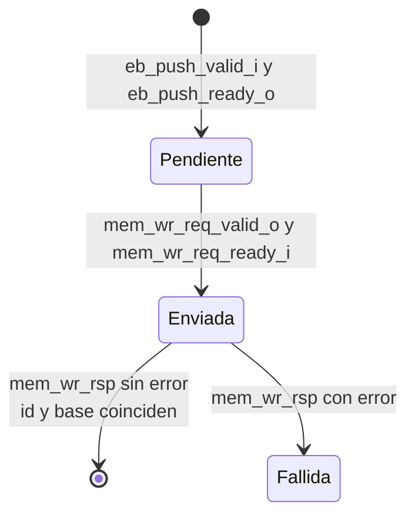
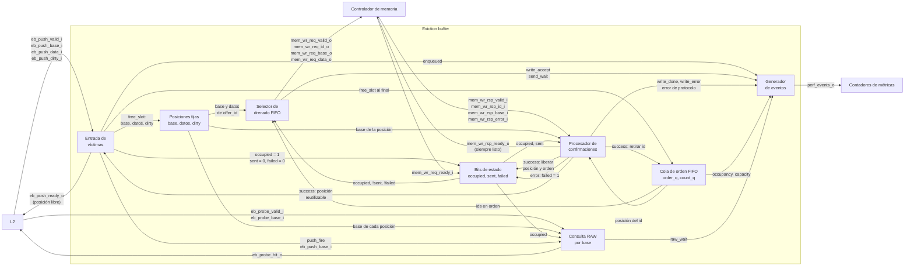
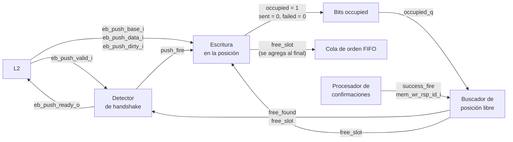
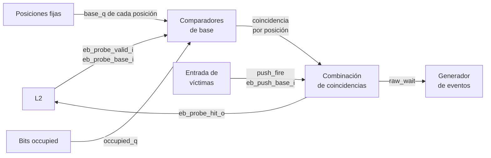
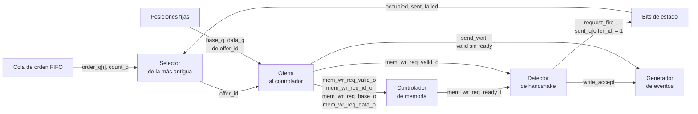
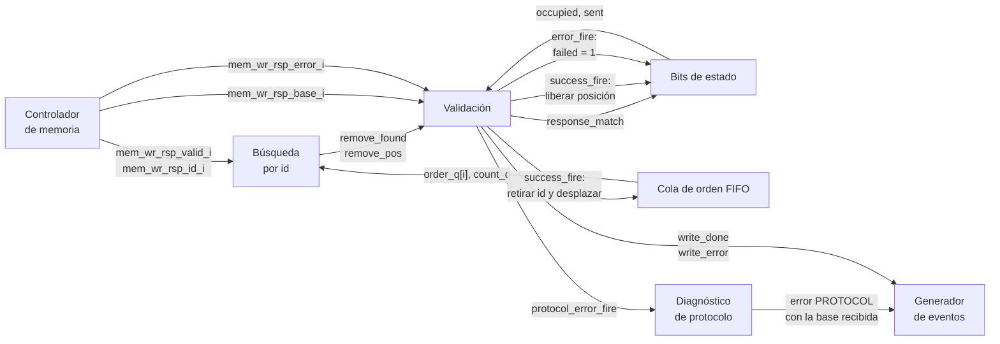

# Organización / Microarquitectura — Eviction buffer L2 → memoria

**Módulo:** `rtl/memory/eviction_buffer.sv` · **Issue:** P2-04

## 1. Resumen de la organización

| Propiedad | Valor |
| --- | --- |
| Función | Recibe las víctimas **sucias** de L2 y las drena hacia memoria principal sin que L2 espere la escritura |
| Capacidad | `EVICTION_BUFFER_DEPTH` líneas, 8 por defecto (rango del enunciado: 4 a 16) |
| Contenido de una entrada | Dirección base, 32 bytes de datos, dirty, y los bits `occupied`, `sent` y `failed` |
| Almacenamiento | **Posiciones fijas**: los datos no se mueven; el índice de la posición es el id de escritura |
| Orden | Un arreglo `order_q` guarda los ids de las posiciones en orden FIFO |
| RAW con L2 | **Stall**: la lectura de una línea en el buffer espera su confirmación de escritura |
| Liberación | Solo al consumir una confirmación de escritura correcta (`mem_wr_rsp` sin error) |
| Ancho del id | `id_width(EVICTION_BUFFER_DEPTH)`, independiente del id de lectura de L2 |

Estados de una entrada, según sus bits:

| Situación | `occupied` | `sent` | `failed` | Significado |
| --- | --- | --- | --- | --- |
| Pendiente | 1 | 0 | 0 | Aceptada; espera ser ofrecida al controlador. |
| Enviada | 1 | 1 | 0 | El controlador aceptó la escritura; espera la confirmación. |
| Fallida | 1 | 1 | 1 | La confirmación llegó con error: se conserva y **no se reenvía**. |
| Libre | 0 | 0 | 0 | Liberada por una confirmación correcta. |

Una entrada sigue participando en la consulta RAW desde que se acepta hasta que se
libera: incluso con el burst ya terminado, la línea se considera pendiente hasta
consumir su confirmación correcta.

## 2. Diagrama de organización interna

## 3. Qué representa cada bloque

| Bloque | Lógica en `eviction_buffer.sv` | Función |
| --- | --- | --- |
| Entrada de víctimas | `free_found`, `free_slot`, `push_fire` | Acepta una víctima si hay una posición libre, **incluida la que una confirmación correcta libera en el mismo flanco**. El índice libre pasa a ser su id de escritura. |
| Posiciones fijas | `base_q`, `data_q`, `dirty_q` | Guardan la línea sin moverla hasta que se libera. Solo `occupied_q` indica si el contenido es vigente. |
| Bits de estado | `occupied_q`, `sent_q`, `failed_q` | Un bit por posición; definen en qué etapa está la entrada. |
| Cola de orden FIFO | `order_q`, `order_d`, `count_q` | Lista de ids en orden de llegada. Al retirar un id se desplazan los siguientes; al aceptar una víctima se agrega el id al final. |
| Consulta RAW por base | segundo `always_comb` (`eb_probe_hit_o`) | Combinacional y sin handshake. Compara con toda posición ocupada (pendiente, enviada o fallida) y con la víctima que L2 entrega en ese mismo flanco. |
| Selector de drenado FIFO | `offer_found`, `offer_id` | Recorre `order_q` y ofrece la primera entrada ocupada que no se haya enviado ni haya fallado. |
| Procesador de confirmaciones | `response_match`, `success_fire`, `error_fire`, `protocol_error_fire` | Valida id, base y que la entrada esté enviada. Con éxito libera; con error conserva y marca `failed`; sin coincidencia emite un error de protocolo. |
| Generador de eventos | último `always_comb` | Convierte los handshakes y el estado en `eb_events_t`. No altera el control. |

## 4. Canales del eviction buffer

### 4.1 Canal de entrada (`eb_push_*`)

Su handshake libera a L2: al aceptarse, L2 invalida su vía y puede reutilizarla sin
esperar a que la línea llegue a memoria. El buffer reserva una posición fija por
víctima, por lo que la línea no se copia ni se desplaza después.

Si el flanco libera una posición y a la vez se acepta una víctima, **gana el push** y
reutiliza esa posición: la bandera `occupied` se vuelve a activar en lugar de
borrarse.

### 4.2 Canal de consulta RAW (`eb_probe_*`)

L2 consulta el buffer antes de pedir una línea a memoria. Si la base coincide con una
escritura pendiente, **L2 espera** a que se consuma su confirmación correcta y recién
después emite la lectura; no hay forwarding ni se vacía el buffer completo.

La coincidencia incluye la víctima que L2 entrega **en el mismo flanco**. Así, el
controlador de memoria no puede aceptar una lectura de una base cuya escritura se
acaba de aceptar en el buffer. La entrada fallida también cuenta: sigue siendo la
versión más reciente de esa línea hasta que se escriba bien.

### 4.3 Canal de drenado (`mem_wr_req_*`)

Ofrece la entrada pendiente más antigua sin mover sus datos. El valor `valid` y los
campos se mantienen estables mientras el controlador no acepta, porque el selector
recalcula siempre la misma entrada hasta que se marca como enviada.

Aceptar la solicitud **no libera** la entrada: solo la marca como enviada. La línea
permanece en el buffer y en la consulta RAW hasta la confirmación correcta.

### 4.4 Canal de confirmación (`mem_wr_rsp_*`)

El controlador publica la confirmación cuando las ocho palabras quedaron almacenadas.
El buffer siempre está listo para consumirla (`mem_wr_rsp_ready_o = rst_ni`), así que
una respuesta nunca queda retenida por falta de espacio aquí.

Una confirmación es válida solo si coinciden **cuatro condiciones**: la posición está
ocupada, fue enviada, su id está en la cola de orden y la base devuelta es la
guardada. Si falla alguna, se consume pero no modifica el estado y se emite un error
de protocolo.

| Resultado | Efecto sobre la entrada |
| --- | --- |
| Correcta (`success_fire`) | Se libera la posición y se retira su id de la cola. |
| Con error (`error_fire`) | Se conserva con `failed = 1`; no se reenvía y sigue en la consulta RAW. |
| Sin coincidencia (`protocol_error_fire`) | Ningún cambio; un evento `ERROR_PROTOCOL`. |

## 5. Orden FIFO sin mover los datos

El buffer separa **dónde** está una línea de **cuándo** le toca salir:

1. Cada víctima aceptada ocupa una posición fija; su índice es el id de escritura.
2. `order_q` guarda esos ids en orden de llegada, con `count_q` entradas válidas.
3. Al retirar un id (confirmación correcta) los ids siguientes se desplazan una
   posición; los datos de 256 bits no se copian.
4. Al aceptar una víctima nueva se agrega su id al final, después de aplicar el retiro
   del mismo flanco.
5. Una entrada fallida permanece en `order_q`, pero el selector de drenado la omite.

Comparado con el write buffer, que compacta datos, aquí solo se desplazan ids de pocos
bits. A cambio, las confirmaciones pueden llegar fuera de orden y se retira siempre la
posición identificada, sin alterar el orden relativo de las demás.

## 6. Instrumentación

| Evento | Se genera cuando | Contadores derivados |
| --- | --- | --- |
| `enqueued` | `push_fire` | Víctimas encoladas |
| `write_accept` | `request_fire` (aceptación del controlador) | Escrituras iniciadas |
| `write_done` | `success_fire` | Escrituras confirmadas |
| `write_error` | `error_fire` | Escrituras con error |
| `state.occupancy`, `capacity` | Siempre | Ocupación y capacidad |
| `state.push_wait` | `eb_push_valid_i` sin `ready` | Esperas de L2 por buffer lleno |
| `state.send_wait` | `mem_wr_req_valid_o` sin `ready` | Esperas de aceptación del controlador |
| `state.raw_wait` | `eb_probe_valid_i` con `hit` | Esperas por conflicto RAW |
| `error` | Confirmación sin coincidencia | `ERROR_PROTOCOL`, con la base recibida |

La ocupación se muestrea con el estado previo al flanco; los eventos de handshake se
calculan en el mismo ciclo en que ocurren.

## 7. Decisiones de diseño

| Decisión | Justificación |
| --- | --- |
| **Posiciones fijas con id = índice** | Evita copiar 256 bits en cada retiro y da un identificador natural para emparejar confirmaciones. |
| **Cola de ids para el orden FIFO** | Mantiene el orden de drenado con un desplazamiento barato, sin mover los datos. |
| **RAW por stall** | Una escritura pendiente garantiza que memoria se actualiza antes de leerla; con la política exclusiva y el drenado FIFO el costo es bajo y la lógica mínima. |
| **La línea cuenta hasta la confirmación** | Aunque el burst haya terminado, la entrada sigue en la consulta RAW hasta que la escritura se confirma sin error. |
| **Consulta con la víctima del mismo flanco** | Elimina la ventana en que una lectura y la escritura de la misma base se aceptarían a la vez. |
| **Push gana sobre la liberación** | Una posición liberada se reutiliza de inmediato, sin ciclo muerto. |
| **Entradas fallidas se conservan** | Un error no pierde datos; sigue la política de timeout del controlador. |
| **`rsp_ready` siempre activo** | Una confirmación nunca depende de espacio interno, así que el controlador no se bloquea con respuestas retenidas. |
