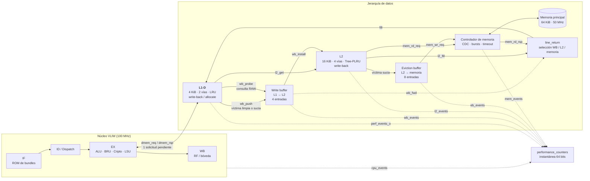
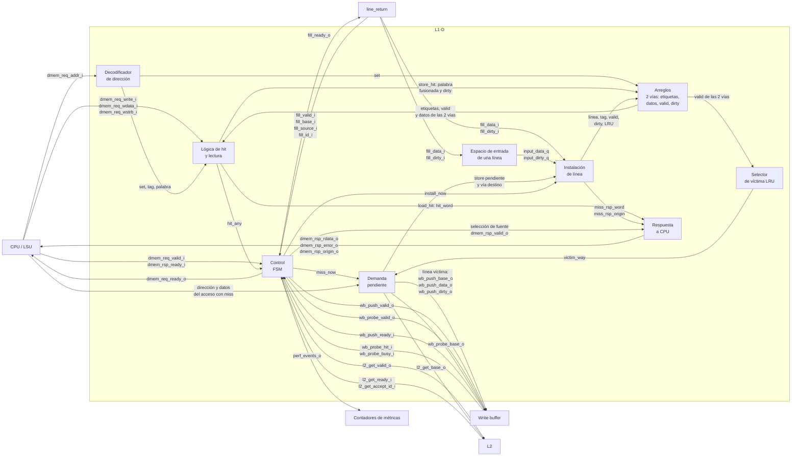
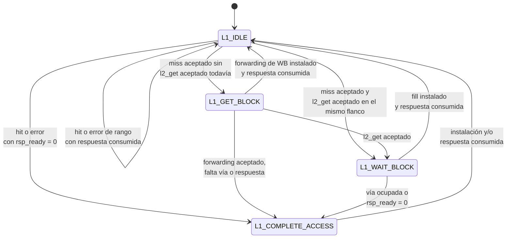

# Organización / Microarquitectura — Caché L1-D

**Estado:** documentación de diseño · **Módulo:** `rtl/memory/cache_l1.sv` · **Issue:** P2-06

## 1. Propósito y alcance

Describe la organización interna de la caché de datos L1-D, su posición dentro del
sistema extendido (pipeline, write buffer, L2, eviction buffer, controlador de
memoria y contadores) y el flujo de datos de cada tipo de acceso. Las políticas
que la gobiernan están justificadas en [Jerarquía](../memory-hierarchy.md). La conexión con el núcleo se describe en [Organización](../microarchitecture.md).

## 2. Resumen de la organización

| Propiedad | Valor | Origen |
| --- | --- | --- |
| Capacidad | 4 KiB (1024 palabras de 32 bits) | Enunciado 3.2.2 |
| Asociatividad | 2 vías | Enunciado 3.2.2 |
| Línea | 32 bytes (8 palabras, 256 bits) | Enunciado 3.2.2 |
| Conjuntos | 4096 / (2 × 32) = **64** | Calculado (`SET_COUNT`) |
| Escritura / asignación | Write-back / write-allocate | Decisión de grupo |
| Reemplazo | LRU, 1 bit por conjunto | Decisión de grupo |
| Inclusión con L2 | Exclusiva (una línea reside en L1 **o** en L2) | Decisión de grupo |
| Hit time | 1 ciclo (aceptación y respuesta en el mismo flanco) | Enunciado 3.2.2 |
| Demandas pendientes | 1 (una sola solicitud de CPU a la vez) | Contrato CPU–memoria |
| RAW con el write buffer | Store-to-load forwarding de la línea completa | Decisión de grupo |

### Descomposición de la dirección

```text
 31                         11 10          5 4      2 1  0
+-----------------------------+-------------+--------+----+
|        tag (21 bits)        | índice (6)  | palabra| 00 |
+-----------------------------+-------------+--------+----+
                                 64 conjuntos  8 pal./línea  alineada a 4 B
```

`BLOCK_OFFSET_W = 5`, `SET_INDEX_W = 6`, `TAG_W = 32 − 6 − 5 = 21`. El índice de
palabra son los bits `[4:2]`. La dirección base de línea es la dirección con
sus cinco bits inferiores en cero; es la que viaja hacia WB, L2 y memoria.

### Almacenamiento interno

| Arreglo | Dimensión | Bits | Función |
| --- | --- | --- | --- |
| `block_data_q` | 64 × 2 × 256 | 32 768 (4 KiB) | Datos de cada línea. |
| `block_tag_q` | 64 × 2 × 21 | 2 688 | Etiqueta. |
| `block_valid_q` | 64 × 2 × 1 | 128 | Validez. |
| `block_dirty_q` | 64 × 2 × 1 | 128 | Línea modificada (write-back). |
| `lru_victim_q` | 64 × 1 | 64 | Vía víctima del conjunto. |

El arreglo de datos se lee de forma combinacional (lectura asíncrona de las dos
vías en paralelo con la comparación de etiquetas), lo que permite el hit en un
ciclo sin etapa MEM separada: el acceso ocurre dentro de EX.

## 3. L1 en el sistema extendido



Las líneas continuas son transferencias con handshake `valid/ready`; las
punteadas son observación de eventos que no alteran el comportamiento funcional.
`line_return` selecciona la única fuente autorizada para la demanda pendiente de
L1 y propaga `ready` hacia el origen.

## 4. Organización interna de L1



### 4.1 Camino de lectura (hit)

1. La dirección de `dmem_req_addr_i` se divide en tag, índice y palabra.
2. Las dos vías del conjunto se leen y se comparan en paralelo
   (`way_hit[i] = valid && tag == req_tag`).
3. `hit_way` selecciona la línea y el índice de palabra selecciona 32 bits
   (`hit_word`).
4. Si el estado es `L1_IDLE`, no hay desalojo pendiente y la dirección es válida,
   `req_ready` y `rsp_valid` se activan en el mismo ciclo: **un hit se
   acepta y responde en el flanco E1**.
5. En ese flanco `lru_victim_q[set] <= ~hit_way`. Si la CPU no puede consumir la
   respuesta (`rsp_ready=0`), se retiene en `response_*` y la FSM pasa a
   `L1_COMPLETE_ACCESS`.

### 4.2 Camino de escritura (hit)

La palabra de la línea se fusiona byte a byte con `dmem_req_wdata_i` según
`dmem_req_wstrb_i` (`merged_store_word`), se escribe en el arreglo de datos y se
marca `block_dirty_q`. La respuesta lleva dato cero. La modificación permanece en
L1 hasta el desalojo de la línea (write-back).

### 4.3 Selección de víctima

`victim_way` prioriza una vía inválida (vía 0 y luego vía 1); si ambas están
ocupadas usa `lru_victim_q[set]`. Un acceso o instalación en la vía *k* deja como
víctima la vía *1−k*. La vía destino se fija en `destination_way_q` al aceptar el
miss y se conserva hasta completar el desalojo.

### 4.4 Recursos de un miss

Un miss usa dos recursos independientes, para que el retorno de línea nunca
dependa de que L1 ya haya desalojado su víctima:

| Recurso | Registros | Función |
| --- | --- | --- |
| Espacio de entrada | `input_reserved_q`, `input_valid_q`, `input_data_q`, `input_dirty_q`, `input_source_q` | Una línea de 32 B reservada **antes** de pedir la línea; recibe el retorno aunque la vía destino aún esté ocupada. Si la vía está libre, la línea se instala directamente en el flanco de entrega. |
| Respuesta retenida | `response_valid_q`, `response_data_q`, `response_error_q`, `response_origin_q` | Conserva el resultado hacia la CPU si `rsp_ready=0`. |
| Demanda pendiente | `pending_*`, `destination_way_q`, `evict_pending_q`, `l2_offered_q`, `l2_id_q` | Dirección, tipo, dato y máscara del store, vía destino y estado de la oferta a L2. |

El store de un miss no se aplica hasta la instalación: `pending_wdata_q` y
`pending_wstrb_q` se fusionan con la línea entrante (`final_install_line`) y la
línea se instala sucia. Se aplica una sola vez.

## 5. Máquina de estados de control



| Estado | Qué hace | Salidas activas |
| --- | --- | --- |
| `L1_IDLE` | Resuelve hit, error de rango o inicia un miss. Solo acepta solicitudes si no hay un desalojo pendiente (`!evict_pending_q`). | `req_ready`, `rsp_valid`; en miss, `wb_probe` y `l2_get`. |
| `L1_GET_BLOCK` | Consulta el WB. Si hay coincidencia libre, acepta el forwarding; si no, ofrece `l2_get`. Si la coincidencia está en servicio (`busy`), espera su instalación en L2 y luego pide a L2. | `wb_probe`, `l2_get`, `fill_ready`. |
| `L1_WAIT_BLOCK` | L2 aceptó la demanda: espera el retorno sin repetir la solicitud. Solo acepta un `fill` cuya base, `id` y fuente coinciden. | `fill_ready`. |
| `L1_COMPLETE_ACCESS` | Termina la instalación desde el espacio de entrada cuando la vía queda libre y/o entrega la respuesta retenida. | `rsp_valid`. |

El desalojo de la víctima es **independiente de la FSM**: mientras
`evict_pending_q=1`, `wb_push_valid` permanece activo con todos sus campos
estables hasta que `wb_push_valid && wb_push_ready` libera la vía. La vía queda
disponible (`way_available_now`) si no hay desalojo pendiente o si el push se
acepta en ese mismo flanco.

## 6. Flujo de datos e instrucciones

El slot LSU de un bundle presenta su acceso durante EX. Todos los slots del
bundle avanzan en lockstep, por lo que mientras L1 no responde, el bundle completo
se congela; la lógica de solicitud pendiente y la propia L1 siguen funcionando.

### 6.1 Load/store con hit (0 stalls)

```text
Ciclo C0 (EX):  LSU calcula addr/wdata/wstrb ──► L1 compara tags (combinacional)
Flanco E1:      req_valid && req_ready  (L1 acepta)
                rsp_valid && rsp_ready  (CPU captura dato y avanza)
```

### 6.2 Miss con hit en L2 (8 stalls)

```text
E1:      L1 acepta; reserva espacio de entrada y vía destino; consulta WB (miss en WB)
         l2_get_valid ─► L2 acepta (devuelve accept_id); CPU se congela
E2–E8:   L2 busca, encuentra la línea y la invalida en L2 (exclusividad)
E9:      fill (fuente L2, dirty conservado) ─► L1 valida base/id/fuente y acepta
         Instala línea (+ fusiona store si aplica), responde y la CPU reanuda
```

### 6.3 Miss en L1 y L2 (8 + Tmem stalls)

El flujo es el mismo hasta la decisión de L2; luego L2 pide la línea al
controlador, que reúne las 8 palabras del burst y entrega los 256 bits **completos**
(`fill_source = memoria`) al espacio reservado de L1. La línea se instala solo en
L1 y limpia (salvo store). Con los valores por defecto: `Tmem = 25 + 7×2 = 39`,
47 stalls, reanudación en `E48`.

### 6.4 Miss con forwarding del write buffer

```text
E1:   L1 acepta; wb_probe_hit=1 y busy=0  ─► no se presenta l2_get
GET:  WB entrega la línea (wb_fwd ─► line_return ─► fill, fuente WB)
      L1 acepta; la entrada se retira del WB y las demás conservan su orden
      Se instala con su dirty original y se completa el acceso
```

Si la entrada ya está en servicio hacia L2 (`busy=1`), L1 espera el consumo de
la confirmación de instalación y recién entonces pide la línea a L2. Forwarding y
drenado nunca entregan la misma entrada a ambos destinos. El forwarding sigue
contando como miss de L1 y no genera una demanda a L2.

### 6.5 Desalojo de una víctima

Si la vía destino está ocupada por una línea válida, `evict_pending_q` se activa
al aceptar el miss. L1 presenta la víctima completa (`base`, 32 B, `dirty`) al
write buffer **también cuando está limpia**, porque la relación es exclusiva y la
línea debe sobrevivir en L2. Al aceptarla el WB, L1 invalida la vía y puede
reutilizarla, sin esperar a que la línea llegue a L2. Si el WB está lleno, L1
conserva víctima y vía hasta que haya espacio.

### 6.6 Errores

| Condición | Comportamiento de L1 |
| --- | --- |
| Dirección fuera de `0x00010000–0x0001FFFF` | Respuesta inmediata con `rsp_error=1`, dato cero, origen `ERROR`; no consulta ni modifica el arreglo; evento `ERROR_ADDRESS`. |
| Retorno con `fill_error=1` | No instala; cancela la reserva y responde con error. La víctima pendiente sigue drenando hacia WB. |
| Retorno con base, `id` o fuente ajenos | No acepta (`fill_ready=0`); emite un único evento `ERROR_PROTOCOL`. |
| Reset | Cancela reservas y operaciones pendientes; invalida todas las vías y reinicia el bit LRU. |

## 7. Interfaces de L1

| Interfaz | Señales | Dirección | Uso |
| --- | --- | --- | --- |
| CPU ↔ L1 | `dmem_req_{valid,ready,addr,write,wdata,wstrb}`, `dmem_rsp_{valid,ready,rdata,error,origin}` | Bidireccional | Una solicitud y una respuesta por acceso. `origin` es un sideband de métricas. |
| L1 → WB (desalojo) | `wb_push_{valid,ready,base,data,dirty}` | L1 → WB | Entrega de víctima; el handshake libera la vía. |
| L1 → WB (RAW) | `wb_probe_{valid,base}`, `wb_probe_{hit,busy}` | Combinacional | Detecta coincidencia, incluidas entradas en servicio. |
| L1 → L2 | `l2_get_{valid,ready,base}`, `l2_get_accept_id` | Bidireccional | Demanda de bloque; el `id` solo es válido al aceptarse. |
| Retorno → L1 | `fill_{valid,ready,base,data,dirty,error,source,id}` | Retorno → L1 | Línea completa de WB, L2 o memoria al espacio reservado. |
| Eventos | `perf_events_o` | L1 → contadores | Aceptación, clasificación, víctima y error. |

Las ofertas con `valid && !ready` conservan todos sus campos hasta su aceptación;
cada transferencia ocurre una sola vez aunque haya varios ciclos de espera.

## 8. Instrumentación (contadores de métricas)

L1 emite en `l1_events_t`, un evento por flanco, sin conservar contadores
propios (el conteo lo hace `performance_counters`):

| Evento | Se genera cuando | Contadores derivados |
| --- | --- | --- |
| `access_*` (`valid`, `write`, `result`) | Handshake de solicitud; resultado `HIT`, `MISS` o `INVALID`. | `l1_reads`, `l1_writes`, `l1_{read,write}_{hits,misses}`, `l1_invalid_{reads,writes}` |
| `eviction` (`valid`, `base`, `dirty`) | `wb_push` aceptado por el buffer. | `l1_evictions_clean`, `l1_evictions_dirty` |
| `error` (`valid`, `kind`, `address`) | Dirección inválida o retorno ajeno. | Contadores de errores de la instantánea |

El origen final de cada demanda (`ORIGIN_L1`, `WB`, `L2`, `MEMORY`, `ERROR`) sale por
`dmem_rsp_origin_o` y permite etiquetar la finalización para la latencia y el
AMAT. Los eventos siguen activos durante los stalls del núcleo. Un hit se
clasifica una vez, al aceptarse la solicitud; mantener la solicitud o el bundle
durante un stall no genera accesos nuevos. Los hit/miss rates excluyen las
solicitudes inválidas.

## 9. Tiempos de referencia

| Caso | Aceptación | Respuesta | Stalls |
| --- | --- | --- | --- |
| Hit L1 | `E1` | `E1` | 0 |
| Miss L1, hit L2 | `E1` | `E9` | 8 |
| Miss L1 y L2 (`Tmem=39`) | `E1` | `E48` | 47 |
| Miss L1, forwarding de WB | `E1` | Sin consultar L2 | Según disponibilidad de vía |

## 10. Decisiones de diseño y justificación

| Decisión | Justificación |
| --- | --- |
| **Write-back + write-allocate** | Acumula escrituras en L1 y reduce el tráfico hacia L2; combinación típica y coherente con L2 write-back. Costo: bits dirty y control de desalojo. |
| **LRU de 1 bit por conjunto** | Con 2 vías, un solo bit es LRU exacto; costo de 64 bits y lógica mínima. |
| **Hit combinacional dentro de EX** | Cumple el hit de 1 ciclo sin etapa MEM adicional ni stalls en hit; el costo es un camino crítico tag → mux → respuesta. |
| **Espacio de entrada de una línea** | Evita exigir que la víctima ya esté en L2 para recibir la línea: se desacopla desalojo y llenado. |
| **Una sola demanda pendiente** | Simplifica el control y el mapeo de metadatos; coincide con el núcleo en lockstep, que se congela en cada miss. |
| **Victimas limpias también a WB** | Requisito de la política exclusiva: la línea debe existir en exactamente un nivel. |
| **Forwarding desde el WB** | Resuelve el RAW sin esperar el drenado; la línea vuelve a L1 con su dirty y evita una demanda a L2. |
| **Validación de base/id/fuente en `fill`** | Impide instalar una línea ajena y deja un diagnóstico único en vez de corromper el estado. |
