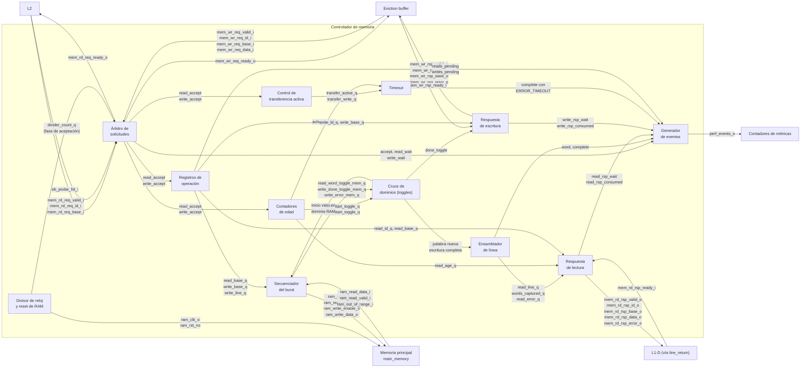
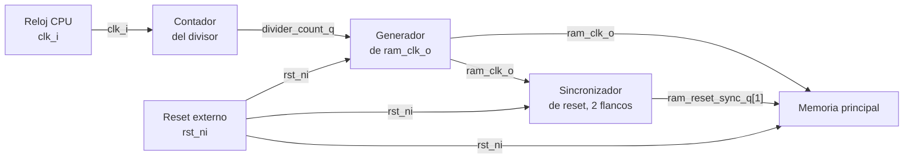
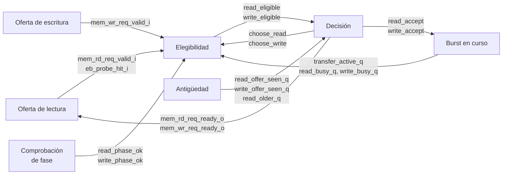
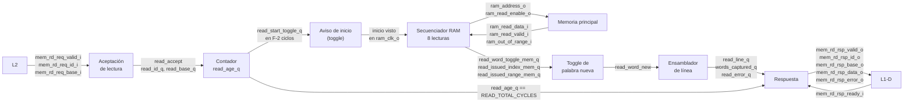
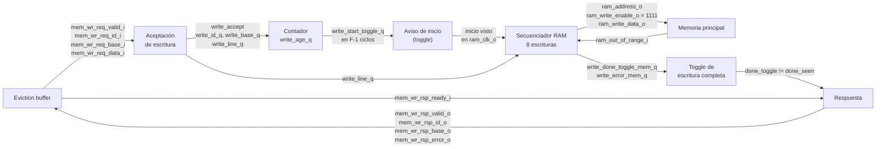
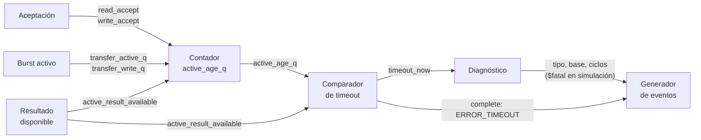

# Organización / Microarquitectura — Controlador de memoria

**Módulo:** `rtl/memory/memory_controller.sv` (almacenamiento: `main_memory.sv`) · **Issue:** P2-03

## 1. Resumen de la organización

| Propiedad | Valor |
| --- | --- |
| Función | Convierte solicitudes de línea completa en bursts de ocho palabras sobre la RAM, realizando el cruce de relojes (CDC) y el timeout |
| Dominios de reloj | CPU (100 MHz) y RAM (`ram_clk_o`, derivado por división de `MEM_CLOCK_DIV`) |
| Reloj de memoria por defecto | `MEM_CLOCK_DIV = 2`, es decir 50 MHz (rango del enunciado: 20 a 50 MHz) |
| Latencia de primera palabra | `MEM_READ_FIRST_WORD_CYCLES` y `MEM_WRITE_FIRST_WORD_CYCLES`, 25 por defecto |
| Duración de un burst | `T = 25 + 7 × MEM_CLOCK_DIV = 39` ciclos de CPU (palabras en 25, 27, 29, 31, 33, 35, 37, 39) |
| Operaciones simultáneas | Una **solicitud de lectura** y una **de escritura** pendientes; un solo burst usa la RAM a la vez |
| Timeout | `MEM_TIMEOUT_CYCLES = 128`, mayor que ambos bursts |
| Ids | Lectura: `id_width(L2_MAX_INFLIGHT)`; escritura: `id_width(EVICTION_BUFFER_DEPTH)`; espacios independientes |

Los tiempos se cuentan **desde la aceptación** de la solicitud e incluyen el CDC. La
espera previa por arbitraje o por alcanzar la fase de reloj necesaria ocurre antes del
handshake, por lo que no forma parte de los 39 ciclos ni del timeout.

### Validaciones de parámetros (en simulación)

| Condición exigida | Motivo |
| --- | --- |
| `MEM_CLOCK_DIV` entre 2 y 5 | Mantiene la RAM entre 20 y 50 MHz. |
| `MEM_READ_FIRST_WORD_CYCLES > MEM_CLOCK_DIV` y `MEM_WRITE_FIRST_WORD_CYCLES ≥ 2` | La latencia inicial debe alcanzar para el aviso a través del CDC. |
| `MEM_TIMEOUT_CYCLES` mayor que ambos bursts | Un burst normal nunca debe terminar en timeout. |

## 2. Diagrama de organización interna

La respuesta de lectura **no pasa por L2**: va por el camino de retorno directo hacia
L1, y L2 solo la observa. Por eso el controlador entrega los 256 bits completos y no
palabras parciales.

## 3. Qué representa cada bloque

| Bloque | Lógica en `memory_controller.sv` | Función |
| --- | --- | --- |
| Árbitro de solicitudes | `read_eligible`, `write_eligible`, `choose_read`, `choose_write`, `read_offer_seen_q`, `write_offer_seen_q`, `read_older_q` | Elige la oferta más antigua que pueda iniciar su burst en el flanco actual. En empate de ofertas nuevas, **gana la escritura** (drenado). Una lectura con `eb_probe_hit_i` no es elegible. |
| Registros de operación | `read_busy_q`, `read_id_q`, `read_base_q`, `write_busy_q`, `write_id_q`, `write_base_q`, `write_line_q` | Capturan id, base y datos al aceptar, de modo que cambios posteriores del origen no alteren la operación. Se liberan al consumir la respuesta. |
| Control de transferencia activa | `transfer_active_q`, `transfer_write_q` | Marca que un burst usa la RAM y de qué tipo. Se libera cuando su resultado está disponible, aunque aún no se consuma. |
| Contadores de edad | `read_age_q`, `write_age_q`, `active_age_q` | Cuentan ciclos de CPU desde la aceptación; programan el aviso al lado RAM y la entrega de la última palabra. |
| Timeout | `timeout_now` | Detecta que `active_age_q` llegó a `MEM_TIMEOUT_CYCLES` sin resultado disponible. |
| Divisor de reloj y reset de RAM | `divider_count_q`, `ram_clk_o`, `ram_reset_sync_q`, `ram_rst_no` | Genera el reloj continuo de la RAM y libera su reset sincronizado en su propio dominio. |
| Cruce de dominios | pares `*_toggle_*_q` y `*_seen_q` | Transporta eventos entre dominios con toggles: aviso de inicio (CPU → RAM) y palabra nueva o escritura completa (RAM → CPU). |
| Secuenciador del burst | bloques `always_ff @(posedge ram_clk_o)` | Recorre las 8 palabras en el reloj de RAM, genera dirección, habilitadores y dato, y recoge los diagnósticos. |
| Ensamblador de línea | `read_line_q`, `words_captured_q`, `read_word_seen_q` | Reúne las palabras leídas hasta tener la línea de 256 bits. |
| Respuesta de lectura | `rsp_valid_q`, `read_complete_now`, `mem_rd_rsp_*` | Publica la línea completa con un bypass en el flanco de la última palabra; si L1 no acepta, la retiene estable. |
| Respuesta de escritura | `write_done_toggle_mem_q`, `write_done_seen_q`, `mem_wr_rsp_*` | Publica la confirmación al almacenarse la palabra 7 y la mantiene hasta que el eviction buffer la consume. |
| Generador de eventos | último `always_comb` | Convierte handshakes y estados en `mem_events_t`; no altera el control. |

## 4. Mecanismos del controlador

### 4.1 Reloj y reset de RAM

El divisor cuenta ciclos de CPU y produce `ram_clk_o` **de forma continua**, haya o no
solicitudes. El reset externo baja `ram_rst_no` de inmediato, pero lo libera con un
sincronizador de dos flancos de `ram_clk_o`, de modo que la RAM comienza a operar
dentro de su propio dominio.

`ram_rst_no = rst_ni && ram_reset_sync_q[1]`. Con reset activo el reloj queda en 0 y los
contadores vuelven a su estado inicial; se cancelan ambas caras del CDC y se descartan
las respuestas anteriores.

### 4.2 Árbitro y fase de aceptación

El handshake de solicitud significa **inicio del servicio**. El árbitro solo acepta
cuando la fase del divisor (`divider_count_q`) coincide con la fase calculada para ese
tipo de transferencia (`READ_ACCEPT_PHASE` o `WRITE_ACCEPT_PHASE`), de manera que la
primera palabra en el reloj de RAM caiga exactamente en el ciclo `F` exigido.

| Regla | Comportamiento |
| --- | --- |
| Un solo burst a la vez | Con `transfer_active_q = 1` no se acepta ninguna solicitud nueva; un burst iniciado termina antes del siguiente. |
| Una operación por tipo | `read_busy_q` y `write_busy_q` impiden aceptar otra del mismo tipo hasta consumir su respuesta. |
| Ofertas con antigüedad | Una oferta retenida con `valid` recuerda que llegó antes; si ambas son nuevas en el mismo ciclo gana la escritura. |
| Oferta fuera de fase | Conserva su antigüedad, pero no bloquea a la otra si esta puede iniciar en el flanco actual. |
| RAW con el eviction buffer | Una lectura con `eb_probe_hit_i` no es elegible hasta que ese conflicto desaparece. |

### 4.3 Camino de lectura

1. Al aceptar, el contador de edad arranca y se guardan id y base.
2. Un ciclo antes de lo necesario, el lado CPU cambia `read_start_toggle_q`; el lado RAM
   lo detecta y comienza a leer.
3. Cada palabra se lee con la dirección `base + índice × 4` y se informa con un cambio
   de `read_word_toggle_mem_q`.
4. El lado CPU detecta cada cambio, guarda la palabra en su posición dentro de
   `read_line_q` y suma `words_captured_q`.
5. La respuesta aparece con las ocho palabras y al menos `READ_TOTAL_CYCLES` ciclos de
   edad. Hay un **bypass**: la última palabra se entrega en el mismo flanco en que
   llega, sin sumar otro ciclo de CPU, lo que mantiene el retorno integrado en `E48`.
6. Si L1 no acepta, el mismo flanco guarda línea y error y retiene `rsp_valid_q` hasta
   el handshake. Disponibilidad y consumo son eventos distintos.

Un reloj de RAM detenido no simula lecturas: se espera hasta el timeout.

### 4.4 Camino de escritura

1. Al aceptar se guardan id, base y la línea completa de 256 bits.
2. El aviso de inicio llega al lado RAM; la dirección usa `write_base_q + índice × 4` y
   la máscara es `1111` en cada palabra.
3. Tras escribir la palabra 7, el lado RAM cambia `write_done_toggle_mem_q`; el lado
   CPU publica la confirmación en ese ciclo.
4. `mem_wr_rsp_valid_o` permanece activo hasta que el eviction buffer consume la
   respuesta (`done_seen` iguala a `done_toggle`).
5. **Aceptar la solicitud no libera la entrada del eviction buffer**: solo consumir
   una confirmación sin error lo hace.

El error de escritura (`write_error_mem_q`) se acumula si alguna palabra cae fuera de
rango.

### 4.5 Cruce de dominios

Los eventos viajan como **toggles**: el emisor invierte un bit y el receptor lo compara
con su copia `seen`. No se usan handshakes entre relojes.

| Evento | Origen → destino | Señales |
| --- | --- | --- |
| Inicio de lectura | CPU → RAM | `read_start_toggle_q` / `read_start_seen_q` |
| Inicio de escritura | CPU → RAM | `write_start_toggle_q` / `write_start_seen_q` |
| Palabra de lectura capturada | RAM → CPU | `read_word_toggle_mem_q` / `read_word_seen_q` |
| Palabra de escritura almacenada | RAM → CPU | `write_word_toggle_mem_q` / `write_word_seen_q` |
| Escritura completa | RAM → CPU | `write_done_toggle_mem_q` / `write_done_seen_q` |

Las latencias de 25 y 39 ciclos **ya incluyen** esta frontera y el CDC. Un dato
sincrónico de la RAM se captura un flanco de CPU después del acceso, y las fases de
aceptación compensan ese desfase.

### 4.6 Timeout

El contador `active_age_q` arranca al aceptar y corre mientras el burst está activo y
no hay resultado disponible. No cuenta la espera previa por arbitraje ni el tiempo que
el receptor tarde en consumir una respuesta ya disponible. Una respuesta del otro canal
que siga retenida no afecta su cuenta.

| Caso | Resultado |
| --- | --- |
| Burst completo en 39 ciclos | Finalización normal. |
| Solicitud todavía esperando turno | El timeout aún no empezó. |
| Burst incompleto al llegar a 128 ciclos | `ERROR_TIMEOUT` y, en simulación, `$fatal` con tipo, base y ciclos. Una escritura fallida conserva su entrada en el eviction buffer. |

## 5. Tiempos de referencia (valores por defecto)

| Operación | Aceptación | Primera palabra | Última palabra y resultado | Duración |
| --- | --- | --- | --- | --- |
| Lectura de línea | `A` | `A + 25` | `A + 39` | 39 ciclos CPU |
| Escritura de línea | `A` | `A + 25` | `A + 39` (confirmación) | 39 ciclos CPU |

Las palabras se transfieren en los ciclos `25, 27, 29, 31, 33, 35, 37, 39`, con
`Tread = Twrite = 25 + 7 × 2`. Si se cambia `MEM_CLOCK_DIV` o las latencias, la fórmula
se mantiene: `T = primera palabra + 7 × MEM_CLOCK_DIV`.

## 6. Instrumentación

| Evento | Se genera cuando | Contadores derivados |
| --- | --- | --- |
| `accept` | `read_accept` o `write_accept` | Accesos a memoria, lecturas y escrituras |
| `word` | Cada palabra tras su flanco RAM real | Palabras leídas y escritas |
| `complete` y `complete_error` | Resultado disponible, antes del `ready` | Transferencias completas y errores (`ADDRESS`, `PROTOCOL`, `TIMEOUT`) |
| `read_active`, `write_active` | Burst en curso | Ciclos ocupados de la interfaz (utilización) |
| `read_wait`, `write_wait` | Oferta `valid` sin `ready` | Esperas por arbitraje o fase |
| `read_rsp_wait`, `write_rsp_wait` | Respuesta `valid` sin `ready` | Esperas del receptor |
| `read_rsp_consumed`, `write_rsp_consumed` | Handshake de respuesta | Consumo de respuestas |
| `reads_pending`, `writes_pending` | Operación aceptada y no consumida | Trabajo pendiente |
| `read_responses_pending`, `write_responses_pending` | Resultado disponible no consumido | Trabajo pendiente |

Cada palabra se informa una sola vez tras su flanco real de RAM. El evento de
finalización de escritura cruza al siguiente flanco de CPU observable.

## 7. Decisiones de diseño

| Decisión | Justificación |
| --- | --- |
| **Reloj de RAM continuo y derivado por divisor** | Reproduce un dominio más lento sin PLL, cumple 20–50 MHz y es simulable en Icarus Verilog. |
| **CDC con toggles** | Transporta eventos puntuales entre relojes sin handshakes complejos, y cada lado conserva su estado. |
| **Aceptación por fase** | Hace que la latencia contada desde el handshake sea exactamente 25 ciclos a la primera palabra, y la espera de fase quede fuera del tiempo medido. |
| **Un burst a la vez, una operación por tipo** | La RAM transfiere una palabra por ciclo de memoria y no admite lectura y escritura simultáneas; esto simplifica el control y evita intercalar bursts. |
| **Escritura gana en empate** | Prioriza el drenado del eviction buffer, liberando espacio para L2. |
| **Entrega de la línea completa con bypass** | L1 nunca recibe palabras parciales y el retorno integrado no suma un ciclo extra. |
| **Respuesta retenida hasta el handshake** | `valid` y los campos permanecen estables y el controlador conserva la línea sin perderla. |
| **Timeout desde la aceptación** | Mide solo el tiempo del burst, excluye arbitraje y consumo, y detecta una RAM sin respuesta o con reloj detenido. |
