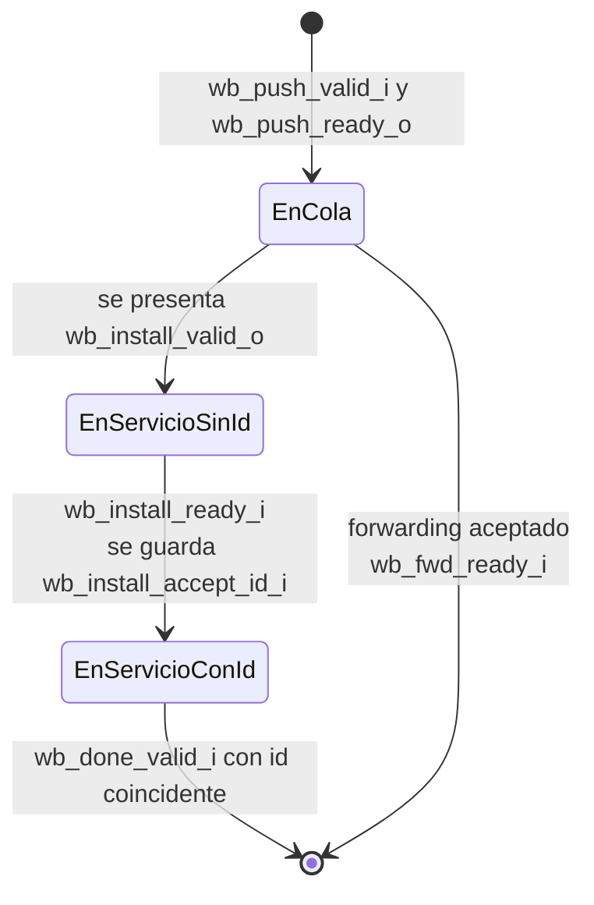
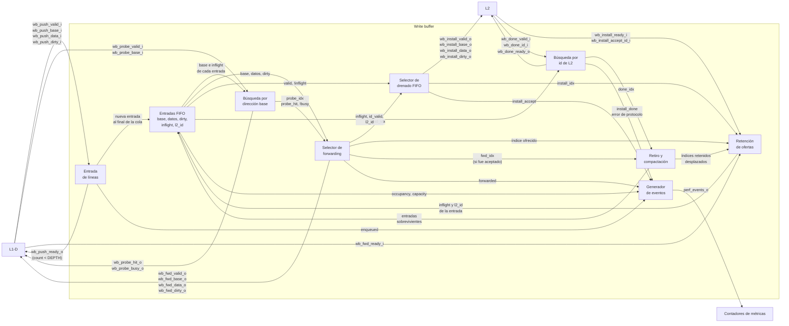
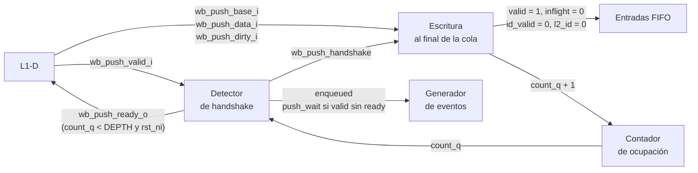
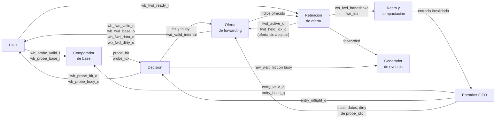
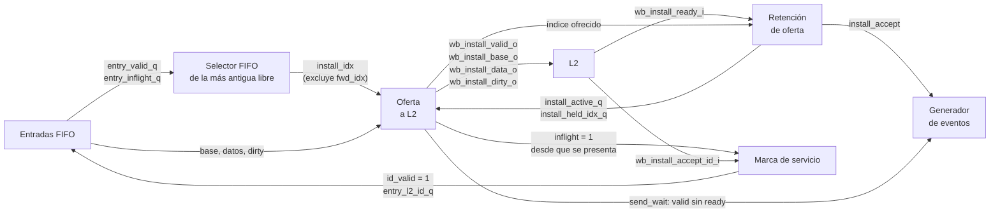
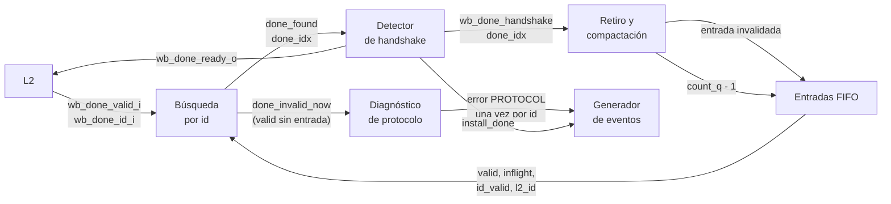

# Organización / Microarquitectura — Write buffer L1 → L2

**Módulo:** `rtl/memory/write_buffer.sv` · **Issue:** P2-05

## 1. Resumen de la organización

| Propiedad | Valor |
| --- | --- |
| Función | FIFO de víctimas de L1 hacia L2, limpias o sucias (L2 es exclusiva) |
| Capacidad | `WRITE_BUFFER_DEPTH` líneas, 4 por defecto (rango del enunciado: 2 a 8) |
| Contenido de una entrada | Dirección base, 32 bytes de datos, dirty, y los bits de servicio (`inflight`, `id_valid`, `l2_id`) |
| Orden | Entradas válidas contiguas en `[0 .. count_q-1]`; el índice 0 es la más antigua |
| RAW con L1 | **Store-to-load forwarding** de la línea completa, con búsqueda por dirección base |
| Drenado | FIFO hacia L2, con confirmaciones identificadas que pueden llegar fuera de orden |
| Ancho del id de L2 | `id_width(L2_MAX_INFLIGHT)` |

Una entrada recorre cuatro situaciones:

| Situación | `entry_valid` | `inflight` | `id_valid` | Significado |
| --- | --- | --- | --- | --- |
| En cola | 1 | 0 | 0 | Esperando turno; **puede salir por forwarding**. |
| En servicio, sin id | 1 | 1 | 0 | Se presentó `wb_install_valid_o`, pero L2 aún no aceptó. |
| En servicio, con id | 1 | 1 | 1 | L2 aceptó y devolvió `accept_id`; espera `wb_done`. |
| Libre | 0 | 0 | 0 | Retirada por `wb_done` o por forwarding. |

Una entrada **en servicio nunca se reenvía**: forwarding y drenado no pueden entregar
la misma línea a ambos destinos. Con `probe_busy` activo, L1 espera la confirmación y
recupera la línea desde L2.

## 2. Diagrama de organización interna

## 3. Qué representa cada bloque

| Bloque | Lógica en `write_buffer.sv` | Función |
| --- | --- | --- |
| Entrada de líneas | `push_ready_internal`, paso 5 del `always_ff` | Acepta una víctima si `count_q < WRITE_BUFFER_DEPTH` y la inserta al final de la cola. Con el buffer lleno, `wb_push_ready_o=0` y L1 conserva víctima y vía. |
| Entradas FIFO | `entry_*_q` | Almacena las entradas en posiciones contiguas, la más antigua en el índice 0. |
| Búsqueda por dirección base | primer `always_comb` (`probe_*`) | Compara `wb_probe_base_i` con cada entrada válida, **incluidas las en servicio**. Es combinacional y sin handshake. |
| Selector de forwarding | `fwd_valid_internal`, `fwd_idx` | Ofrece la línea completa a L1 si hay coincidencia **no** en servicio. |
| Selector de drenado FIFO | `install_found`, `install_idx` | Recorre desde el índice 0 y toma la primera entrada válida, no en servicio y no elegida para forwarding. |
| Retención de ofertas | `fwd_active_q`, `install_active_q` y sus índices | Si la oferta salió sin `ready`, fija el índice para mantener estables `valid` y datos hasta el handshake. |
| Búsqueda por id de L2 | `done_found`, `done_idx` | Busca la entrada en servicio cuyo `l2_id` coincide con `wb_done_id_i`. Acepta la confirmación solo si la encuentra. |
| Retiro y compactación | pasos 3 y 4 del `always_ff` | Invalida las entradas retiradas por forwarding o `wb_done` (posiblemente en el mismo ciclo), compacta las restantes conservando el orden FIFO y reajusta los índices retenidos. |
| Generador de eventos | segundo `always_comb` | Convierte handshakes y estado en `wb_events_t`, sin alterar el control. |

## 4. Canales del write buffer

El módulo tiene cuatro canales con handshake. Los dos de salida hacia L1 y L2 ofrecen
`valid` sin esperar `ready`; esa oferta se retiene hasta el handshake.

### 4.1 Canal de entrada (`wb_push_*`)

El buffer inserta después de compactar, así que la nueva entrada queda siempre al
final y conserva el orden FIFO. La aceptación de la víctima libera la vía de L1 sin
esperar a que la línea llegue a L2.

### 4.2 Canal de consulta y forwarding (`wb_probe_*` y `wb_fwd_*`)

Se consulta el buffer antes de pedir la línea a L2. Si hay coincidencia libre, la línea
vuelve completa a L1 con su dirty original y se retira del buffer al aceptarse.

`wb_probe_busy_o` vale 1 en dos casos: la entrada ya estaba en servicio (`inflight`), o
**se está presentando como install en este mismo ciclo**. Así, aunque L2 no haya
aceptado aún, forwarding y drenado no pueden coincidir sobre la misma entrada. Si ambos
compiten por una entrada libre, gana el forwarding.

### 4.3 Canal de drenado (`wb_install_*`)

Presenta la entrada más antigua que no esté en servicio ni sea elegida para
forwarding. Al aceptar L2, el buffer guarda el `accept_id` y puede presentar la
siguiente entrada sin esperar la confirmación.

La entrada pasa a `inflight` desde el ciclo en que se presenta, aunque L2 todavía no
acepte. Esto cierra la ventana de carrera con el forwarding.

### 4.4 Canal de confirmación (`wb_done_*`)

L2 confirma la instalación con el id que había entregado. La entrada se identifica por
ese id, de modo que las confirmaciones pueden llegar **fuera de orden** sin alterar el
orden relativo de las restantes.

Liberar la entrada solo ocurre con `wb_done_valid_i && wb_done_ready_o`: aceptar
`wb_install` no la libera. Un `wb_done` con id sin entrada asociada no se acepta y
genera un único evento de protocolo por id.

## 5. Retiro y compactación

En cada ciclo el buffer puede retirar hasta dos entradas (una por forwarding y otra por
`wb_done`) e insertar una nueva. El `always_ff` lo resuelve en una secuencia fija:

1. Retiene o libera la oferta de forwarding.
2. Marca `inflight` y asocia el `accept_id` si hay handshake de install.
3. Invalida las entradas retiradas.
4. **Compacta** las sobrevivientes hacia el índice 0, conservando el orden y
   desplazando los índices retenidos (`fwd_held_idx_q`, `install_held_idx_q`).
5. Inserta la nueva entrada al final.
6. Limpia los huecos por encima del nuevo `count_q`.

Mantener las entradas contiguas simplifica la selección FIFO (la más antigua es la
primera válida) a costa de un movimiento de datos por retiro, razonable con 2 a 8
entradas.

## 6. Instrumentación

| Evento | Se genera cuando | Contadores derivados |
| --- | --- | --- |
| `enqueued` | Handshake de `wb_push` | Entradas encoladas, con dirty |
| `forwarded` | Handshake de `wb_fwd` | Forwardings |
| `install_accept` | Handshake de `wb_install` | Instalaciones aceptadas por L2 |
| `install_done` | Handshake de `wb_done` | Instalaciones confirmadas |
| `state.occupancy`, `capacity` | Siempre | Ocupación y capacidad |
| `state.push_wait` | `wb_push_valid_i` sin `ready` | Esperas de L1 por buffer lleno |
| `state.send_wait` | `wb_install_valid_o` sin `ready` | Esperas de aceptación en L2 |
| `state.raw_wait` | `probe_hit` y `probe_busy` | Esperas por entrada en servicio |
| `error` | `wb_done` con id sin entrada | `ERROR_PROTOCOL`, un pulso por id |

Los eventos se calculan en un bloque combinacional separado de las ofertas, para que un
cambio de `ready` o `accept_id` no realimente la generación de `valid` hacia el árbitro
de L2.

## 7. Decisiones de diseño

| Decisión | Justificación |
| --- | --- |
| **Forwarding de la línea completa** | Resuelve el RAW sin esperar el drenado, devuelve la línea con su dirty a L1 y evita una demanda a L2. |
| **«En servicio» desde que se presenta** | Impide entregar una misma entrada a L1 y a L2, aun si L2 no ha aceptado. |
| **Confirmaciones por id** | L2 es non-blocking: las instalaciones pueden terminar fuera de orden, y el buffer libera la entrada correcta. |
| **Entradas contiguas con compactación** | La entrada más antigua es siempre la primera válida; simplifica el drenado FIFO. |
| **Retención de ofertas** | Mantiene estables `valid` y datos hasta el handshake y evita repetir solicitudes ya aceptadas. |
| **Capacidad parametrizable (4 por defecto)** | El enunciado permite 2 a 8 entradas; 4 amortigua ráfagas de desalojos sin costo excesivo de área. |
