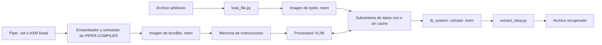
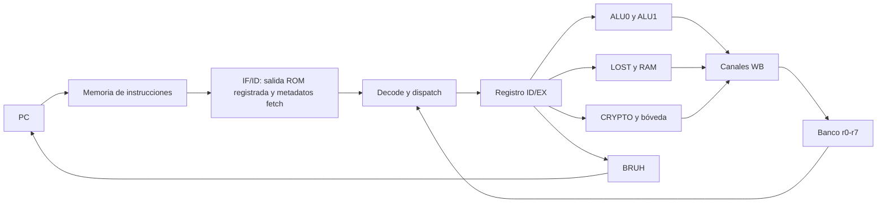

# Modelo de simulación de PORYGON

Este documento describe el modelo de simulación implementado: cómo se
representan el banco de registros, las unidades funcionales y las memorias,
y cómo se conectan el ensamblador y las herramientas de carga y extracción de
archivos. La codificación de instrucciones está en [isa.md](isa.md).

## 1. Qué constituye el sistema simulado

El núcleo P2-09 expone CPU–memoria con handshakes. `porygon_system` integra la
jerarquía con cachés de P2-11 o la referencia sin caché de P2-12 y el observador
P2-10. `make test-p2-11` y `make test-p2-12` verifican esos caminos reales.
Las pruebas aisladas siguientes siguen disponibles: `sim-core-memory-wait`
comprueba el núcleo con un doble y `elaborate-core` elabora sus puertos externos.

`make sim-reference-storage` prueba exclusivamente el almacenamiento del
doble de referencia, ubicado en `tests/support/cpu_memory_reference.sv`. Incluye
lectura little endian, escrituras por máscara, límites e imagen de datos previa.
`make sim-reference-timing` prueba su interfaz CPU–L1 con latencias configuradas
1, 9 y 48: aceptación bloqueada, respuesta en E1/E9/E48, campos capturados,
respuesta retenida durante tres ciclos, store aplicado una sola vez, error de
rango y cancelación por reset. El contador usa relojes reales, independiente
del avance del núcleo. Es un modelo de datos y protocolo con latencia fija,
sin etiquetas ni reemplazo de caché.

`make sim-core-reference` conecta ese modelo directamente al núcleo y a la ROM
síncrona. Reutiliza `tests/programs/top/top_integration.mem` en los tres perfiles,
con aceptación inmediata y dos flancos iniciales de bloqueo. Comprueba seis
solicitudes y respuestas, un error de rango, avance en el flanco de respuesta,
inhibición de los cinco puertos RF durante stalls, valores finales de loads,
multiplicación y ALU, y el store por máscara. Un load fallido conserva el valor
anterior de su destino. Cada pasada termina desde el testbench después de 45
avances. La imagen incluye saltos y
revocación CRYPTO. También compara las finalizaciones, slots NOP/literales,
demandas, procedencias y esperas de `perf_events_o`.
Después ejecuta ocho casos de parada: marcador solo, load/MUL, ALU, error
CRYPTO, store, load fallido y ALU/MUL hacia `r0`.
Comprueba cierre de fetch/admisión en el flanco del marcador, cancelación de
los slots jóvenes y finalización de load/MUL. Un bloqueo de aceptación impide
registrar la parada hasta que EX avance; reset reabre la admisión entre casos.
El test espera `halted_o` y exige un único `stop_done_o` en el ciclo esperado:
el mismo avance del marcador si no deja trabajo pendiente, uno después para
ALU/error CRYPTO y tres después para MUL, también con destino `r0`. Comprueba resultados y diagnóstico
del último flanco y persistencia de la parada. No usa una espera fija para
declarar vacío el núcleo.

La prueba integrada también carga las cuatro palabras de credencial mediante
LSU y LOPW, autentica y emite Feistel hacia `r0` y luego Feistel junto con MUL. El siguiente bundle mezcla
load y WRITE: fuerza espera de aceptación y servicio, y comprueba que se
conserven la sesión con cuenta 32, la llave anterior y los resultados/tags
pendientes de Feistel/MUL. Al reanudar verifica RF, load, producto y llave;
cuenta escrituras en los cinco puertos RF y commits de bóveda para detectar
efectos repetidos. Finalmente reinicia con EX1 y WB retenidos: en E1 cancela una
oferta bloqueada y en E9/E48 una solicitud aceptada. Tras el nuevo arranque y
un intervalo mayor que la latencia anterior, exige ausencia de respuestas y
efectos antiguos. La referencia usa 16 bytes en estos escenarios.

`make test-p2-09` agrupa toda la verificación dirigida. Incluye
`sim-bundle-completions` (finalizaciones EX/WB/MUL, r0, literales, simultaneidad,
stall/reset), `sim-core-metrics` (causas de espera, origen WB/error, diagnóstico
ROM retenido/cancelado y retardo) y las pruebas de LSU, ROM, fronteras y núcleo.
La prueba integrada añade desalineación real sin solicitud y diagnóstico ROM
con PC retenido mientras otro load congela EX. `make sim-lost` usa ahora un
doble de hit E1 y mantiene las 102 comprobaciones del formato LSU; `make test`
ejecuta las pruebas unitarias previas con ese API actualizado.

El núcleo emite `perf_events_o` sin acumular contadores. El programa base de 45
avances completa 43 bundles y 17 instrucciones; el programa autenticado con
Feistel/MUL completa 33 bundles y 19 instrucciones. Las pruebas comparan también
NOPs/literales y cantidades exactas de efectos RF/bóveda. El origen de la
referencia es configurable: los perfiles de integración usan L1/L2/memoria y
los errores se etiquetan como `ORIGIN_ERROR`, sin modelar etiquetas de caché.
El núcleo está siempre dispuesto a consumir fuera de reset; el backpressure
de respuesta se prueba aisladamente en LSU, referencia y observador.

`make sim-load-wb` prueba ejecución de forma aislada y su nueva previsión
`work_after_advance_o`, observada antes de flancos habilitados. Comprueba qué
trabajo seguirá pendiente tras avanzar y que el WB que termina en ese flanco
no agregue una espera; cubre ALU/load, etapas MUL, bóveda y errores CRYPTO,
además de Feistel con ambos destinos `r0`. Conserva los casos de retención de
resultados, temporizador y reset. El núcleo conecta esta previsión al pulso de
última finalización `stop_done_o`; `halted_o` registra la parada completa e inhibe
el avance hasta reset. El entorno puede muestrear el pulso para `perf_stop`.

`rtl/porygon_system.sv` conecta tres módulos: `vliw_processor`,
`instruction_memory` y `data_memory_hierarchy`. El procesador conserva puertos de
instrucciones y datos independientes; el *wrapper* les conecta las memorias
concretas de simulación. `tests/integration/tb_system.sv` genera reloj y reset, carga
las imágenes `.mem`, observa la terminación y escribe el volcado de RAM y un
resumen. El reloj del testbench invierte su valor cada 5 ns; su período es
10 ns. Ese tiempo es una escala de simulación, no una medición de frecuencia
máxima de hardware físico.



Una imagen de datos **no es un programa**: cargar bytes no realiza operaciones
por sí solo. El programa de instrucciones debe leerlos, operar sobre ellos y
escribir los resultados que se deseen conservar en RAM.

### Pipeline y ejecución paralela

Cada bundle ocupa 64 bits: cuatro slots de 16 bits, con el slot 0 en `[15:0]`.
El PC avanza **8 bytes** por bundle. Un slot puede contener una instrucción
`MATH`, `LOST`, `JUMP` o `CRYPTO`, independientemente de su posición. Si la
instrucción activa `imm`, el slot inmediatamente siguiente es su literal de
16 bits y **no** se ejecuta como otra instrucción. `0x0000` es el NOP. El
despachador `rtl/core/decode/idd_stage.sv` limpia los literales, selecciona
una operación para cada unidad, enruta el literal correspondiente y produce
las direcciones de lectura del banco de registros. Cuando más de un slot
solicita la misma unidad en un bundle, `pipe_gate.sv` elige el de **menor
índice**: el generador de código debe evitar esa colisión porque el otro slot
no queda pendiente para un ciclo futuro.

La frontera IF/ID conserva el bundle en la salida registrada de
`instruction_memory.sv` y su PC y validez en `fetch_stage.sv`. No hay un segundo
registro del bundle en fetch. Las otras fronteras son ID/EX en
`vliw_processor.sv` y las salidas de ejecución que alimentan WB. En ID/EX se
capturan tanto las instrucciones y sus PC como los operandos leídos. Distintos
bundles pueden encontrarse simultáneamente en etapas distintas. Hay dos ALU
(`ALU0` general y `ALU1` especializada), una LSU llamada `LOST`, una unidad
de saltos `BRUH` y una unidad `CRYPTO`. Aunque hay cinco unidades, solo hay
cuatro slots físicos: no se pueden emitir cinco instrucciones de un mismo
bundle.



| Ruta | Comportamiento en el modelo | Escritura o efecto |
|---|---|---|
| ALU0 | Aritmética y lógica combinacional; resultado registrado | Un canal WB |
| ALU1 | Desplazamientos y operaciones rápidas; multiplicación con dos etapas internas de productos parciales | Un canal WB compartido |
| LOST | Forma la dirección efectiva y la máscara de bytes; la RAM captura la solicitud en el flanco | Store en RAM o un canal WB para load |
| BRUH | Evalúa condición y destino en EX | Actualiza el PC; no escribe GPR |
| CRYPTO | Decodifica, consulta la bóveda y calcula una ronda Feistel combinacional; `crypto_wb` registra salida y eventos | Hasta dos canales WB, uno por mitad |

La documentación de `execution_stage.sv` fija como referencia la escritura
de resultados rápidos en `issue+2` y la de multiplicación en `issue+4`.
El banco de registros se lee antes de la escritura concurrente en el mismo
flanco: un consumidor debe emitirse **después** del flanco que escribe su
fuente. No hay forwarding, scoreboarding ni stalls automáticos por dependencia
de datos. El scheduler debe insertar separaciones y NOPs, y debe evitar que
una operación rápida de ALU1 use su canal cuando llega una multiplicación
anterior. `writeback_stage.sv` conecta los canales; no arbitra colisiones de
destino. Si se escriben varios valores en un mismo registro durante un flanco,
el índice mayor de puerto del banco gana, por el orden de sus asignaciones.
Ese comportamiento observable no sustituye una calendarización válida.

BRUH calcula saltos relativos desde el PC del **bundle actual**, con offsets
firmados en unidades de bundle; `jr` usa la dirección absoluta del registro.
Los saltos ordinarios conservan **dos bundles NOP de retardo** por software.
Un salto tomado hacia el PC de su propia instrucción es el marcador de parada.
En la iteración 1 cierra el conteo en esa detección y observa las salidas tras
`#1`, sin esperar explícitamente operaciones anteriores pendientes. En el núcleo
adaptado, reconocer el marcador al avanzar EX detiene fetch y admisión e
invalida los bundles posteriores ya capturados. Ejecución y WB siguen avanzando
para completar el bundle marcador y las operaciones anteriores, según el
[control de avance del núcleo](microarchitecture.md).
El núcleo ya detecta el vaciado e informa ese último flanco con `stop_done_o`;
el sistema conecta ese pulso al cierre de los contadores P2-10. El drenado posterior de líneas
dirty queda fuera de esa ventana, según el [método de medición](performance.md#método).

## 2. Banco de registros y estado criptográfico

`rtl/core/register_file.sv` modela **ocho GPR de 32 bits** (`r0`–`r7`),
con diez puertos de lectura combinacional y cinco puertos de escritura
síncrona. Los diez puertos corresponden a dos operandos para cada una de las
cinco unidades; los cinco canales WB corresponden a ALU0, ALU1, load y las
dos mitades de Feistel. El reset activo bajo limpia el arreglo de GPR de
forma asíncrona. `r0` siempre entrega cero y se ignoran sus escrituras. PC y
estado de autenticación son estados separados; la bóveda no forma parte del
arreglo de GPR.

`rtl/core/crypto/key_vault.sv` mantiene cuatro llaves de 128 bits,
divididas en cuatro subllaves de 32 bits cada una, más la credencial temporal,
la contraseña almacenada, el estado de autenticación y un temporizador de
inactividad de **32 ciclos de avance del núcleo** por defecto. El reset de esta
bóveda es síncrono: limpia las llaves y la credencial temporal, restaura la
contraseña inicial y cierra la sesión. `lopw` carga palabras de la credencial; `auth` la compara;
`write`, `feistel` y `pwd` requieren autorización; `rvk` la revoca. Una ronda
autorizada usa internamente
`F(R,k) = (ROL32(R,5) + k) XOR ROL32(R,13)` y produce `L' = R`,
`R' = L XOR F(R,k)`. Cuatro rondas forman el cifrado completo. Las subllaves
no se exponen por lecturas de GPR o RAM general. Las salidas de autenticación
fallida y acceso rechazado son **eventos de diagnóstico**; el procesador actual
no implementa un registro de estado arquitectónico general ni una trampa que
desvíe el PC por esos eventos. Esto distingue al modelo implementado de las
aspiraciones descritas en la ISA y el enunciado.

El temporizador conserva su cuenta mientras el pipeline está congelado por
memoria y descuenta en cada avance sin recargas, incluidos los NOPs. La bóveda
conserva su reloj y reset sigue activo. Las instrucciones criptográficas
retenidas no se aceptan ni recargan la sesión hasta avanzar. Las métricas y el
timeout de memoria continúan en ciclos reales. La regla completa se define en el
[control de avance del núcleo](microarchitecture.md).

## 3. Memorias y direcciones efectivas

El sistema de simulación conecta **64 KiB de memoria de instrucciones** y
**64 KiB de memoria de datos**:

| Segmento | Direcciones inclusivas | Organización y acceso |
|---|---|---|
| Texto | `0x00000000`–`0x0000FFFF` | 8192 bundles de 64 bits; lectura síncrona de un ciclo; PC alineado a 8 bytes |
| Datos | `0x00010000`–`0x0001FFFF` | 65 536 bytes; lectura registrada en flanco positivo y escritura con máscara por byte |
| Pila del programa Piper | `0x0001F000`–`0x0001FFFF` | Parte del segmento de datos; crece hacia abajo |

Las posiciones no cargadas se inicializan en cero. En texto, cero equivale a
un bundle NOP; una lectura habilitada registra el bundle al terminar IF.
Si la dirección es desalineada o está fuera de rango, registra NOP y activa
`instruction_access_error_o`, con el PC de esa solicitud registrado en paralelo.
Sin lectura se conserva el bundle y se desactiva el diagnóstico. Reset limpia
las salidas sin borrar la imagen cargada. En datos, una petición fuera del segmento activa
`data_access_error_o`; la escritura se descarta, y una lectura devuelve cero
con `read_valid_o=0` para suprimir el WB del load. Son diagnósticos, no
excepciones con rutina de atención. Una lectura válida de datos conserva su
última respuesta hasta otra lectura. `memory_sp_ram.sv` arma palabras de
32 bits en **little endian**; `lost_unit.sv` extrae byte o media palabra con
extensión de signo o de ceros según la instrucción. `low`/`stw` exigen
alineación a cuatro bytes y `loh`/`sth` a dos; una solicitud desalineada se
descarta y levanta `invalid_address_o`.

La base física de la RAM es `0x10000`, pero el índice cero de su arreglo
SystemVerilog corresponde a esa dirección. Por ello una directiva `$readmemh`
`@00000020` en la imagen de **datos** carga desde `0x10020`, no desde
`0x00000020`. La imagen de **instrucciones** usa una palabra hexadecimal de
64 bits por bundle y su índice cero corresponde al PC `0x00000000`.

La capacidad de una matriz depende del ancho de sus elementos y de qué otros
datos deban coexistir. Una matriz `B32` de `f × c` elementos requiere `4fc`
bytes. Si un programa escrito a mano dedicara **toda** la RAM de datos a una
única matriz cuadrada, cabrían como máximo `128×128` elementos de 32 bits:
`128² × 4 = 65 536` bytes. Los programas Piper reservan los últimos 4096
bytes de esa RAM para la pila; sus datos globales disponen de 61 440 bytes.
Por tanto, **una única matriz cuadrada global Piper**, sin otros globales,
puede tener como máximo `123×123` elementos `B32` (`60 516` bytes), porque
`124×124` requeriría `61 504` bytes. Para una matriz rectangular, el límite
global correspondiente es `f × c ≤ 15 360` elementos. Otras matrices,
escalares globales o archivos cargados reducen el espacio disponible; una
operación con entrada y salida separadas debe reservar ambas a la vez. Estos
límites son de **almacenamiento**, no del número de repeticiones de un ciclo.

El compilador Piper almacena cada elemento según su tipo declarado: `B8`/`uB8`
ocupan 1 byte, `B16`/`uB16` ocupan 2 y `B32`/`uB32` ocupan 4. Una matriz
global aislada puede alcanzar los siguientes tamaños dentro de los 61 440
bytes disponibles para datos globales:

| Tipo de elemento | Bytes por elemento | Máximo rectangular (`filas × columnas`) | Máximo cuadrado |
| --- | ---: | ---: | ---: |
| `B8` / `uB8` | 1 | 61 440 elementos | `247 × 247` |
| `B16` / `uB16` | 2 | 30 720 elementos | `175 × 175` |
| `B32` / `uB32` | 4 | 15 360 elementos | `123 × 123` |

Cada variable se alinea a su ancho natural, por lo que varias variables
pueden requerir unos bytes adicionales de relleno entre ellas. Los
parámetros que representan arreglos guardan una dirección de 4 bytes en la
pila, mientras que los elementos del arreglo conservan su ancho declarado.

## 4. Toolchain de PIPER-COMPILER y generación de instrucciones

El ensamblador utilizado está en el repositorio del compilador `PIPER-COMPILER`, en
`porygon_assembler/`, y trabaja junto con `scheduler/`. Forma parte de la ruta
que convierte un programa Piper (`.rwt`) en instrucciones para este simulador:

```text
fuente.rwt → generación de ASM lineal → parser y codificador PORYGON
           → scheduler y verificador → programa.mem → $readmemh
```

PORYGON conserva el RTL, sus pruebas y las herramientas de ejecución y memoria.
La implementación del ensamblador y del scheduler se mantiene únicamente en
PIPER-COMPILER, junto con sus pruebas; este repositorio consume su `.mem` de
salida sin compilar ni copiar esas herramientas.

`bin/pipoc mem fuente.rwt -o programa.mem` ejecuta esa ruta completa. También
se puede comenzar con ASM PORYGON escrito a mano mediante
`bin/porygon-schedule entrada.asm salida.bundles salida.mem`; ambos caminos
utilizan el ensamblador y el scheduler de `PIPER-COMPILER`. El `.mem` resultante
se pasa a `make sim PROG=programa.mem` en PORYGON.

El parser de programa acepta ASM lineal, con una instrucción por línea y
etiquetas simbólicas. Reconoce los mnemónicos y operandos, informa errores con
línea y columna, y construye una representación intermedia de instrucciones y
etiquetas. El codificador traduce cada instrucción a su palabra de 16 bits y,
cuando corresponde, a un literal adicional de 16 bits. Para calendarizar, la
representación también registra qué registros lee y escribe cada instrucción,
sus efectos de memoria y estado, y la unidad funcional que necesita.

El scheduler reúne las instrucciones en bundles de cuatro slots. Asigna las
operaciones de ALU a una unidad disponible y respeta las restricciones de
LOST, BRUH y CRYPTO. Al decidir qué puede compartir un bundle o ejecutarse en
uno posterior, considera dependencias entre registros (RAW, WAR y WAW),
accesos a memoria, estado criptográfico y latencias de escritura. Si hace
falta esperar, emite NOPs; después de un salto reserva los dos bundles NOP
requeridos por el pipeline. Una instrucción con literal ocupa dos slots
contiguos, por lo que el literal no se despacha como otra operación.

Una vez fijadas las posiciones de los bundles, resuelve las etiquetas de los
saltos relativos y verifica el calendario antes de escribir la salida. La
imagen `.mem` contiene una palabra hexadecimal de 64 bits por línea, con los
cuatro slots de 16 bits en el orden que espera la memoria de instrucciones.
Así `$readmemh` la carga directamente en la simulación. El flujo genera los
formatos necesarios para el modelo; demostrar cobertura del 100 % de los
mnemónicos exige verificar cada instrucción de la ISA por separado.

## 5. Carga, ejecución y extracción de archivos

`tools/memory/load_file.py` lee bytes sin interpretar su formato. Por
defecto emite una imagen de **8 bits por posición**, relativa a base `0x10000`,
con `@` y hasta 65 536 bytes. `--address` es obligatorio y expresa una dirección
física del segmento de datos. Verifica que dirección, relleno y longitud
quepan en RAM; avisa si se invade la pila. Añade ceros hasta un múltiplo de
ocho bytes para bloques Feistel, salvo `--no-pad`. Informa tanto la longitud
original como la longitud escrita; para recuperar el archivo original debe
extraerse la **longitud original**, no el relleno. `--append` permite agregar
otro bloque e informa solapamientos. Para esta RAM el ancho correcto es 8;
seleccionar `--width 16/32/64` cambia el formato del archivo, pero **no**
reconfigura el arreglo de bytes de `memory_sp_ram.sv`.

Ejemplo desde la raíz de PORYGON (las rutas de programa y archivo son ejemplos):

```sh
python3 tools/memory/load_file.py --input entrada.bin \
  --output datos.mem --address 0x10000
make sim PROG=programa.mem DATA=datos.mem MAX_CYCLES=200000
python3 tools/memory/extract_data.py \
  --memory build/sim/programa/memory.dump.mem \
  --address 0x10000 --size 1234 --output salida.bin
```

El testbench carga las imágenes mediante `$readmemh` y al terminar llama
`$writememh` para volcar los **65 536 bytes** de RAM. `extract_data.py` analiza
directivas `@` y comentarios del volcado, reconstruye el rango solicitado y
rechaza posiciones ausentes o con `x/z` en el rango solicitado;
`--allow-uninitialized` solo permite completar huecos ausentes con cero y
siempre rechaza `x/z`. `tools/sim.sh`/`make sim PROG=...`
generan `results.txt`, `simulation.log`, `memory.dump.mem` y `waves.vcd`;
el destino por defecto es `build/sim/<programa>/` y el watchdog es
100 000 ciclos. `--out` permite elegir otro directorio. El wrapper
`tools/memory/extract.sh programa dirección tamaño [salida]` recupera un rango
del volcado por el nombre de la simulación. Un `halted=1` solo dice que se vio
un salto al propio PC; `errors=0` solo cubre los eventos que el testbench
cuenta. Estas cifras no certifican por sí solas el valor de una operación.
Cuando el código generado por Piper detecta un índice de arreglo fuera de
rango, salta a su rutina interna `_IR_error_indice` y termina allí. Ese salto
no incrementa el contador `errors` del testbench: `halted=1, errors=0` puede
aparecer también en ese caso y no debe interpretarse como éxito del programa.

### Dónde se observa un resultado

Una instrucción aritmética escribe normalmente su resultado en un **registro**.
El volcado `memory.dump.mem` contiene únicamente los bytes de la RAM de datos:
no incluye el banco de registros ni el contenido de la memoria de
instrucciones. `results.txt` y el resumen de `tb_system` muestran `r0`–`r7`
**al terminar** la ejecución. Si otra instrucción sobrescribe el registro,
ese resultado intermedio ya no aparece allí. Las ondas `.vcd` permiten seguir
el resultado durante la ejecución.

Para ver un valor aritmético en el **volcado de RAM**, el programa debe
almacenarlo con una instrucción `stw`/`stb`/`sth`, o mediante una asignación
Piper que genere esa escritura, en una dirección válida y conocida. Una
variable global Piper tiene dirección fija en el segmento de datos; la tabla
de símbolos del compilador permite localizarla. Una variable local usa la
pila y su dirección puede reutilizarse después de salir de la rutina.
El testbench vuelca la RAM completa aunque un valor no se haya escrito:
por eso **ver ceros en el volcado no demuestra que una suma no se ejecutó**.
Para interpretar una palabra `B32`, se toman cuatro bytes consecutivos desde
su dirección, en orden little endian; `extract_data.py` puede recuperar ese
rango. La extracción muestra qué quedó almacenado, mientras `results.txt`
muestra el estado final de los registros.

## 6. Referencia sin caché y comparación de P2-12

`make sim PROG=programa.mem DATA=datos.mem NO_CACHE=1` o
`tools/sim.sh programa.mem --data datos.mem --no-cache` seleccionan el adaptador
sin caché con el controlador y la RAM reales. Sin esa opción se usa la jerarquía
de P2-11. La selección ocurre al elaborar el sistema, sin cambiar la ISA ni las
imágenes. Los parámetros RTL `MEM_*` se propagan al mismo controlador en ambas
configuraciones; al comparar deben mantenerse iguales.

Por defecto la referencia guarda sus resultados en
`build/sim/<programa>_no_cache/`, para conservar también la ejecución con cachés.
Ambos modos exportan `metrics.txt` y `indicators.json`, además de registros,
log, ondas y volcado de bytes. Los indicadores de cachés/buffers son `N/A` en
la referencia; `reference_without_cache=1` y capacidades cero la identifican.
Los errores y el watchdog conservan la instantánea parcial como fallida.

Cada load obtiene una línea completa y cada store lee, modifica por máscara y
escribe una línea completa. Los tiempos y el tráfico de esta adaptación están
definidos en [modelo de referencia sin caché](../rtl/memory/uncached_adapter.sv).
La inicialización y el cierre usan las mismas reglas en ambos modos: inicio
antes de fetch y cierre al completar el programa, incluidos sus últimos efectos.
El volcado recupera también los datos residentes en cachés/buffers en la
configuración con cachés, sin alterar la medición congelada.

`make test-p2-12` comprueba máscaras, datos y tiempos, configuración y métricas,
esperas, errores, reset y timeout, comparación CPU contra referencia y el flujo
de cifrado/descifrado de archivos en ambas configuraciones.

## 7. Verificación integrada de P2-13

`make test-p2-13` agrupa ambas configuraciones, los contratos locales de L1/L2,
WB/EB y LSU, y balances independientes de los contadores exportados. Verifica
non-blocking con el controlador y RAM reales: una instalación de WB termina
mientras un miss sigue transfiriendo datos. Con N=1 no se permite ese solapamiento;
con N=3/4 se exige, y se comprueba el límite de ocupación configurado.

La exclusividad se comprueba recorriendo todas las líneas válidas de L1 y L2
durante la ejecución. Se cubren entrada L1 reservada con WB lleno, forwarding,
WB en servicio, RAW resuelto con otras entradas aún en EB, presión de buffers,
reservas y finalizaciones fuera de orden. Los balances de accesos, latencias,
stalls, palabras y pendientes comprueban que las esperas no duplican eventos.
Los timeouts de los caminos con/sin caché deben terminar con el diagnóstico
esperado; un cuelgue de simulación no se considera evidencia de timeout correcto.

Por decisión del grupo se conserva la organización interna actual de L2. Esta
verificación exige non-blocking y exclusividad; no certifica un pipeline interno
multietapa ni su throughput.
