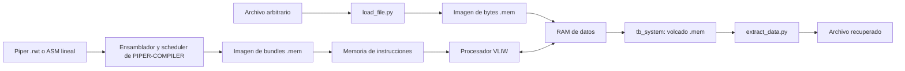
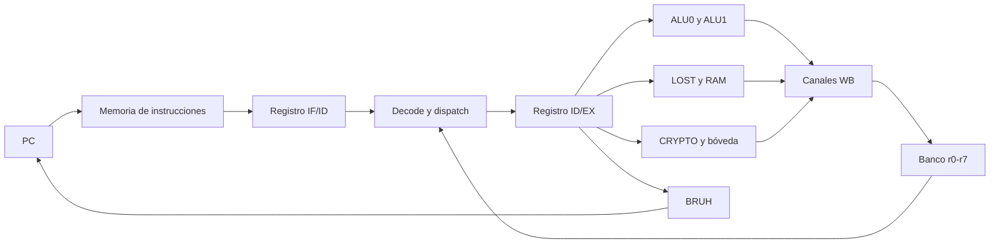

# Modelo de simulación de PORYGON

Este documento describe el modelo de simulación implementado: cómo se
representan el banco de registros, las unidades funcionales y las memorias,
y cómo se conectan el ensamblador y las herramientas de carga y extracción de
archivos. La codificación de instrucciones está en [isa.md](isa.md).

## 1. Qué constituye el sistema simulado

`hardware/src/porygon_system.sv` conecta tres módulos: `vliw_processor`,
`instruction_memory` y `memory_sp_ram`. El procesador conserva puertos de
instrucciones y datos independientes; el *wrapper* les conecta las memorias
concretas de simulación. `hardware/tb/tb_system.sv` genera reloj y reset, carga
las imágenes `.mem`, observa la terminación y escribe el volcado de RAM y un
resumen. El reloj del testbench invierte su valor cada 5 ns; su período es
10 ns. Ese tiempo es una escala de simulación, no una medición de frecuencia
máxima de hardware físico.



Una imagen de datos **no es un programa**: cargar bytes no realiza operaciones
por sí solo. El programa de instrucciones debe leerlos, operar sobre ellos y
escribir los resultados que se deseen conservar en RAM.

### Pipeline y ejecución paralela

Cada bundle ocupa 64 bits: cuatro slots de 16 bits, con el slot 0 en `[15:0]`.
El PC avanza **8 bytes** por bundle. Un slot puede contener una instrucción
`MATH`, `LOST`, `JUMP` o `CRYPTO`, independientemente de su posición. Si la
instrucción activa `imm`, el slot inmediatamente siguiente es su literal de
16 bits y **no** se ejecuta como otra instrucción. `0x0000` es el NOP. El
despachador `hardware/src/idd/idd_stage.sv` limpia los literales, selecciona
una operación para cada unidad, enruta el literal correspondiente y produce
las direcciones de lectura del banco de registros. Cuando más de un slot
solicita la misma unidad en un bundle, `pipe_gate.sv` elige el de **menor
índice**: el generador de código debe evitar esa colisión porque el otro slot
no queda pendiente para un ciclo futuro.

Las fronteras registradas son IF/ID en `fetch_stage.sv`, ID/EX en
`vliw_processor.sv` y las salidas de ejecución que alimentan WB. En ID/EX se
capturan tanto las instrucciones y sus PC como los operandos leídos. Distintos
bundles pueden encontrarse simultáneamente en etapas distintas. Hay dos ALU
(`ALU0` general y `ALU1` especializada), una LSU llamada `LOST`, una unidad
de saltos `BRUH` y una unidad `CRYPTO`. Aunque hay cinco unidades, solo hay
cuatro slots físicos: no se pueden emitir cinco instrucciones de un mismo
bundle.



| Ruta | Comportamiento en el modelo | Escritura o efecto |
|---|---|---|
| ALU0 | Aritmética y lógica combinacional; resultado registrado | Un canal WB |
| ALU1 | Desplazamientos y operaciones rápidas; multiplicación con dos etapas internas de productos parciales | Un canal WB compartido |
| LOST | Forma la dirección efectiva y la máscara de bytes; la RAM captura la solicitud en el flanco | Store en RAM o un canal WB para load |
| BRUH | Evalúa condición y destino en EX | Actualiza el PC; no escribe GPR |
| CRYPTO | Decodifica, consulta la bóveda y calcula una ronda Feistel combinacional; `crypto_wb` registra salida y eventos | Hasta dos canales WB, uno por mitad |

La documentación de `execution_stage.sv` fija como referencia la escritura
de resultados rápidos en `issue+2` y la de multiplicación en `issue+4`.
El banco de registros se lee antes de la escritura concurrente en el mismo
flanco: un consumidor debe emitirse **después** del flanco que escribe su
fuente. No hay forwarding, scoreboarding ni stalls automáticos por dependencia
de datos. El scheduler debe insertar separaciones y NOPs, y debe evitar que
una operación rápida de ALU1 use su canal cuando llega una multiplicación
anterior. `writeback_stage.sv` conecta los canales; no arbitra colisiones de
destino. Si se escriben varios valores en un mismo registro durante un flanco,
el índice mayor de puerto del banco gana, por el orden de sus asignaciones.
Ese comportamiento observable no sustituye una calendarización válida.

BRUH calcula saltos relativos desde el PC del **bundle actual**, con offsets
firmados en unidades de bundle; `jr` usa la dirección absoluta del registro.
No hay *flush*. El programa debe colocar **dos bundles NOP después del salto**
para cubrir los bundles jóvenes ya encaminados. El testbench reconoce como
fin de programa un salto tomado hacia el PC de su propia instrucción.

## 2. Banco de registros y estado criptográfico

`hardware/src/register_file.sv` modela **ocho GPR de 32 bits** (`r0`–`r7`),
con diez puertos de lectura combinacional y cinco puertos de escritura
síncrona. Los diez puertos corresponden a dos operandos para cada una de las
cinco unidades; los cinco canales WB corresponden a ALU0, ALU1, load y las
dos mitades de Feistel. El reset activo bajo limpia el arreglo de GPR de
forma asíncrona. `r0` siempre entrega cero y se ignoran sus escrituras. PC y
estado de autenticación son estados separados; la bóveda no forma parte del
arreglo de GPR.

`hardware/src/crypto/key_vault.sv` mantiene cuatro llaves de 128 bits,
divididas en cuatro subllaves de 32 bits cada una, más la credencial temporal,
la contraseña almacenada, el estado de autenticación y un temporizador de
inactividad de **32 ciclos** por defecto. El reset de esta bóveda es síncrono:
limpia las llaves y la credencial temporal, restaura la contraseña inicial y
cierra la sesión. `lopw` carga palabras de la credencial; `auth` la compara;
`write`, `feistel` y `pwd` requieren autorización; `rvk` la revoca. Una ronda
autorizada usa internamente
`F(R,k) = (ROL32(R,5) + k) XOR ROL32(R,13)` y produce `L' = R`,
`R' = L XOR F(R,k)`. Cuatro rondas forman el cifrado completo. Las subllaves
no se exponen por lecturas de GPR o RAM general. Las salidas de autenticación
fallida y acceso rechazado son **eventos de diagnóstico**; el procesador actual
no implementa un registro de estado arquitectónico general ni una trampa que
desvíe el PC por esos eventos. Esto distingue al modelo implementado de las
aspiraciones descritas en la ISA y el enunciado.

## 3. Memorias y direcciones efectivas

El sistema de simulación conecta **64 KiB de memoria de instrucciones** y
**64 KiB de memoria de datos**:

| Segmento | Direcciones inclusivas | Organización y acceso |
|---|---|---|
| Texto | `0x00000000`–`0x0000FFFF` | 8192 bundles de 64 bits; lectura combinacional; PC alineado a 8 bytes |
| Datos | `0x00010000`–`0x0001FFFF` | 65 536 bytes; lectura registrada en flanco positivo y escritura con máscara por byte |
| Pila del programa Piper | `0x0001F000`–`0x0001FFFF` | Parte del segmento de datos; crece hacia abajo |

Las posiciones no cargadas se inicializan en cero. En texto, cero equivale a
un bundle NOP; un fetch desalineado o fuera de rango entrega NOP y activa
`instruction_access_error_o`. En datos, una petición fuera del segmento activa
`data_access_error_o`; la escritura se descarta, y una lectura devuelve cero
con `read_valid_o=0` para suprimir el WB del load. Son diagnósticos, no
excepciones con rutina de atención. Una lectura válida de datos conserva su
última respuesta hasta otra lectura. `memory_sp_ram.sv` arma palabras de
32 bits en **little endian**; `lost_unit.sv` extrae byte o media palabra con
extensión de signo o de ceros según la instrucción. `low`/`stw` exigen
alineación a cuatro bytes y `loh`/`sth` a dos; una solicitud desalineada se
descarta y levanta `invalid_address_o`.

La base física de la RAM es `0x10000`, pero el índice cero de su arreglo
SystemVerilog corresponde a esa dirección. Por ello una directiva `$readmemh`
`@00000020` en la imagen de **datos** carga desde `0x10020`, no desde
`0x00000020`. La imagen de **instrucciones** usa una palabra hexadecimal de
64 bits por bundle y su índice cero corresponde al PC `0x00000000`.

La capacidad de una matriz depende del ancho de sus elementos y de qué otros
datos deban coexistir. Una matriz `B32` de `f × c` elementos requiere `4fc`
bytes. Si un programa escrito a mano dedicara **toda** la RAM de datos a una
única matriz cuadrada, cabrían como máximo `128×128` elementos de 32 bits:
`128² × 4 = 65 536` bytes. Los programas Piper reservan los últimos 4096
bytes de esa RAM para la pila; sus datos globales disponen de 61 440 bytes.
Por tanto, **una única matriz cuadrada global Piper**, sin otros globales,
puede tener como máximo `123×123` elementos `B32` (`60 516` bytes), porque
`124×124` requeriría `61 504` bytes. Para una matriz rectangular, el límite
global correspondiente es `f × c ≤ 15 360` elementos. Otras matrices,
escalares globales o archivos cargados reducen el espacio disponible; una
operación con entrada y salida separadas debe reservar ambas a la vez. Estos
límites son de **almacenamiento**, no del número de repeticiones de un ciclo.

El compilador Piper almacena cada elemento según su tipo declarado: `B8`/`uB8`
ocupan 1 byte, `B16`/`uB16` ocupan 2 y `B32`/`uB32` ocupan 4. Una matriz
global aislada puede alcanzar los siguientes tamaños dentro de los 61 440
bytes disponibles para datos globales:

| Tipo de elemento | Bytes por elemento | Máximo rectangular (`filas × columnas`) | Máximo cuadrado |
| --- | ---: | ---: | ---: |
| `B8` / `uB8` | 1 | 61 440 elementos | `247 × 247` |
| `B16` / `uB16` | 2 | 30 720 elementos | `175 × 175` |
| `B32` / `uB32` | 4 | 15 360 elementos | `123 × 123` |

Cada variable se alinea a su ancho natural, por lo que varias variables
pueden requerir unos bytes adicionales de relleno entre ellas. Los
parámetros que representan arreglos guardan una dirección de 4 bytes en la
pila, mientras que los elementos del arreglo conservan su ancho declarado.

## 4. Ensamblador propio y generación de instrucciones

El ensamblador utilizado está en el repositorio del compilador `PIPER-COMPILER`, en
`porygon_assembler/`, y trabaja junto con `scheduler/`. Forma parte de la ruta
que convierte un programa Piper (`.rwt`) en instrucciones para este simulador:

```text
fuente.rwt → generación de ASM lineal → parser y codificador PORYGON
           → scheduler y verificador → programa.mem → $readmemh
```

`bin/pipoc mem fuente.rwt -o programa.mem` ejecuta esa ruta completa. También
se puede comenzar con ASM PORYGON escrito a mano mediante
`bin/porygon-schedule entrada.asm salida.bundles salida.mem`; ambos caminos
utilizan el ensamblador y el scheduler de `PIPER-COMPILER`. El `.mem` resultante
se pasa a `make sim PROG=programa.mem` en PORYGON.

El parser de programa acepta ASM lineal, con una instrucción por línea y
etiquetas simbólicas. Reconoce los mnemónicos y operandos, informa errores con
línea y columna, y construye una representación intermedia de instrucciones y
etiquetas. El codificador traduce cada instrucción a su palabra de 16 bits y,
cuando corresponde, a un literal adicional de 16 bits. Para calendarizar, la
representación también registra qué registros lee y escribe cada instrucción,
sus efectos de memoria y estado, y la unidad funcional que necesita.

El scheduler reúne las instrucciones en bundles de cuatro slots. Asigna las
operaciones de ALU a una unidad disponible y respeta las restricciones de
LOST, BRUH y CRYPTO. Al decidir qué puede compartir un bundle o ejecutarse en
uno posterior, considera dependencias entre registros (RAW, WAR y WAW),
accesos a memoria, estado criptográfico y latencias de escritura. Si hace
falta esperar, emite NOPs; después de un salto reserva los dos bundles NOP
requeridos por el pipeline. Una instrucción con literal ocupa dos slots
contiguos, por lo que el literal no se despacha como otra operación.

Una vez fijadas las posiciones de los bundles, resuelve las etiquetas de los
saltos relativos y verifica el calendario antes de escribir la salida. La
imagen `.mem` contiene una palabra hexadecimal de 64 bits por línea, con los
cuatro slots de 16 bits en el orden que espera la memoria de instrucciones.
Así `$readmemh` la carga directamente en la simulación. El flujo genera los
formatos necesarios para el modelo; demostrar cobertura del 100 % de los
mnemónicos exige verificar cada instrucción de la ISA por separado.

## 5. Carga, ejecución y extracción de archivos

`tools/data_loader/load_file.py` lee bytes sin interpretar su formato. Por
defecto emite una imagen de **8 bits por posición**, relativa a base `0x10000`,
con `@` y hasta 65 536 bytes. Verifica que dirección, relleno y longitud
quepan en RAM; avisa si se invade la pila. Añade ceros hasta un múltiplo de
ocho bytes para bloques Feistel, salvo `--no-pad`. Informa tanto la longitud
original como la longitud escrita; para recuperar el archivo original debe
extraerse la **longitud original**, no el relleno. `--append` permite agregar
otro bloque e informa solapamientos. Para esta RAM el ancho correcto es 8;
seleccionar `--width 16/32/64` cambia el formato del archivo, pero **no**
reconfigura el arreglo de bytes de `memory_sp_ram.sv`.

Ejemplo desde la raíz de PORYGON (las rutas de programa y archivo son ejemplos):

```sh
python3 tools/data_loader/load_file.py --input entrada.bin \
  --output datos.mem --address 0x10000
make sim PROG=programa.mem DATA=datos.mem MAX_CYCLES=200000
python3 tools/data_loader/extract_data.py \
  --memory sim_output/programa/memory.dump.mem \
  --address 0x10000 --size 1234 --output salida.bin
```

El testbench carga las imágenes mediante `$readmemh` y al terminar llama
`$writememh` para volcar los **65 536 bytes** de RAM. `extract_data.py` analiza
directivas `@` y comentarios del volcado, reconstruye el rango solicitado y
rechaza posiciones ausentes o con `x/z` por defecto; `--allow-uninitialized`
solo permite completar huecos ausentes con cero. `sim.sh`/`make sim PROG=...`
generan `results.txt`, `simulation.log`, `memory.dump.mem` y `waves.vcd`;
el watchdog es 100 000 ciclos por defecto. Un `halted=1` solo dice que se vio
un salto al propio PC; `errors=0` solo cubre los eventos que el testbench
cuenta. Estas cifras no certifican por sí solas el valor de una operación.
Cuando el código generado por Piper detecta un índice de arreglo fuera de
rango, salta a su rutina interna `_IR_error_indice` y termina allí. Ese salto
no incrementa el contador `errors` del testbench: `halted=1, errors=0` puede
aparecer también en ese caso y no debe interpretarse como éxito del programa.

### Dónde se observa un resultado

Una instrucción aritmética escribe normalmente su resultado en un **registro**.
El volcado `memory.dump.mem` contiene únicamente los bytes de la RAM de datos:
no incluye el banco de registros ni el contenido de la memoria de
instrucciones. `results.txt` y el resumen de `tb_system` muestran `r0`–`r7`
**al terminar** la ejecución. Si otra instrucción sobrescribe el registro,
ese resultado intermedio ya no aparece allí. Las ondas `.vcd` permiten seguir
el resultado durante la ejecución.

Para ver un valor aritmético en el **volcado de RAM**, el programa debe
almacenarlo con una instrucción `stw`/`stb`/`sth`, o mediante una asignación
Piper que genere esa escritura, en una dirección válida y conocida. Una
variable global Piper tiene dirección fija en el segmento de datos; la tabla
de símbolos del compilador permite localizarla. Una variable local usa la
pila y su dirección puede reutilizarse después de salir de la rutina.
El testbench vuelca la RAM completa aunque un valor no se haya escrito:
por eso **ver ceros en el volcado no demuestra que una suma no se ejecutó**.
Para interpretar una palabra `B32`, se toman cuatro bytes consecutivos desde
su dirección, en orden little endian; `extract_data.py` puede recuperar ese
rango. La extracción muestra qué quedó almacenado, mientras `results.txt`
muestra el estado final de los registros.
